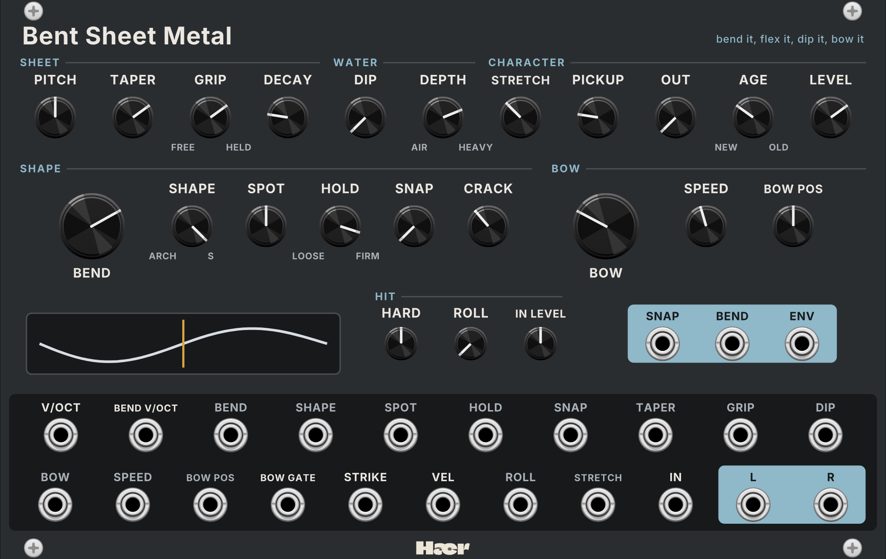

# Bent Sheet Metal Fable

A VCV Rack 2 plugin with one module, **Bent Sheet Metal** (40 HP): a ringing strip of spring steel that you bend, S-bend, flex through flat, dip in water and bow. Musical saw, flexatone, wobble board, thunder sheet and water gong, with every range pushed past what steel survives. A display strip shows the sheet's live shape, the water level and the bow.



- Manual: [docs/MANUAL.md](docs/MANUAL.md) and `docs/BentSheetMetal-Manual.pdf`
- Build spec: [docs/BUILD-INSTRUCTIONS.md](docs/BUILD-INSTRUCTIONS.md)
- Reference engine the sound was approved on: `tools/proto/bent_ref.c`

## Build

```
make RACK_DIR=/path/to/Rack-SDK dist     # the plugin
make test                                # offline engine checks, no Rack needed
make demos                               # WAVs of the reference scenes and every preset, into test/demos/
```

`make test` compiles the reference engine twice (with different rounding), renders its scenes into `test/ref/` and `test/ref2/`, and compares the C++ engine with them. It also renders every preset through the whole module chain. The CI in this repository builds the plugin for Apple silicon Macs on every push.

Regenerate the panel with `python3 res/make_panel.py` (needs fonttools and the Inter font), the presets with `python3 tools/make_presets.py`, the preview with `python3 tools/preview.py panel-preview.png <Rack>/res/ComponentLibrary`, the PDF with `python3 tools/make_pdf.py`.

## Test results

All 17 checks pass (`make test`, about 25 minutes on a 4-core cloud machine):

- Reference match: the pure `saw` opening matches to 0.000 dB and 0.00 cents; every scene agrees with the reference at least as well as the reference agrees with itself.
- Saw notes within 9 cents; bend pitch within 1.7%; water drops the bowed note 2.6 semitones and lighter than air raises it 1.6.
- Fuzz: 400 random patches x 20 s at 48 kHz and 300 x 10 s at 44.1, 48 and 96 kHz: no NaN, no guard event, output within +-11 V. The stiffness limiter and the energy clamp do fire at extreme random settings (in most patches, briefly), as designed.
- Silence: exactly 0 V after 60 s with nothing playing, at AGE 0 and 0.3.
- Speed: 34% of one cloud core at 48 kHz in bowed roar, 50% with DIP 0.5. The spec's target was 20% on Apple silicon, which has not been measured; Apple silicon is usually much faster per core than the cloud machine.
- Every preset sounds through the full module chain; Init peaks at 4.9 V.

## Deviations from the spec

The engine and controls:

1. **SPEED range.** The spec's `0.05 * 60^x` (up to 3) put most of the knob where a bow cannot start the sheet from rest (above a bow speed of about 1.1 the sheet stays silent unless struck first). SPEED is now `0.05 * 24^x` (0.05 to 1.2) and its default is 0.44, which gives the same bow speed as the spec's 0.34.
2. **Snap Flip replaces Self Flipper.** At SNAP 1 and HOLD 0.1 the sheet does not throw itself about with nothing patched; it settles on one side. Preset 15 is Snap Flip: it sings held still, and a 0.4 Hz LFO into BEND makes it throw itself over, as its notes say.
3. **Preset retunes.** Several presets had too fast a bow after the SPEED change or were nearly silent through the full chain: Alive (SPEED 0.77), Dragged Under (SPEED 0.9), Break-up (SPEED 0.85), Scream (SPEED 0.8, GRIP 0.3, SHAPE 0.6, AGE 0.6, OUT 0.8), Sub Sheet (SPEED 0.4), Lighter Than Air (BOW 0.35, SPEED 0.58, DIP 0.3). Water Gong and Mercury use DECAY 2.
4. **STRETCH claim.** STRETCH 3 throws the pitch by about 375 cents (test 9), not "an octave or more". The manual says "more than half an octave".
5. **Stability additions found by the fuzz test**, all in the reference too, none reached by the approved scenes: a semi-implicit bend step, a clamp on the lighter-than-air water coupling so it stays stable at the sample rate, and a clamp on TAPER's stiffness.
6. **Float transforms with a half-grid symmetry** (the grid is symmetric, so each transform runs on 24 points split into even and odd modes). The mode recursion stays in double.
7. **AGE tired hand** only acts while bowing (the bowing hand is the one that tires); otherwise it made the sheet sound with nothing playing, which broke the silence test.
8. **BOW GATE** is a level (0 to 10 V scales the pressure), so envelopes give swells. **VEL** also sets the ROLL strength. **STRETCH CV** is 0.3 per volt (a tenth of its 0 to 3 range). Bipolar CVs (BEND, SPOT, BOW POS) are 0.2 per volt so +-5 V sweeps them.
9. **Display.** Drawn with nanovg as specified (the curvature integrated twice, water from the left, a bow mark). It updates about 60 times a second.

The tests:

10. **Test 1** cannot be matched band for band in the chaotic scenes (`alive`, `break`): the reference against itself, compiled with different rounding, already disagrees. Each scene must agree with the reference at least as well as the reference agrees with itself, less 5 points (capped at 90%). The pure opening of `saw` matches to 0.000 dB and 0.00 cents.
11. **Test 6** uses the full energy (modes plus stretch) with the bend held still; the mode energy alone is not conserved when the stretch term is on.
12. **Test 7** uses SNAP 0.55 knob units as in the `flex` scene. CRACK is checked the other way round from the spec: CRACK 0.35 must add broadband level above 2 kHz compared with CRACK 0 (it does, 24 dB), since the spec's "less than 1 dB" check could not tell a broken CRACK from a working one.
13. **Test 9** compares the loud start of a bowed note with its quiet tail (the pitch glide STRETCH makes) instead of two bow pressures, because heavy bowing also changes which partial is strongest.
14. **Tests 15 and 16 (new)** render every preset through the full module chain and check it sounds, is not a polite sine where the spec says so, and peaks near 5 V for Init.

## Untested in Rack

The module has been built by CI but not yet opened in Rack. The engine and the whole module chain are shared with the offline tests (`src/dsp/`), so the sound and stability are checked; the panel, jacks, display and menus are not.

Haer, GPL-3.0-or-later.
