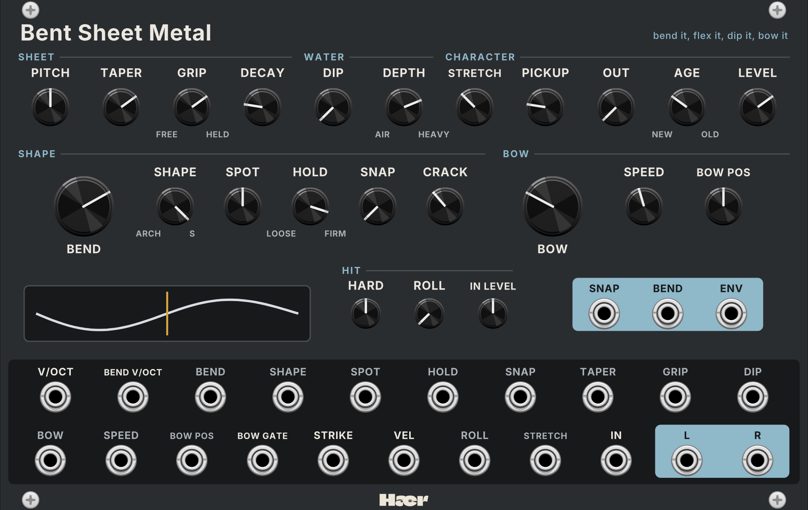

# Bent Sheet Metal

A VCV Rack module by Haer. 40 HP, plugin "Bent Sheet Metal Fable", search for **Bent Sheet** or **BSM** in the module browser.

## What it is

Bent Sheet Metal is a strip of spring steel whose shape is the instrument. It keeps ringing while you bend it, so the pitch slides as the shape changes. Bend it into an S and one note gets trapped where the curve turns over: that is a musical saw. Let it flip through flat and it cracks and wobbles like a wobble board or a thunder sheet. Lower it into water and the pitch sinks and smears like a water gong. Bow it and it sings, then splits into chords, then roars.

It is a physical model, but the ranges go well past what a real sheet survives. The sheet can bend further than steel allows, the liquid can be heavier than mercury or lighter than air, the bow can push harder than any arm, and loud notes can throw their own pitch upwards. Those are the places where it sounds most alive.

There is one voice. Every input reads channel 1 of a polyphonic cable.

## The five things you do to it

1. **Bend it.** BEND is the hand. Bending tightens the sheet and raises its pitch, like pressing on a ruler hanging off a table.
2. **S-bend it and trap a note.** SHAPE turns the arch into an S. Where the S crosses flat, one note gets trapped and rings on while the rest dies away. SPOT moves that point, which changes the note and pans the sound. GRIP decides how much else is allowed to ring.
3. **Flex it and let it snap.** Turn HOLD down and the hand goes loose. Turn SNAP up and the sheet prefers to sit bent one way or the other, so it snaps between them. Each flip clicks (CRACK) and sends a trigger from SNAP out.
4. **Dip it.** DIP lowers the sheet into a liquid from the left-hand end. The wet part gets heavier, so its notes drop and smear. DEPTH sets how heavy the liquid is.
5. **Bow it.** BOW is how hard the bow presses, SPEED how fast it moves. Light pressure gives the pure saw voice, more gives chords, the top of the knob gives roar.

## The display

The strip under the SHAPE section shows the sheet edge-on. The line is its live shape (including what HOLD and SNAP are doing to it), it brightens as the sheet gets louder, blue water fills in from the left as DIP rises, and an orange mark shows where the bow is, brighter as it presses harder.

## Panel tour

### SHEET

| Control | What you hear |
|---|---|
| PITCH + V/OCT | The size of the sheet, plus or minus three octaves around C3. The whole sheet scales, so with the shape held still it tracks 1 V per octave exactly. |
| TAPER | 0 is a rectangle. 1 is a saw blade three times wider at the handle, which spreads the notes unevenly and makes trapped notes sing more clearly. |
| GRIP | How hard the ends are held. At 0 the sheet hangs free and everything rings. At 1 only the trapped notes ring. |
| DECAY | How long it rings, from a quarter to four times as long. |

### WATER

| Control | What you hear |
|---|---|
| DIP | How far the sheet is in the liquid, from the left-hand end. Pitch sinks as it goes in. Sweeping it is the water gong sound. |
| DEPTH | How heavy the liquid is. 0.5 is water and 1 is far heavier than mercury. Below 0 the liquid is lighter than air (it does not exist): dipping the sheet then makes the pitch **rise**. |

### SHAPE

| Control | What you hear |
|---|---|
| BEND (large) | The hand. Bipolar: the sheet bends one way or the other. Pitch rises with the bend either way. Past about 60% is beyond what steel survives. |
| SHAPE | 0 is an arch (a flexatone or a flexed sheet), 1 an S-bend (a saw). In between, a lopsided S. |
| SPOT | Where the S turns over. Moves the trapped note along the sheet: a different pitch, and the sound pans with it. |
| HOLD | How firm the hand is. Firm: the sheet does exactly what BEND says. Loose: it wobbles on its own when it is knocked or flipped. |
| SNAP | Makes the sheet prefer to sit bent one way or the other, so it snaps between them. Above about 60% it flips itself hard. |
| CRACK | How loud the click is at each flip. |

### BOW

| Control | What you hear |
|---|---|
| BOW (large) | Bow pressure. About 27% is the pure saw voice. Around 50% the note splits into chords. Above 70% it roars. |
| SPEED | How fast the bow moves: louder, and pushed harder. At the very top (above about 97%) the bow is too fast to start a still sheet by itself, so strike it or start lower. |
| BOW POS | The bow rides the S-point (where the saw note lives). Move it away and the bow finds other trapped notes, for fifths and other intervals. |
| BOW GATE (jack) | Scales the bow pressure, 0 to 10 V, through a 50 ms slew. Unpatched means fully on. A gate gives bowed notes; an envelope gives swells. |

### HIT

| Control | What you hear |
|---|---|
| STRIKE and VEL (jacks) | A beater strike on each trigger. VEL sets how hard (0 to 10 V; 7 V when unpatched). |
| HARD | Soft mallet to hard beater. It also sharpens the clicks of the flips. |
| ROLL | The two beaters of a flexatone, striking by themselves, alternating, from 4 to 20 times a second. Off at zero. VEL sets their strength too. |
| IN LEVEL and IN (jack) | Audio in shakes the sheet. Drums, noise or a voice through IN make the sheet ring along, like a spring reverb made of steel. |

### CHARACTER

| Control | What you hear |
|---|---|
| STRETCH | How much loudness throws the pitch. 0 is a perfectly linear sheet. 1 is steel. At 3 a loud note bends up by more than half an octave and settles back as it dies. |
| PICKUP | Saturation in the pickup: loud passages squash and thicken. |
| OUT | Output saturation. |
| AGE | A used sheet. See below. |
| LEVEL | Output level. At 70% the Init sound is about 5 V peak. A leveller after the sheet keeps quiet and loud settings within reach of each other. |

### Jacks

The CV inputs (BEND, SHAPE, SPOT, HOLD, SNAP, TAPER, GRIP, DIP, BOW, SPEED, BOW POS, ROLL, STRETCH) add to their knobs. One-sided controls move 10% per volt, so 0 to 10 V sweeps the whole knob. The bipolar ones (BEND, SPOT, BOW POS) move 20% per volt, so plus or minus 5 V sweeps them fully. STRETCH moves 0.3 per volt. BEND, DIP, SPOT and BOW are fine at audio rate.

**BEND V/OCT** retunes by bending rather than by resizing the sheet. On an arched, untapered sheet it tracks in semitones; elsewhere it is close but not exact.

Outputs:

- **SNAP**: a 1 ms, 10 V trigger every time the sheet flips through flat hard enough to click.
- **BEND**: the sheet's actual bend, bipolar, after the loose hand and the snapping have had their say. It is the hand plus everything the sheet does on its own.
- **ENV**: how much energy is in the sheet, 0 to 10 V.
- **L, R**: two pickups at opposite ends. The trapped note lives at the S-point, so SPOT pans it.

## Where the ranges go past real

- BEND above about 0.6, in either direction.
- DEPTH above 0.5 (heavier than water) and anything below 0 (lighter than air).
- BOW above about 0.7 and SPEED near the top: no arm presses that hard.
- SNAP above about 0.6: a sheet that throws itself about.
- STRETCH above 1.
- DECAY above 1 with GRIP at 0: steel that rings much longer than steel does.

## AGE

One knob for a sheet that has been played a lot. At 0 it is all off.

- **Dents**: small kinks in the sheet's curvature, which colour the trapped notes and the way the S rings.
- **Detuned modes and extra loss**: the partials sit a little off and die a little faster.
- **Tired hand**: while bowing, the hand holding the bend trembles slightly, a few cents of slow wobble.
- **Rosin**: the bow's grip drifts over seconds, so a held note breathes.
- **Fatigue**: the sheet prefers one side, so with SNAP it snaps unevenly.
- **Warm-up**: after a long loud passage the pitch sags slightly, over about 20 seconds.

The tremor and rosin drifts follow a random unit stored with the patch. The right-click menu shows it and has **New AGE unit** for a different drift. The dents themselves are fixed: every Bent Sheet Metal is cut from the same sheet.

## The presets

| # | Name | What it is | Patch for motion |
|---|---|---|---|
| 1 | Init | A bowed S-bent blade singing one note. Raise BOW and it roars. | |
| 2 | Alive | Pushed bow on a loose sheet, splitting and drifting. | Slow LFO (4 s) to BEND, about 0.75 V; another (3 s) to BOW, about 1.5 V |
| 3 | Dragged Under | Heavy bow, half in water. | Slow LFO (5 s) to DIP, about 3 V |
| 4 | Break-up | A loose, half-S sheet bowed hard and snapping. Breaks up by itself. | |
| 5 | Water Gong | Struck arch, free ends, long ring. | Triggers to STRIKE; slow LFO or envelope to DIP |
| 6 | Mercury | The same in a much heavier liquid, half in. | Triggers to STRIKE |
| 7 | Lighter Than Air | Bowed, dipped in a liquid lighter than air: pitch rises as it dips. | Slow LFO to DIP, about 3 V |
| 8 | Singing Saw | The classic saw: tapered blade, firm grip, light bow. | Sequencer to SPOT, about -1.5 to +1.75 V |
| 9 | Saw Fifths | Bow moved off the S-point so it finds the next trapped note. | |
| 10 | Overbowed | Too much bow and STRETCH 2: chords and growl. | |
| 11 | Scream | Everything pushed: full bow, full pickup and output saturation, STRETCH 3. | |
| 12 | Flexatone | Struck arch with ROLL on: the beaters rattle by themselves. | Slow LFO to BEND |
| 13 | Wobble Board | Loose hand, some snap, big cracks. | Bipolar LFO, 2 to 3 Hz, about 2 V, into BEND |
| 14 | Thunder Sheet | Low, loose, snapping, stretched. | Fast LFO (2 to 5 Hz) or slow noise, about 2.5 V, into BEND |
| 15 | Snap Flip | A bowed sheet at full SNAP on a loose hand. Held still it sings on one side; flip it and it throws itself over. | Slow LFO (0.4 Hz), about 2.5 V, into BEND |
| 16 | Sub Sheet | A huge sheet, two and a half octaves down, bowed. | |
| 17 | Glass Blade | Two octaves up, firm grip, long decay, light bow. | |
| 18 | Rusted | AGE at full on a bowed, loosely held sheet. | |
| 19 | Linear Sheet | STRETCH 0: clean and polite, for contrast. | |
| 20 | Resonator | No bow; audio in makes the sheet ring along. | Drums or noise bursts into IN; play BEND while it runs |

Presets 5, 6 and 20 are silent until you patch STRIKE or IN. Every other preset sounds with nothing patched.

## Patch recipes

1. **The sinking drone.** Init, BOW at 0.45. A slow sine LFO (about 0.1 Hz, 0 to 4 V) into DIP. The note sinks and smears as the sheet goes in, and comes back clean as it lifts out.
2. **Accents that roar.** Singing Saw. An envelope (fast attack, 300 ms decay) from your drum clock into BOW, about 6 V. Most of the time it sings; on the accents it tears.
3. **Saw melody.** Singing Saw. A sequencer into SPOT, values between -2 V and +2 V. Each step moves the trapped note: you get a saw melody that glides between notes, panning as it goes. Add a little slew on the sequencer for the classic portamento.
4. **Arch melody.** Water Gong with BEND at 0.3. A quantised sequencer into BEND V/OCT and its gate into STRIKE. The arch retunes by being bent harder, so each note has a tiny bend glide.
5. **Wobble board.** Wobble Board, a bipolar LFO at 2.5 Hz into BEND, about 2 V. For a tune, play the LFO rate from a sequencer.
6. **Audio-rate bend.** Init with BOW at 0.5. A sine oscillator at 50 to 300 Hz into BEND, 0.5 to 2 V. The sheet's tension is modulated at audio rate: metallic FM that stays physical.
7. **Snap clock.** Wobble Board or Snap Flip with an LFO into BEND. Patch SNAP out into a drum module or a clock divider. The sheet's own flips, which are never quite even, play the rhythm.
8. **The filter follows the sheet.** BEND out into a filter's cutoff, a second oscillator through the filter. Whatever HOLD and SNAP make the sheet do, the filter does too.
9. **Loud passages sink.** ENV out through an attenuator (about 50%) into DIP. When the sheet gets loud it sinks into the water and its pitch drops, which quietens it, which lifts it out again: a slow self-regulating wobble.
10. **Drums into steel.** Resonator. A drum loop into IN, IN LEVEL 0.6. Sweep BEND by hand or with a slow LFO while the drums run: the ring retunes under the beat. Try SHAPE at 1 and GRIP at 1 for a pitched, saw-like ring.
11. **Two sheets a fifth apart.** Two modules with the same preset (Init or Alive), one with PITCH 7 semitones higher (about +0.58). Same slow LFO into both DIPs. Pan them left and right.
12. **Bowed notes from a keyboard.** Init. Keyboard V/OCT into V/OCT, gate into BOW GATE. Each key bows a note and lets it ring out when released. Raise DECAY for longer tails.
13. **Flexatone in time.** Flexatone with ROLL at 0.4. A clock-synced LFO into ROLL so the rattle speeds up and slows down in time, and an LFO into BEND for the pitch swoop.

## Building

`make RACK_DIR=/path/to/Rack-SDK dist` builds the plugin. `make test` runs the offline checks without Rack. See the README for details.
