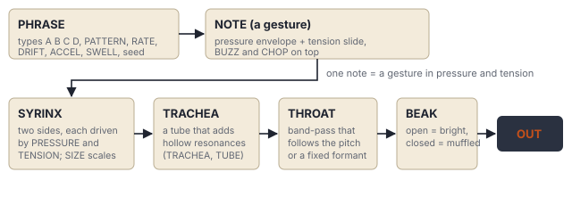
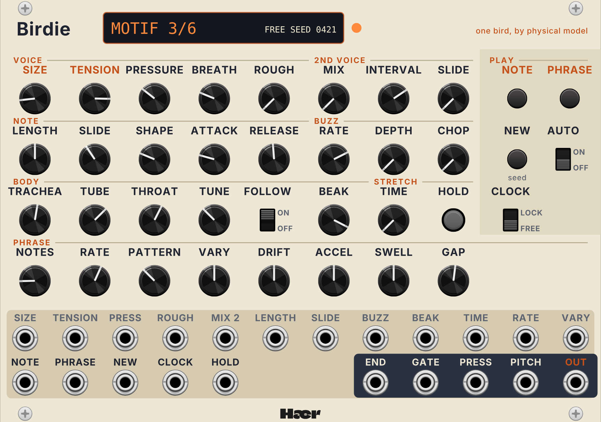

# Birdie

**One bird, by physical model.** Birdie is a VCV Rack voice that sings like a bird: whistles, trills, chirps, buzzes, two notes at once, coos and harsh calls. It plays one note when you trigger NOTE and a whole phrase when you trigger PHRASE. There are no samples. Everything comes from a model of how a bird's voice box works.

Every control can go past what a real bird can do. Make the bird huge and it becomes a drone or a bass line. Slow it down sixteen times and a trill turns into a melody. Lock it to a clock and its phrases fall in time with your track.

*Plugin Birdie Fable, version 2.0.0, by Haer. Mono. 36 HP.*

## How it works

**The voice box (syrinx).** A bird sings with a pair of small membranes, one on each side of its airway. Air pressure from the lungs sets them flapping, and muscles set their tension. Birdie runs the same physics, a small set of equations from the birdsong research literature, sixteen times per sample. Two controls matter most:

- **PRESSURE** starts the sound and makes it louder and brighter.
- **TENSION** sets the pitch, and also the tone. High tension is a pure whistle. Turn it down and the pitch falls while the tone turns spiky and buzzy. Right at the bottom the voice breaks into rough pulses, which is where crows, ducks and the bass sounds live.

**The body.** After the voice box, the sound goes through the windpipe (TRACHEA and TUBE), the throat (THROAT and TUNE) and the beak (BEAK). Real songbirds move their throat to follow their pitch, and that is what makes a whistle clean, so FOLLOW is on by default.

**A note** is a gesture: a swell of pressure plus a slide in tension, shaped by SHAPE, SLIDE, ATTACK and RELEASE. BUZZ wobbles it fast.

**A phrase** is a family of notes. The note you set on the panel is always note type A. Birdie invents three relatives, B, C and D, from the seed. VARY decides how different they are. PATTERN decides the order. RATE, DRIFT, ACCEL and SWELL shape the whole phrase. The same seed always gives the same phrase, so a good one can be kept with the patch.

**SIZE** scales the whole bird. Pitch follows it exactly: twice the size is one octave down. The SIZE input is 1 V per octave, so a sequencer can play the bird in tune.

## The panel

The display shows the pattern and, while a phrase plays, which note it is on (for example `MOTIF 3/6`). On the right it shows FREE or LOCK and the last four digits of the seed. `LOCK?` means CLOCK is at LOCK but no clock has arrived yet, so phrases run free. The light next to the display follows the pressure.

### Voice

| Control | What it does |
|---|---|
| SIZE | How big the bird is, from half size to 64 times. Pitch follows exactly, and the windpipe, throat and beak scale with it. |
| TENSION | Pitch and tone together, -36 to +7 semitones. High is a pure whistle, low is rich and buzzy, the bottom is rough pulses. |
| PRESSURE | Air pressure at the peak of each note: louder, brighter and slightly sharper. |
| BREATH | Air noise riding on each note. |
| ROUGH | Turbulence: random shake in pressure and tension, for raspy and harsh calls. |
| 2ND VOICE MIX | Brings in the other side of the voice box, a second note at the same time. |
| INTERVAL | The second voice's pitch, -12 to +12 semitones from the first. Near zero they beat against each other. |
| SLIDE (2nd voice) | How the second voice follows the note's slide: +100% moves with it, -100% mirrors it, 0 stays still. |

### Note

| Control | What it does |
|---|---|
| LENGTH | One note's length, 10 ms to 4 s. In a phrase a note never runs past 92% of its slot. |
| SLIDE | How far the pitch moves during a note, -24 to +24 semitones. Negative falls, positive rises. |
| SHAPE | The curve of the slide: LINE, FALL (fast, then settling), SWOOP (slow, then fast), ARCH (out and back), DOUBLE (two arches). |
| ATTACK, RELEASE | Fade in and fade out, as a share of the note. |
| BUZZ RATE | Speed of the buzz, 5 to 400 Hz. |
| BUZZ DEPTH | How far the buzz wobbles the tension. |
| CHOP | How hard the buzz chops the air, from tremolo to separate clicks. |

### Body and stretch

| Control | What it does |
|---|---|
| TRACHEA | Windpipe length, 0.5 to 10 cm at size 1. |
| TUBE | How strongly the windpipe resonates: hollow and nasal when high. |
| THROAT | How much the throat filters the sound. |
| TUNE | Where the throat sits: a multiple of the pitch with FOLLOW on (0.5 to 4 times), or a fixed formant with it off. |
| FOLLOW | ON: the throat tracks the pitch (clean whistles). OFF: a fixed formant (harsh calls, vowel sounds). |
| BEAK | Beak opening: low is muffled like a dove, high is bright. |
| TIME | Slows every gesture, buzz and phrase up to 16 times, without changing pitch. |
| HOLD | The voice sounds all the time, like an oscillator. Notes and phrases still play their slides on top. The HOLD jack does the same while its gate is high. |

### Phrase and play

| Control | What it does |
|---|---|
| NOTES | Notes in a phrase, 1 to 32. |
| RATE | FREE: notes per second, 0.25 to 40. LOCK: notes per clock pulse, in nine steps: 1/4, 1/3, 1/2, 1, 2, 3, 4, 6, 8. |
| PATTERN | The order of note types A, B, C and D (see below). |
| VARY | How different B, C and D are from A. At 0 every note is identical. |
| DRIFT | Pitch movement across the phrase, up to an octave either way. |
| ACCEL | The phrase speeds up (positive) or slows down (negative) by its end. |
| SWELL | The phrase grows louder (positive) or fades away (negative). |
| GAP | With AUTO on, the rest between phrases, 0.1 to 8 s (stretched by TIME). |
| NOTE | Button: sing one note. |
| PHRASE | Button: sing one phrase. |
| NEW | Button: a new seed, used from the next phrase. |
| AUTO | ON: the bird sings by itself, phrase after phrase, with GAP between. Triggers still work and restart the wait. |
| CLOCK | FREE: phrases run at RATE. LOCK: Birdie measures the CLOCK input and fits RATE's number of notes into each clock. |

**Right-click menu.** *New seed every phrase* gives a fresh phrase every time. *Seed* shows the seed and lets you type one.

### Patterns

| Pattern | Order |
|---|---|
| REPEAT | A A A A. A trill. |
| PAIR | A B A B. |
| MOTIF | A A B, A A B. |
| TAIL | A A A ... ending in B for the last quarter. |
| RUN | A A, B B, C C, D D: steps through the types in blocks. |
| CALL | A B C D, round again. |
| SHUFFLE | Types picked at random by the seed. |

### Jacks

| Jack | |
|---|---|
| SIZE | 1 V per octave up (+1 V halves the size). |
| TENSION | 12 semitones per volt. |
| PRESS, ROUGH, MIX 2, VARY | 10% of the range per volt. |
| LENGTH, TIME | +1 V doubles. |
| SLIDE | 4.8 semitones per volt. |
| BUZZ, BEAK | 1 V per octave. |
| RATE | 1 V per octave in FREE, one step per volt in LOCK. |
| NOTE, PHRASE, NEW | Triggers. |
| CLOCK | Clock pulses, for LOCK. |
| HOLD | Gate: holds while high. |
| END | Trigger when a phrase finishes. |
| GATE | High while a note sounds. |
| PRESS | The bird's pressure envelope, 0 to 10 V. |
| PITCH | The bird's pitch as V/oct (0 V = C4), held between notes. An estimate, within about a semitone. |
| OUT | Audio, about ±5 V. |

## Presets

Twenty presets, in the Rack preset menu. Each stores its seed. They are named by the kind of sound, not as species.

| Preset | What it is |
|---|---|
| Whistler | Clear falling whistles, repeated. |
| Triller | A fast trill that speeds up and falls. |
| Chirper | Short arched chirps in a motif, sparrow-like. |
| Buzzer | Buzzy notes with a different tail. |
| Thrush | Two voices at once, cycling through four calls. |
| Dove | A soft coo from a big bird with a closed beak. |
| Crow | Harsh caws from the rough bottom of TENSION. |
| Honker | Nasal honks that slow down and fade, goose-like. |
| Songster | A long, varied song. |
| Warbler | Quick shuffled double notes. |
| Giant | Songster's song from a bird eight times bigger and three times slower. |
| Drone | HOLD on: a held tone with two beating voices and a slow wobble. Phrases bend it. |
| Bass Bird | A huge bird for bass lines. CLOCK at LOCK, four notes per clock: send it quarter notes for 16ths. |
| Robot | Swoops with buzz and chop. |
| Tiny | A very small, very fast trill. |
| Owl | Low, soft hoots. |
| Churr | Long churring notes chopped into clicks. |
| Gull | Wailing arched calls that quicken. |
| Siren | Wide double sweeps, dub siren style. |
| Glitch | Thirty-two tiny shuffled notes that slow down. |

## Patch recipes

**A garden bird.** Songster, AUTO on, and *New seed every phrase* in the menu. A slow random CV into TENSION makes it wander.

**Call and answer.** Two Birdies. The first one's END into the second one's PHRASE, and the second one's END back into the first one's PHRASE. Give them different SIZE and seeds.

**Trill fills.** Triller, with PHRASE from a sequencer's last step. Use ACCEL and DRIFT for rising or falling fills.

**Bass Bird.** Load the preset. Send a quarter-note clock to CLOCK and a bar clock to PHRASE. Patch a sequencer's pitch into SIZE (1 V/oct) for the notes, and an envelope into TENSION as the "filter": up for clean, down for growl.

**Acid bird.** HOLD on, SIZE between 8 and 32, sequencer pitch through a slew into SIZE. An envelope into TENSION and CHOP up a little. Use PRESS to duck a pad.

**Dub siren.** Siren, or Whistler with LENGTH long, an LFO into TENSION, and a delay after it.

**Scratch birds.** Chirper, NOTE from a drum pattern, a different SLIDE voltage on each step.

**The bird as a modulator.** PRESS and PITCH from Birdie into a filter cutoff or another oscillator's pitch. GATE and END make rhythms.

**Monsters.** Any preset with SIZE and TIME turned up together.

**Machines.** Robot, ROUGH and CHOP by CV, FOLLOW off, and an LFO on TUNE for vowel sounds.

## What to know

- The voice model is the one used in birdsong research (Mindlin and colleagues). It was written from memory and checked by running it: it starts at a pressure threshold, tension sets the pitch, and the tone gets rich at low tension, as the papers describe. The windpipe, throat and beak are simplified filters.
- No preset is fitted to a recording of a real bird. They were judged by measurement and spectrogram, not by ear.
- CPU: about 4% of one core at 48 kHz on a cloud test machine. The voice box is solved 16 times per sample at 44.1 and 48 kHz, 8 times at 88.2 and 96 kHz, and 4 times above, so the cost stays roughly the same at any sample rate.
- Changes from the design: RATE goes down to 0.25 notes per second and LENGTH up to 4 s, so the Churr, Siren and Drone presets fit on the knobs. The 2ND VOICE INTERVAL has no CV jack (there was no room in the row of twelve).
