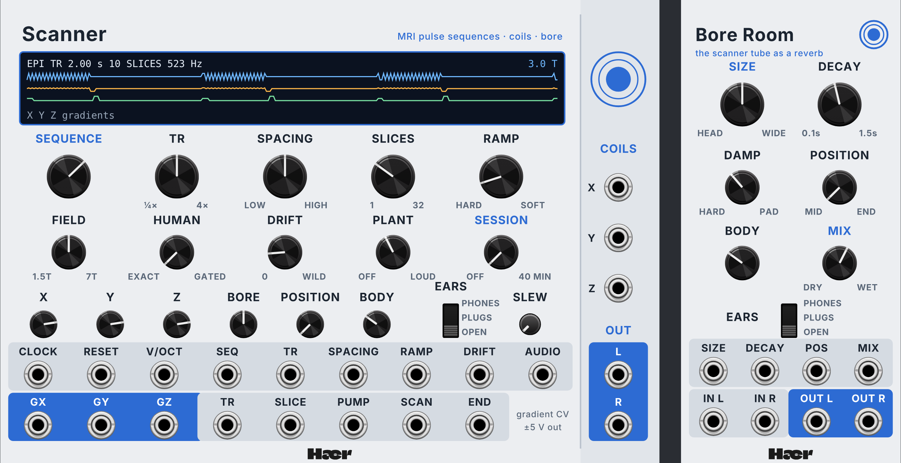

# Bore

Two modules about the inside of an MRI scanner. **Scanner** plays the machine: real pulse-sequence timing driving three tuned gradient coils, the helium pump, the tube you lie in and your ears. **Bore Room** is that tube on its own, as a reverb for any sound.

## How the sound is made

A scanner knocks because its three gradient coils (X, Y, Z) carry pulsed current inside a huge magnet, so they jump with every switch. What you hear is the gradient waveform filtered by the machine's response. That is exactly how Scanner works:

**sequence timing → three gradient waveforms → each coil's resonances → the bore → your ears**

- Pitch comes from repetition. An EPI readout flips every echo spacing, so it sounds at 1 / (2 × spacing). Slow spin echoes repeat too slowly for a pitch, so you hear knocks.
- Each coil rings differently: X and Y near 430 and 950 Hz, Z near 1170 and 1310 Hz, plus a low frame thump.
- Hard ramps knock; soft sinusoidal ramps are what "silent" scans use.

## Scanner (36 HP)

| Control | What it does |
| --- | --- |
| SEQUENCE | Prescan/shim (warbling sweeps), Localiser (three quick bursts of ticks), T1 spin echo (slow heavy banging), T2 turbo spin echo (buzzy knock trains), FLAIR (T2 with long held gaps), Gradient echo (fast drone), EPI (the high "beep" tone in bursts), Diffusion (deep paired thumps then a tone; the timbre moves as the direction changes), Angio TOF (very regular fast ticking), Silent (soft clicks) |
| TR | How often the sequence repeats, ¼× to 4× its usual time. With CLOCK patched, every clock pulse starts a TR, so the scan locks to your tempo |
| SPACING | Echo spacing: ±2 octaves of pitch and knock-buzz speed. V/OCT tracks it (EPI is C5 at 0 V, Diffusion A4) |
| SLICES | 1–32 slices (or bursts) per TR: how dense each repeat is |
| RAMP | Hard knock to soft. Fully soft is quieter and darker |
| FIELD | 1.5 T, 3 T (centre), 7 T: louder, harder, brighter |
| HUMAN | Heart-gated timing: each TR waits for a wandering heartbeat |
| DRIFT | The phase-encode order, coil balance, pitch and diffusion directions wander, so the pattern keeps mutating |
| PLANT | The cold-head pump ("chirp", then "thump", about once a second), 50 Hz hum and air. It runs between series too |
| SESSION | Off, or a whole exam lasting 5–40 minutes: table in, prescan, localiser, T1, T2, FLAIR, EPI, diffusion, angio, table out, with real pauses. SEQUENCE is ignored while it runs; RESET restarts it |
| X Y Z | Level of each coil |
| BORE | Head coil (34 cm), standard 60 cm bore, 70 cm wide bore |
| POSITION | Head at the centre of the tube, or near the opening (more room, less tube) |
| EARS | Open, earplugs (darker, as earplugs cut highs most) or headphones |
| BODY | The low end that reaches you through the table and your skull |
| SLEW | Smooths the GX GY GZ outputs from raw to slow |

**Inputs:** CLOCK, RESET, V/OCT, SEQ (1 V per sequence), TR, SPACING, RAMP, DRIFT, AUDIO (put any sound inside the bore with the scanner).

**Outputs:** GX GY GZ (the three gradient waveforms as ±5 V CV: modulation from the scan itself), TR and SLICE triggers, PUMP trigger, SCAN gate (high while gradients play), END (end of each series in a session), COILS X Y Z (dry coil sounds), L and R.

## Bore Room (12 HP)

| Control | What it does |
| --- | --- |
| SIZE | Head coil to 70 cm wide bore. Sets the wall flutter (a 60 cm tube reflects every 1.75 ms), the cross modes (335, 556, 697 Hz… for 60 cm) and the length modes (about 87 Hz and multiples) |
| DECAY | 0.1 to 1.5 s tail |
| DAMP | Hard plastic to padded |
| POSITION | Centre of the tube to the opening, where the room outside takes over |
| BODY | Bone-conducted low end |
| MIX | Dry to wet |
| EARS | Open, earplugs, headphones |

CV inputs for SIZE, DECAY, POS and MIX (±5 V covers half the range). IN R is normalled to IN L.

## Patch ideas

1. **The scan as a drum machine.** Clock Scanner from your master clock, SEQUENCE on T2, SLICES 4. Use TR and SLICE triggers for a kick and hats elsewhere, and let DRIFT at 30 % keep the knock pattern moving.
2. **The symphony.** SESSION at 15 minutes, PLANT up, EARS on earplugs, BODY at half. Record it and use END to change something in the rest of the patch at every series change; it is arrangement done for you.
3. **Gradients as modulation.** GX into a filter cutoff with SLEW at a third, GZ into a VCA. Diffusion mode gives slow lurching shapes; EPI with SLEW up gives a pulsing envelope.
4. **Inside the tube.** Put chords or a voice through Bore Room with SIZE on head coil and EARS on headphones: the small, close, ringing space you hear in a head scan.

## Tests and demo

`make test` runs offline checks (bore modes, decay, EPI pitch, 3 T louder than 1.5 T, silent mode quieter, earplugs darker, session advances, clock lock) and writes demo WAVs in `test/`.

## Sources

Research notes and the sources behind the numbers are in the design doc. Key ones: Hennel et al. 1999 (silent MRI with soft gradient pulses), Edelstein et al. 2002 (Making MRI quieter), Moelker 2004 thesis, Moelker & Pattynama 2003, Tan et al. 2017, Shtrepi et al. 2023 (7 T bore acoustics), Price (MR Safety Week), McRobbie (MRI scanner music).

Licence: MIT (see LICENSE.txt).
