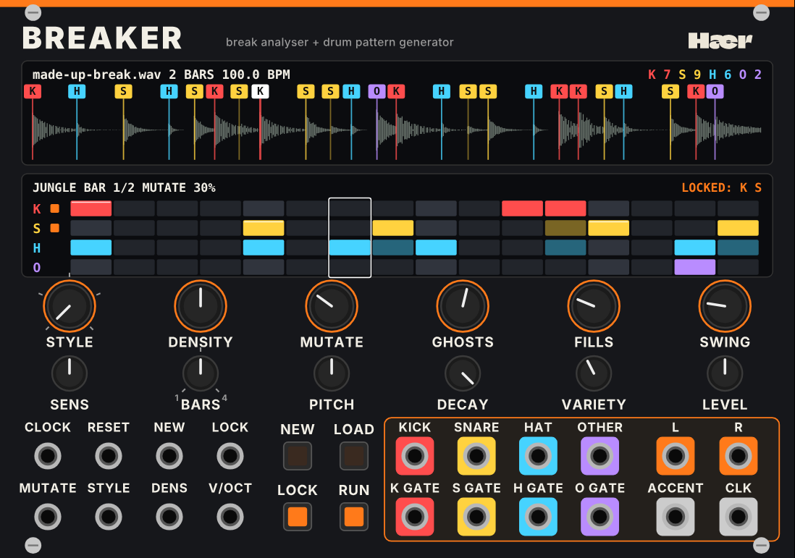

# Breaker

**Load a breakbeat. Breaker finds every hit in it, sorts each one into kick, snare,
hat or other, and plays brand-new drum patterns built from those hits.**

36 HP · plugin version 2.1.0 · MIT · untested in Rack so far

## Quick start

1. Press **LOAD** (or drop a WAV onto the module). One to four bars of a break, cut
   on the bar line, works best.
2. Patch **L / R** to your mixer. With nothing in **CLOCK**, Breaker plays at the
   break's own tempo (shown on the screen) while **RUN** is lit.
3. Turn **STYLE**. Fully left (**BREAK**) plays the break's own rhythm back, hit for
   hit. The other positions write new patterns in that style from the same hits.
4. Press **NEW** for a new pattern. Turn up **MUTATE** to let it drift bar by bar,
   and press **LOCK** when it sounds right.

## The screens

**Top: the break.** Every hit gets a coloured tag:
**K** kick (red), **S** snare (yellow), **H** hat (blue), **O** other (purple: toms,
cymbals, percussion). Faint lines are quiet ghost hits. A tag turns white while it plays.
**Click a tag to change its type** (K → S → H → O). Your corrections get a white ring
and are kept in the patch. **SENS** finds fewer (left) or more (right) hits.

**Bottom: the pattern**, one bar at a time, with the playhead. Bright = hit, dim =
ghost note, white bar on top = accent.

- Click a step to switch it on or off, **Shift-click** for a ghost note (a white dot
  marks your edits).
- Click a lane letter to **lock just that lane** (the orange square). NEW and MUTATE
  leave locked lanes alone, so you can keep the kick and snare and keep rolling hats.

## Controls

| Control | What it does |
|---|---|
| **STYLE** | BREAK (its own rhythm), BREAKS (funk breakbeat), JUNGLE (double kick, syncopated snares, busy ghosts), HIP HOP (boom bap), BROKEN TECHNO (kicks dodge the beat, off-8th hats). |
| **DENSITY** | Noon = as the style writes it. Left thins out, right fills in. Turning back brings the same pattern back. |
| **MUTATE** | How many steps re-roll at each bar line. LOCK stops it. |
| **GHOSTS** | Quiet ghost notes (snare and hat mostly). Noon = normal, right = twice as many. In BREAK style these are the break's own ghost hits. |
| **FILLS** | Chance of a fill (snare/tom roll) in the last bar of every 4-bar phrase. Above halfway, fills can start half a bar early. |
| **SWING** | 50% (straight) to 75%. Applies to the clock in and the free-running clock. |
| **SENS** | Hit finding: fewer ↔ more. |
| **BARS** | Pattern length 1, 2 or 4 bars. |
| **PITCH** | ±12 semitones, sampler-style: speed and pitch together. With CLOCK unpatched the tempo follows too. |
| **DECAY** | Fully right: each hit plays until the next hit in the break. Left: shorter, tighter hits. |
| **VARIETY** | 0: each drum always uses the same hit (the loudest kick, the loudest snare...). Up: picks among all of the break's hits of that kind, so snares change from step to step. Ghost notes pick the quietest hits. In BREAK style, VARIETY swaps the break's own hits for others of the same kind. |
| **LEVEL** | Output level (left out of Ctrl+R randomize). |
| **NEW** | New pattern (locked lanes kept). |
| **LOCK** | Stop mutation. |
| **LOAD** | Choose a WAV. |
| **RUN** | Start/stop when no clock is patched. |

## Jacks

**In:** CLOCK (16th notes), RESET, NEW (trigger), LOCK (gate), MUTATE (0-10 V adds),
STYLE (2 V per style), DENS (±5 V), V/OCT (pitch).

**Out:** KICK, SNARE, HAT, OTHER audio (patching one takes it out of the mix, so you
can process it separately), L / R mix, a GATE for each lane (drive other drums with the
same pattern; they work with no break loaded too), ACCENT (strong beats), CLK (16ths as
played, swing included; handy when Breaker is the master).

## Right-click menu

- **Load break**
- **Break length**: Breaker guesses how many bars the loop is from the tempo
  (whichever of 1, 2, 4 or 8 bars lands nearest 125 BPM). If it guesses wrong, set it here.
- **Sort hits by sound** (for samples that aren't drum breaks: voices, synths, field
  recordings): instead of looking for kicks and snares, Breaker ranks the hits against each
  other. The quietest fifth become hats, then the darkest third of the rest kicks, the
  brightest third snares and the middle third other. Every lane gets sounds to play.
- **Undo my hit corrections**
- **Lock a lane**, **Clear mutation** (back to the last NEW), **Clear my step edits**

## Patch ideas

1. **Live as master**: clock from Live (CV Tools through the disting NT) as 16ths
   into CLOCK, Live's start into RESET. STYLE on JUNGLE, MUTATE about 30%, lock the
   kick lane, and let snares and hats drift.
2. **Break plus your own kick**: patch **K GATE** into a Boohm or Thunder kick, and
   patch the KICK audio out into a muted mixer channel so the break's own kicks leave the
   mix. You keep the break's snares and hats with a kick that suits your track.
3. **Arrangement moves**: put an LFO or a Long Form-style lane into DENS and
   MUTATE so the beat thins for a breakdown and fills back in, with LOCK on a gate that
   freezes the pattern for the drop.

## How it works

- **Finding hits**: the break is split into four bands (below 120 Hz, 120-500 Hz,
  500-3000 Hz, above 5 kHz). Every 3 ms Breaker checks how much each band jumped compared
  with the last few frames; jumps that stand out from their surroundings are hits.
- **Sorting hits**: each hit's first 60 ms, minus whatever was still ringing from the
  hit before. Mostly low end = kick. Mostly top end with no low end = hat (or *other* when
  it rings on like a cymbal). Mid crack plus noise = snare. Anything else = other.
- **Patterns**: each style is a table of chances for every 16th in each lane. Every step
  rolls its own dice once (on NEW); DENSITY and GHOSTS move the chances, so turning them
  is smooth and repeatable, and MUTATE re-rolls a few steps' dice each bar.

## Testing without Rack

- `make check`: runs the analyser on two made-up breaks (synthesised kick, snare, ghost
  snares, hats, an open hat and a tom) and reports how many hits it found and sorted right.
- `make test`: renders demo WAVs from the real engine into `test/out/`.
