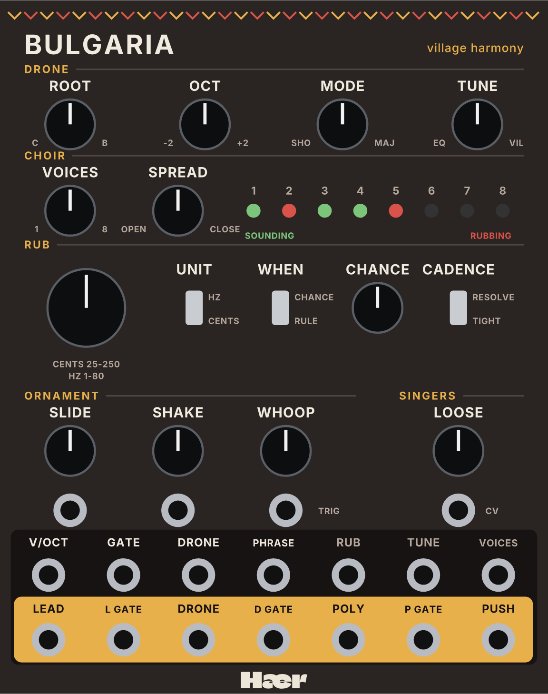

# Bulgaria Fable

Two VCV Rack modules. **Bulgaria** (20 HP) harmonises one melody the way Bulgarian village choirs do. A drone and up to seven more voices that sit a deliberately mistuned second from the lead; rub set in cents or as a beat rate in Hz; village tunings; slides, throat shakes and the phrase-end whoop. Pitch, gate and push CV out. It makes no sound itself.

**Horo** (10 HP, added in 2.1.0) is its companion clock: a clock and accent sequencer for Bulgarian uneven dance metres (ruchenitsa 2+2+3, daichovo, kopanitsa, buchimish, sedi donka and others, plus four typed user groupings). Fed a fast clock, it puts out pulse, beat, long-beat, bar and phrase triggers and an accent CV; the PHRASE output is made for Bulgaria's PHRASE input. LILT stretches the long beats. Manual: `docs/HORO-MANUAL.md` and `docs/Horo-Manual.pdf` (also the last chapter of the Bulgaria manual); spec `docs/HORO-BUILD-INSTRUCTIONS.md`.

Design by Fable (`docs/BUILD-INSTRUCTIONS.md`, prototype in `tools/proto/`), build by Opus. Manual: `docs/MANUAL.md` and `docs/Bulgaria-Manual.pdf`.

## Build

`make dist RACK_DIR=...` as for any Rack plugin. The repository workflow builds it for Apple silicon.

## Tests and demos

`make test` (no Rack needed): 64 checks from spec section 8: pitches of lead, rub and drone; lean-in; the Hz rub holding 32 Hz across four octaves; drone dodge and cadences (TIGHT, RESOLVE, PHRASE timing, PHRASE with the gate low); TUNE 0 passing every semitone; whoop gates and pitch; VOICES and SPREAD; LOOSE stagger and drift RMS; CHANCE; ornaments and their triggers; unpatched gate; DRONE input; 60 s fuzz at 44.1, 48 and 96 kHz (finite, within 6 V, push 0 to 10 V); CPU (about 1.4% of one core of the Linux build container with 8 voices).

`make demos` runs the C++ engine over the demo scenes and every preset (`test/tool`) and plays the result through the stand-in sawtooth synth of `tools/proto/bulgaria_proto.py`. The tone in the demos is not the module's.

## Changes from the spec

- RESOLVE test: the rubbing voice is within 1 cent of the lead 0.75 s after PHRASE rather than 0.7 s. The rule itself is as specified (unison from 0.65 s); the 22 ms glide needs a few more milliseconds to land.
- Hz test: checks the absolute beat. Below the root the near side is above the lead, so the difference is negative there, as the spec's rules say.
- SHAKE dips the lead's PUSH to 55% while a flick is under way (each 28 ms flick), through the usual PUSH smoothing.
- The melody input is clamped to plus or minus 4.5 V (54 semitones) and the pitch outputs to plus or minus 6 V.
- Input pitch has 0.6 semitone of hysteresis so a wobbly CV doesn't chatter between notes.
- With GATE unpatched the gate never falls, so the by-rule whoop can't fire; use the WHOOP trigger. The manual says so implicitly (whoop fires when the gate falls).
- RUB uses a RoundBigBlackKnob; the lights are green/red pairs (green sounding, red rubbing).
- Demo scene 2 compares CENTS and HZ on the same line; the width sweep from the Fable sketch is left out (the demo tool has no knob automation).
- The plugin was not compiled locally (the Rack SDK download is blocked in the build container); the GitHub workflow compiles it for Apple silicon.

## Horo: tests, demos, changes from the spec

`make test` also runs `test/horo_test` (74 checks, spec section 8). `make horo-demos` renders four clips with `test/horo_tool` driving stand-in drums and, in clips 1 and 4, the Bulgaria engine through the stand-in saw synth with Horo's PHRASE patched to Bulgaria's PHRASE. The tone in the demos is not the modules'. Presets: `tools/make_horo_presets.py`. Panel: `res/make_horo_panel.py`, preview `tools/preview_horo.py`.

Changes from the Horo spec:

- RESET: the spec ignored clock edges for 1 ms after a reset. That would swallow the clock edge a clock module sends together with its reset, so bar 1 would start one pulse late. Instead, a reset within 1 ms after a clock edge takes that edge as pulse 1; otherwise the next edge is pulse 1.
- Any PULSE rise needs the gate to be low first: if a pulse falls due while the previous one is still high (only after a sudden tempo jump), it waits a sample, and a backlog goes out one per millisecond with the gate low at least 0.5 ms between. Pulses out still equal clocks in.
- The fuzz test checks pulse conservation in a separate jittering run without resets (a reset restarts the count by design); "pulses out = clocks in" allows the lilt's shift of up to three pulses inside a bar.
- BARS 1 fires PHRASE every bar.
- In ELENINO (2 2 1 2) the shortest group is the 1, so every 2 counts as long. That is the spec's rule; the manual says so.
- Display, in the spec's four lines: the dot of the current pulse is red on a beat start and gold otherwise; the current group is lit dim.
- METRE is a stepped knob whose tooltip gives name, count and grouping; LILT's tooltip names the direction.

Nothing has been tested in Rack yet. The plugin was not compiled locally (the Rack SDK download is blocked in the build container); the GitHub workflow compiles it for Apple silicon.
