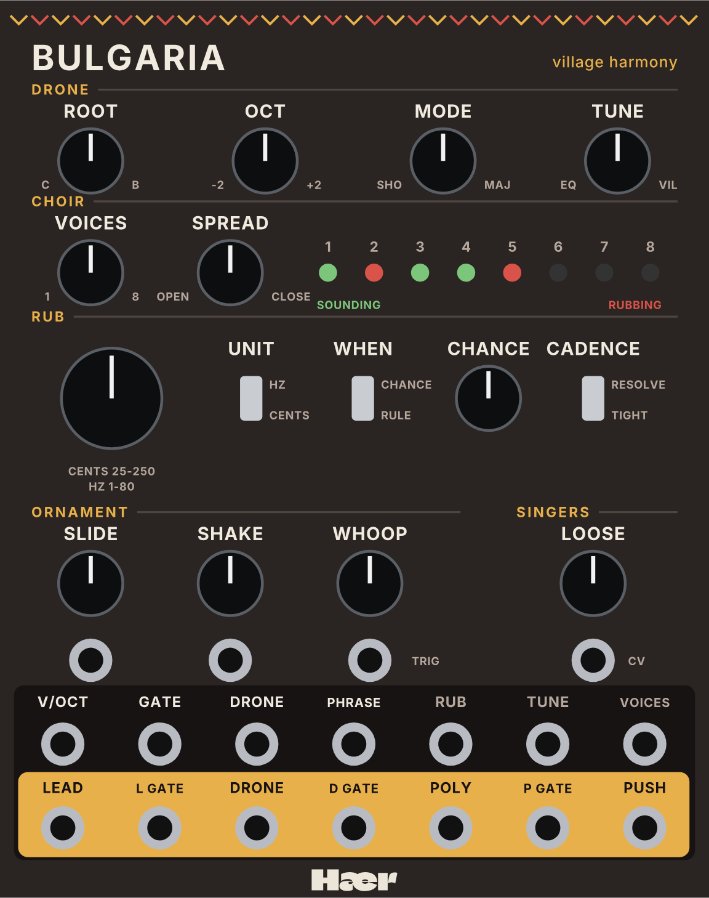
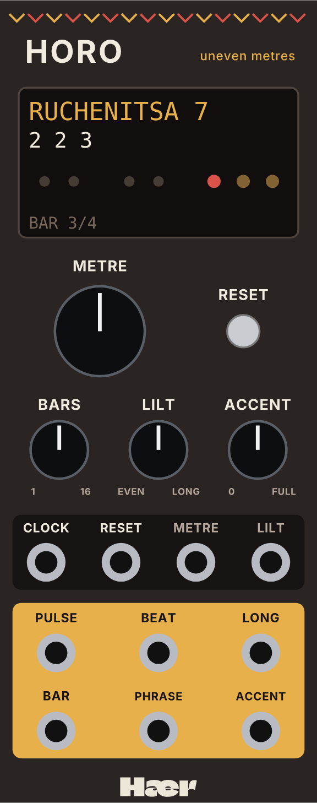

# Bulgaria

**Bulgaria Fable** by Haer. Two VCV Rack modules: Bulgaria (20 HP) and its companion clock Horo (10 HP, last chapter). Design by Fable, build by Opus.

Bulgaria harmonises one melody the way Bulgarian village choirs do. It takes the melody's pitch and gate and gives back up to eight voices: the melody, a drone, and voices that sit a deliberately mistuned second away from the melody so they beat and ring against it. **It makes no sound itself.** You patch its pitch, gate and push outputs into your own oscillators, envelopes and filters.

## The idea in two minutes

The sound people know from *Le Mystère des Voix Bulgares* grew out of village singing, mostly from the Shope and Pirin regions of western Bulgaria. Its core is simple:

- **A drone.** One or more singers hold the tonic, usually in a loud chest voice, often without a break.
- **A melody that clashes with it.** The lead keeps landing one scale step from the drone or from another voice and stays there. To western ears that is a dissonance to be resolved; here it is the point.
- **Seconds that aren't tempered.** Singers pitch those seconds wherever they ring hardest, often well narrower than a piano's 200 cents. Reported values run from about 130 to 200 cents. The tunings in this module are estimates in that range, not measurements of one choir.
- **A bright, straight sound.** No vibrato, loud and nasal. Two close pitches then beat fast and hard. That beating is the "rub".
- **Ornaments.** *Tresene* is a throat shake: quick upward flicks on a held note. The *izvik* is a whooped leap upward at the end of a phrase. Notes are often scooped into from below.

Bulgaria turns each of those into a control.

## Quick start

1. Patch a sequencer's pitch to **V/OCT** and its gate to **GATE**.
2. Patch **POLY** (V/OCT) to a polyphonic oscillator, such as VCV VCO set to sawtooth.
3. Patch **P GATE** to a poly ADSR, and use it on a poly VCA after the oscillator. Mix the poly signal down (VCV Sum or Mixer).
4. Load the *Init (Shope Three)* preset. You now hear three parts: your melody retuned to the Shope mode, a voice rubbing a second under it, and a drone.

The rub rings best with **bright, loud oscillators with no vibrato**: sawtooth or pulse, filters open. Keep the voices at similar levels. For more, patch **PUSH** to filter cutoff or VCA level (recipe 2).

## Controls

### DRONE

| Control | What it does |
| --- | --- |
| ROOT | Drone note, C to B. Changes take effect at the next note. |
| OCT | Octave of the drone, -2 to +2. 0 puts the root in the octave above C4 (0 V). |
| MODE | The scale: Shope, Aeolian, Dorian, Phrygian, Hijaz, Mixolydian, Major. Each has an equal-tempered and a village tuning (table below). |
| TUNE | Fades from equal temperament to the village tuning. At 0 your melody passes through untouched, chromatic notes included; at 100% it is snapped to the mode and village-tuned. The added voices always use whole scale steps. CV: +10% per volt. |

### CHOIR

| Control | What it does |
| --- | --- |
| VOICES | How many voices, 1 to 8. Sets the channel count of the three poly outputs. CV: 0 to 10 V adds 0 to 7 voices. |
| SPREAD | Turns the open voices (octave drones and the fifth) into more close-rubbing voices: above 25% voice 8, above 50% voice 6, above 75% voice 4. Read at each note start. |
| Lights 1 to 8 | Green: the voice is sounding. Red: it is rubbing. Brightness follows PUSH. |

### RUB

| Control | What it does |
| --- | --- |
| RUB | How far the rubbing voices sit from the lead. In CENTS: 25 to 250 cents per step (default 170). In HZ: a beat rate of 1 to 80 Hz per step (default about 31). CV: +10% of the range per volt. |
| UNIT | CENTS or HZ (see below). |
| WHEN | RULE: the voices follow the tradition's rules on every note. CHANCE: the CHANCE knob decides, note by note, whether voice 2 rubs or sings a plain third. |
| CHANCE | How often voice 2 rubs in CHANCE. |
| CADENCE | What happens on a phrase's last note (marked by PHRASE). TIGHT narrows the rub to 60% over 150 ms and holds it: the clash gets harsher. RESOLVE closes the rubbing voices to a unison with the lead between 0.35 and 0.65 s into the note. |

**Cents or Hz?** A fixed width in cents sounds rougher as you go up: 170 cents beats at about 12 Hz on A2 (110 Hz) and about 49 Hz on A4 (440 Hz). In HZ, the voice is placed so the beating rate is the same in every register. Around 25 to 40 Hz is the harshest rub; under 8 Hz it becomes a slow throb; above 60 Hz it turns into a buzz. HZ assumes your oscillators track 1 V/oct with 0 V at C4 (VCV's standard).

### ORNAMENT

Each ornament has a knob that sets how often it fires by itself, and a trigger input below it that fires it at once.

| Ornament | What it does | Fires by itself |
| --- | --- | --- |
| SLIDE | The lead scoops up into the note from about 160 cents below; rubbing voices follow from 90 cents below, more slowly. | At note starts, with the knob's probability. |
| SHAKE | *Tresene*: three quick upward flicks of about 190 cents, 90 ms apart, on the lead. PUSH dips on each flick. | When a note has been held 0.3 s. Above 75% it repeats every 0.6 s. |
| WHOOP | *Izvik*: when the note ends, the lead leaps up nearly an octave in 170 ms with its gate held open and its push falling away. Voice 5 joins it when active. | Only on a cadence note (PHRASE), when the gate falls. |

A triggered whoop while the gate is still high leaves the whooping voices silent until the next note.

### SINGERS

| Control | What it does |
| --- | --- |
| LOOSE | Human singers. Scales slow pitch drift (about 9 cents RMS on each voice at 100%, half that on the lead), late entries (up to 35 ms), wander in the rub width (up to 12%), uneven ornament depths (up to 40%) and wander in PUSH. At 0 every voice is exact. CV: +10% per volt. |

### Inputs

| Jack | What it takes |
| --- | --- |
| V/OCT | The melody. |
| GATE | The melody's gate. A rise starts a note; a pitch change while it is high is a legato note. Unpatched, the gate counts as always on and every pitch change is a new note. |
| DRONE | V/OCT for the drone root, rounded to the nearest semitone. Overrides ROOT and OCT. |
| PHRASE | A trigger on the **last note** of a phrase marks it as a cadence. A trigger while the gate is low marks the next note. |
| RUB, TUNE, VOICES | CV for those knobs. |
| SLIDE, SHAKE, WHOOP (under the knobs) | Ornament triggers. |
| LOOSE CV (under the knob) | CV for LOOSE. |

### Outputs

| Jack | What it gives |
| --- | --- |
| LEAD, L GATE | The retuned melody alone (voice 1). |
| DRONE, D GATE | The drone alone (voice 3), available even when VOICES is under 3. |
| POLY | V/OCT of all voices, one channel each, lead and drone included. |
| P GATE | Gates of all voices, 0 or 10 V. The drone follows your gates. |
| PUSH | 0 to 10 V per voice. High while a voice is rubbing and leaning in, spiking on the whoop, dipping on each shake, 0 when the gate is low. Patch it to filter cutoff or level so the clashing voices push forward. |

## The voices

Every incoming note is snapped to the nearest step of the mode. Each voice is then placed by a rule, counted in scale steps from the lead. "Near side" means below the lead when the melody is at or above the root, above it when the melody is below the root.

| Voice | Name | Where it goes |
| --- | --- | --- |
| 1 | Lead | Your melody, retuned by TUNE. |
| 2 | Rub | One step from the lead on the near side, pulled to the RUB setting. In CHANCE it sometimes sings a plain third instead. |
| 3 | Drone | The root. When the lead lands on the root (not at a cadence), the drone drops one step so the clash never disappears. |
| 4 | Low drone | The root an octave down. Above 75% SPREAD: rubs 3 steps above the lead. |
| 5 | Upper rub | One step from the lead on the far side, so the lead is squeezed from both sides. |
| 6 | Fifth | A fifth above the root. Above 50% SPREAD: rubs 3 steps on the near side. |
| 7 | Under rub | Two steps on the near side, stacked on voice 2 into a three-note cluster. |
| 8 | High drone | The root an octave up. Above 25% SPREAD: rubs 2 steps on the far side. |

A rubbing voice starts each note on the plain scale step and closes to the RUB setting over about a tenth of a second, the way a singer finds the clash. When the lead is one step above the root, voice 2 lands a few cents or Hz off the drone, so it beats against the drone too.

Voices glide between notes (12 ms on the lead, 22 ms on the others), and jump without gliding after a rest of 50 ms or more.

## Village tunings

Cents above the root. TUNE fades from the first row of each mode to the second.

| Mode | Tempered | Village |
| --- | --- | --- |
| Shope | 0 200 300 500 700 900 1000 | 0 170 310 500 700 870 1010 |
| Aeolian | 0 200 300 500 700 800 1000 | 0 190 305 500 700 810 1000 |
| Dorian | 0 200 300 500 700 900 1000 | 0 195 300 500 700 890 1000 |
| Phrygian | 0 100 300 500 700 800 1000 | 0 125 305 500 700 815 1000 |
| Hijaz | 0 100 400 500 700 800 1000 | 0 130 385 500 700 810 1000 |
| Mixolydian | 0 200 400 500 700 900 1000 | 0 195 385 500 700 885 1000 |
| Major | 0 200 400 500 700 900 1100 | 0 200 390 500 700 890 1090 |

Shope and Dorian share a tempered scale; Shope is the strongly bent one.

## Presets

All presets have ROOT C and OCT 0. Change ROOT to suit your patch.

| # | Name | What it is |
| --- | --- | --- |
| 1 | Init (Shope Three) | Drone, lead, one rubbing voice at 170 cents. |
| 2 | Shope Duet | Two parts, tight rub, always whoops at phrase ends. |
| 3 | Pirin Drone | Aeolian, wider rub that resolves at cadences, loose. |
| 4 | Rhodope Wide | Mixolydian, wide seconds, lots of sliding. |
| 5 | Thrace Hijaz | Hijaz mode, narrow 130-cent rub, shaking. |
| 6 | Harvest Song | Heavy throat shakes and whoops, very loose. |
| 7 | Koutev Choir | Six parts, partly tempered, resolving cadences. |
| 8 | Mystere Eight | Eight parts, a little spread. |
| 9 | Tight Cluster | Eight voices all rubbing, 120 cents. |
| 10 | Squeezed Lead | Five parts: the lead rubbed from both sides. |
| 11 | Hard Rub 30 Hz | Beat rate held at 30 Hz in every register. |
| 12 | Slow Throb | 4 Hz beating, half-tempered. |
| 13 | Buzz 60 Hz | Beating so fast it buzzes. |
| 14 | Quarter-Tone Smear | 50-cent rub with spread: a smeared cluster. |
| 15 | Machine Choir | Tempered, exact, 34 Hz: no humans at all. |
| 16 | Techno Cluster | Eight voices at 34 Hz, whoops on phrase ends. For riffs over a kick. |
| 17 | Acid Diaphony | Two parts, 28 Hz, lots of slides: for 303-style lines. |
| 18 | House Stab Rub | Five parts, CHANCE 60%, resolving: for chord stabs. |
| 19 | Dub Drone | 8 Hz throb, CHANCE 40%, slides. |
| 20 | Coin Toss | Init, but voice 2 rubs on half the notes. |
| 21 | Mostly Sweet | Major, CHANCE 20%: mostly thirds, the odd clash. |
| 22 | Whoop Only | Lead alone, retuned, with all the ornaments. |
| 23 | Drunk Wedding | Hijaz, everything loose and ornamented. |
| 24 | Glass Unison | Tempered cluster with a 2 Hz shimmer. |

## Patch recipes

### 1. First patch

- Sequencer (VCV SEQ-3 or any) CV → **V/OCT**, gate → **GATE**.
- **POLY** → VCV VCO V/OCT. Use its SAW output.
- **P GATE** → VCV ADSR gate (poly). ADSR → VCV VCA CV; VCO SAW → VCA in.
- VCA out → VCV Sum → Audio.
- Bright, loud and steady makes the rub ring. Avoid vibrato and chorus.

### 2. Let the clash push forward

- As recipe 1, with a poly filter (VCV VCF) after the VCO.
- **PUSH** → VCF cutoff CV (attenuverter about +40%), and/or **PUSH** → a second VCA's CV.
- Rubbing voices open up as they lean in; the drone sits back; the whoop flares and falls.

### 3. Mark the phrase ends

- A trigger on the last step of your sequence → **PHRASE**. Many sequencers have an end-of-cycle output; otherwise use a gate sequencer with only the last step on.
- CADENCE TIGHT: the last note squeezes harder. RESOLVE: it settles into unison.
- Turn up WHOOP for the leap at the end of each phrase.

### 4. Move the drone

- A second, slow sequencer or a quantizer → **DRONE**. The whole harmony follows the new root from the next note.

### 5. Play the rub

- An LFO (VCV LFO, slow triangle) or an envelope → **RUB** CV. In CENTS the clash widens and narrows; in HZ the beating speeds up and slows down.
- Try switching UNIT while a low line plays: in CENTS low notes throb gently and high notes buzz; in HZ every note rubs the same.

### 6. Split the choir

- **LEAD** → one voice (say a brighter VCO), **DRONE** → a darker voice, low.
- **POLY** with VOICES 5 or more → a third poly voice for the cluster. The lead and drone are on POLY too, so leave that voice's channels 1 and 3 quiet with VCV Split / Merge if you want them only once.

### 7. Ornaments from triggers

- A random trigger source (Audible Instruments Bernoulli Gate on a clock) → **SHAKE**: shakes at random but in time.
- A sequencer's end-of-pattern output → **WHOOP**: a whoop every pattern.
- A clock divider → **SLIDE**: scoop into every fourth note.

### 8. Eight-voice cluster over a kick

- Preset *Techno Cluster*, ROOT A, OCT -1.
- A 16th-note sequence at 126 bpm → V/OCT, GATE; the last step of every second bar → PHRASE.
- POLY → poly sawtooth VCO, P GATE → short ADSR, PUSH → filter cutoff. Add a kick.

## Notes

- The tunings are estimates based on reported ranges for this singing, not measurements.
- Demo audio was made with a plain sawtooth stand-in synth. The tone in the demos is not the module's; Bulgaria only makes pitch, gate and push.
- Nothing here has been tested in Rack yet.

## Horo, the companion clock

**Clock and accent sequencer for Bulgarian uneven dance metres.** A companion to Bulgaria, in the same plugin (Bulgaria Fable 2.1.0). 10 HP. Search for "Horo" in the module browser.

Design by Fable, build by Opus. Nothing has been tested in Rack yet.

### What it is

Horo takes a fast clock, one edge per short unit (usually a sixteenth), and groups the pulses into the 2s and 3s of a dance metre. It puts out a trigger at the start of each beat, a separate one for the long beats, a bar trigger, a phrase trigger made for Bulgaria's PHRASE input, an accent CV that is strongest on the downbeat, and the pulse clock itself, with an optional lilt that stretches the long beats so the bar sounds played rather than counted.

Horo makes no sound. It drives other modules.

### Uneven metres in two paragraphs

Bulgarian dance music counts in short and long beats. A short beat is two pulses, a long beat three. Ruchenitsa, the best known, is 7 pulses grouped 2 + 2 + 3: dancers feel three beats, "quick, quick, slow", not seven. Daichovo is 2 + 2 + 2 + 3 (four beats, the last long), kopanitsa is 2 + 2 + 3 + 2 + 2 (five beats, long in the middle), and the longer metres string these together. The art is in the long beat: in a band it is often a little longer than one and a half short beats, which is what LILT does.

The metre table below comes from the folk-dance teaching literature as remembered by the designer, not checked against a source; names and groupings vary from region to region and band to band, so trust your ears and use the user slots.

### Clocking it

Patch a clock with one edge per pulse into CLOCK. Any clock works: a ×4 output of a clock module for sixteenths, or a VCV LFO square wave. Dance tempos are fast in pulses: ruchenitsa is played from about 280 to 520 pulses a minute (about 5 to 9 Hz), so at 126 bpm a sixteenth clock (8.4 Hz) is a brisk ruchenitsa.

Horo measures the clock period from the edges and follows tempo changes. With LILT at zero every output is sample-accurate with the clock. With LILT turned, the first pulse of every bar still falls on its clock edge, and the pulses in between are moved. The bar keeps its length, and the number of pulses out always equals the number of clock edges in. If the clock stops, the gates go low and Horo waits where it was; the next edge carries on.

RESET (jack or button): the next clock edge is the first pulse of bar 1. If a reset arrives within 1 ms after a clock edge (a clock module that sends both at the start), that edge itself becomes the first pulse.

### Controls

| Control | What it does |
| --- | --- |
| METRE | Chooses one of 18 slots: 14 factory metres and USER 1 to 4. A change takes effect at the next bar line (or the next phrase, see the menu). While a change waits, the display shows the coming name dimmed. |
| BARS | Bars per phrase: 1, 2, 3, 4, 6, 8, 12 or 16. Sets where PHRASE fires and the downbeat accent. |
| LILT | From EVEN (left) through 0 (centre, straight) to LONG (right). Right stretches the long beats, left squeezes them toward an even bar. Latched at each bar line. CV adds 0.2 per volt. |
| ACCENT | Depth of the accent CV. At 0 ACCENT is a constant 10 V; at full it runs from 2 V on weak pulses to 10 V on the phrase downbeat. |
| RESET button | As the RESET jack. |

### Jacks

| Jack | Signal |
| --- | --- |
| CLOCK in | One edge per pulse (rises through 1 V). |
| RESET in | Rising edge restarts at bar 1. |
| METRE in | Adds 0.5 V per slot to the knob (1 V = 2 slots), applied at the bar line. |
| LILT in | Adds 0.2 per volt to the knob. |
| PULSE out | The clock, with lilt; gate half a (warped) pulse long. Clock a sequencer with this. |
| BEAT out | Gate at the start of every group, lasting half the group, so long beats give longer gates. |
| LONG out | As BEAT, long groups only. |
| BAR out | 1 ms trigger on the first pulse of every bar. |
| PHRASE out | 1 ms trigger at the end of every phrase (see the menu). Patch it into Bulgaria's PHRASE. |
| ACCENT out | Held CV, updated on every pulse (table below). |

All gates and triggers are 0/10 V. The lights by BEAT, BAR and PHRASE flash for 80 ms.

### Context menu

- **Phrase trigger on**: *Last beat* (default), the start of the last group of the last bar; *Last long beat*, the start of the last long group of the last bar (in kopanitsa, the 3 in the middle rather than the final 2); *Last pulse*, the very last pulse.
- **Change metre at**: *Next bar* (default) or *Next phrase*.
- **User 1 to 4**: type a grouping, as "2+2+3", "2 2 3" or "223". Groups of 1 to 9, at most 16 groups and 32 pulses. A grouping that breaks the rules is ignored and the previous one kept. It takes effect at the next bar line and is saved with the patch and in presets.

### The metres

| # | Name | Pulses | Grouping |
| --- | --- | --- | --- |
| 1 | PRAVO | 6 | 3 3 |
| 2 | PAIDUSHKO | 5 | 2 3 |
| 3 | RUCHENITSA | 7 | 2 2 3 |
| 4 | LESNOTO | 7 | 3 2 2 |
| 5 | ELENINO | 7 | 2 2 1 2 |
| 6 | DAICHOVO | 9 | 2 2 2 3 |
| 7 | GRANCHARSKO | 9 | 2 3 2 2 |
| 8 | KOPANITSA | 11 | 2 2 3 2 2 |
| 9 | PETRUNINO | 12 | 3 2 2 3 2 |
| 10 | KRIVO | 13 | 2 2 2 3 2 2 |
| 11 | BUCHIMISH | 15 | 2 2 2 2 3 2 2 |
| 12 | YOVE | 18 | 3 2 2 2 2 3 2 2 |
| 13 | SANDANSKO | 22 | 2 2 2 3 2 2 2 3 2 2 |
| 14 | SEDI DONKA | 25 | 3 2 2 3 2 2 2 2 3 2 2 |
| 15 to 18 | USER 1 to 4 | | defaults 3 3 2, 2 3 3, 3 2 3, 2 2 2 2 |

A group is **long** if it has more pulses than the shortest group in the bar. In PRAVO all groups are equal, so nothing is long and LILT does nothing. In ELENINO the shortest group is the 1, so all the 2s count as long.

### LILT, worked

LILT moves time from the short pulses to the long ones while the bar keeps its length. At full LILT each pulse of a long group lasts 1.25 pulses and the short pulses shrink to make up for it, but never below 0.6 of a pulse. In ruchenitsa (2 2 3) at full LILT the 3 lasts 3.75 pulses and each 2 lasts 1.625, so the pulses fall at 0, 0.81, 1.63, 2.44, 3.25, 4.5 and 5.75 of the bar. Turned left, the long beat is squeezed: at full left the 3 lasts 2.25 pulses and each 2 lasts 2.375, nearly even.

Because the pulse clock carries the lilt, anything clocked from PULSE (a sequencer, a drum module) plays with it. Anything clocked straight from your master clock does not, which can be a nice tension.

### The accent

| Pulse | Weight | At ACCENT full |
| --- | --- | --- |
| First pulse of the phrase | 1.00 | 10 V |
| First pulse of any other bar | 0.90 | 9 V |
| Start of a long group | 0.75 | 7.5 V |
| Start of a short group | 0.55 | 5.5 V |
| Last pulse of a group of 3 or more (the pickup) | 0.35 | 3.5 V |
| Any other pulse | 0.20 | 2 V |

The output is `10 V × (1 − ACCENT × (1 − weight))`.

### Presets

| # | Name | Metre | Bars | Lilt | Accent | Phrase on |
| --- | --- | --- | --- | --- | --- | --- |
| 1 | Init (Ruchenitsa) | RUCHENITSA | 4 | 0 | 80% | last beat |
| 2 | Ruchenitsa Played | RUCHENITSA | 4 | +50% | 90% | last beat |
| 3 | Paidushko Limp | PAIDUSHKO | 4 | +60% | 100% | last beat |
| 4 | Lesnoto Slow | LESNOTO | 2 | +40% | 70% | last beat |
| 5 | Daichovo | DAICHOVO | 4 | +30% | 80% | last beat |
| 6 | Kopanitsa | KOPANITSA | 4 | +30% | 80% | last long beat |
| 7 | Krivo | KRIVO | 4 | +20% | 80% | last long beat |
| 8 | Buchimish | BUCHIMISH | 2 | +20% | 80% | last beat |
| 9 | Sedi Donka | SEDI DONKA | 2 | +20% | 80% | last beat |
| 10 | Machine Seven | RUCHENITSA | 8 | 0 | 100% | last pulse |
| 11 | Squared Off | KOPANITSA | 4 | -100% | 60% | last beat |
| 12 | Techno 3 3 2 | USER 1 = 3 3 2 | 8 | +15% | 100% | last beat |

### Patch recipes

Stock VCV modules are used where they do the job. "Clock" means any clock module or a VCV LFO square wave.

#### 1. First patch

1. Clock (sixteenths, about 8 Hz) → Horo CLOCK.
2. Horo PULSE → VCV SEQ 3 CLOCK. Horo BAR → SEQ 3 RESET. Set SEQ 3 to 7 steps for ruchenitsa.
3. SEQ 3 CV 1 → VCV VCO V/OCT; SEQ 3 TRIG (or GATE) → VCV ADSR GATE.
4. VCO SAW → VCV VCF IN; VCF OUT → VCV VCA IN; ADSR OUT → VCA CV.
5. Horo ACCENT → VCF CUTOFF (attenuated) or a second VCA level. The downbeat opens widest.

Turn LILT right and listen to the third beat lean.

#### 2. With Bulgaria: the phrase link

1. Clock → Horo CLOCK. Horo PULSE → SEQ 3 CLOCK; Horo BAR → SEQ 3 RESET.
2. SEQ 3 CV 1 → Bulgaria V/OCT; SEQ 3 GATE (or TRIG into a short envelope used as a gate) → Bulgaria GATE.
3. **Horo PHRASE → Bulgaria PHRASE.** BARS 4: every fourth bar's last beat becomes Bulgaria's cadence note.
4. Bulgaria POLY V/OCT, POLY GATE → poly VCO, ADSR, VCA as in Bulgaria's first recipe.
5. Try Bulgaria's CADENCE on TIGHT (the rub squeezes in at the phrase end), then RESOLVE (the voices close to unison), and turn WHOOP up for the izvik as the cadence note ends.

Which "Phrase trigger on" to pick: *Last beat* marks the note that starts on the final beat, right for ruchenitsa and daichovo, whose last beat is the long one. In kopanitsa and krivo the bar ends with two short beats, and the melody usually comes to rest on the long beat before them; choose *Last long beat*. *Last pulse* is for patterns where every pulse is a note.

Bulgaria acts on PHRASE 2 ms after the edge, so it does not matter whether Horo's trigger arrives a sample before or after the sequencer's step.

#### 3. Accents drive the rub

1. As recipe 2.
2. Horo ACCENT → VCV 8VERT (or any attenuator) at about 30% → Bulgaria RUB CV. Strong beats now clash harder than weak ones.
3. Alternatively ACCENT → Bulgaria LOOSE CV, so the singers tighten on the downbeat (invert it with 8VERT) or loosen.

#### 4. Shake on the long beat

1. As recipe 2.
2. Horo LONG → Bulgaria SHAKE trigger: the throat shake falls on every long beat.
3. Horo BAR → Bulgaria SLIDE trigger: every bar starts with a scoop.
Turn Bulgaria's own SHAKE and SLIDE knobs down so only the triggers fire them.

#### 5. Melody on the beats, not the pulses

1. Horo BEAT → SEQ 3 CLOCK; Horo BAR → SEQ 3 RESET; SEQ 3 at 3 steps for ruchenitsa (one per beat).
2. Horo BEAT → Bulgaria GATE directly. The BEAT gate is half the group long, so the long beat holds its note longer: quick, quick, slow.
3. SEQ 3 CV → Bulgaria V/OCT, PHRASE linked as in recipe 2.

#### 6. Tapan (the big drum)

1. Horo BAR → a kick (VCV's drum modules or any drum voice).
2. Horo LONG → a low tom.
3. Horo PULSE → a hat or rim; Horo ACCENT → that voice's VCA level, so the pickups and off-pulses are quiet.
4. LILT to about +40% for a played feel.

#### 7. Chaining metres

1. Horo BAR → a second SEQ 3's CLOCK (one step per bar).
2. That SEQ 3's CV → Horo METRE CV, with Horo's METRE knob at PRAVO (slot 1). Each 0.5 V is one slot: 0.5 V = PAIDUSHKO, 1.0 V = RUCHENITSA, 3.5 V = KOPANITSA.
3. Program RUCHENITSA, RUCHENITSA, KOPANITSA: 7 + 7 + 11, which is sedi donka the long way round. The change happens at each bar line, so the sequence can't land mid-bar.

Set BARS to the length of the sequence (3 here) so PHRASE marks the end of the whole cycle.

#### 8. Your own metre

1. Right-click → User 1 → type "3 3 2", METRE to USER 1. Under a four-on-the-floor kick, 3 3 2 is the tresillo that runs under a lot of techno and house.
2. User 2 = "2 3 3" for the same thing rotated.
3. A long one: "2 2 3 2 2 2 3 2 2 3" (23 pulses) and let Bulgaria's PHRASE land once a cycle with BARS 1.

### Tests and demos

`make test` runs 74 offline checks of the Horo engine as well as Bulgaria's 64: pulse timing at LILT 0 and full lilt, BEAT, LONG and BAR positions, beat gate lengths, every factory metre's count and beats, the three phrase positions, accent values, lilt limits, metre changes at the bar line and at the phrase, user grouping parsing, clock stop and resume, tempo jumps (pulses out equal clocks in, no two pulse rises closer than 0.5 ms), reset, and a fuzz at 44.1, 48 and 96 kHz.

The demos (`make horo-demos`) run the C++ engine and play its outputs through stand-in sounds: a kick on BAR, a tom on LONG, a tick on PULSE at the ACCENT level, and, in demos 1 and 4, Bulgaria's C++ engine through a stand-in sawtooth synth with Horo's PHRASE patched across. **The tone in the demos is not Horo's or Bulgaria's; both make no sound.**

1. Ruchenitsa, 8 bars straight then 8 bars at LILT +50%, with Bulgaria preset 1 and the phrase link.
2. Kopanitsa drums: 4 bars straight, 4 at full LILT, 4 at full left.
3. Two bars each of paidushko, ruchenitsa, daichovo, kopanitsa and buchimish.
4. 7 + 7 + 11 chained by METRE CV, with Bulgaria preset 16 (Techno Cluster) and a kick on BAR, at 126 bpm sixteenths.
