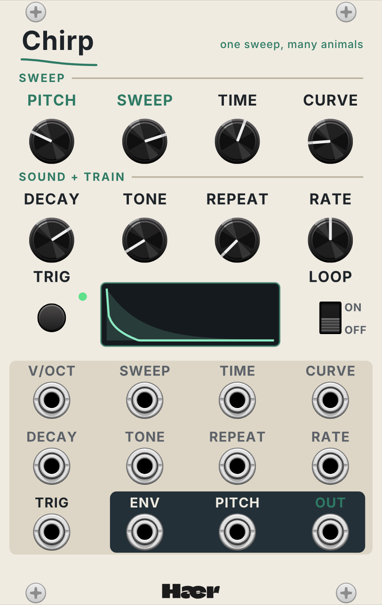

# Chirp

One gesture, lots of sounds. A tone starts at one pitch, glides quickly to another, and fades.
Bats sweep down over an octave in a few milliseconds. Frogs and many birds sweep up. Crickets
and cicadas repeat a short sweep many times a second. An 808 kick is the same gesture again:
a sine dropping from high to low while it decays. Chirp is that gesture as a module.

16 HP, polyphonic (one voice per TRIG or V/OCT channel, up to 16). MIT licence.

## Controls

| Control | What it does |
|---|---|
| **PITCH** | Where the chirp lands. Adds to V/OCT (0 V = C4). |
| **SWEEP** | Where it starts, +/-6 octaves from PITCH. Right of centre falls (kick, zap, bat), left rises (frog, rising bird). Centre is a plain blip. |
| **TIME** | How long the glide takes, 0.5 ms to 2 s. |
| **CURVE** | Left: fast first then settles (the kick drop). Centre: even. Right: holds, then dives. |
| **DECAY** | Fade time of each chirp, 2 ms to 4 s. |
| **TONE** | 0 = pure sine, half = saw-bright, full = driven buzzy square (frogs, insects, rims). |
| **REPEAT** | Chirps per trigger, 1 to 16 (a call is often a short train). |
| **RATE** | Chirps per second inside a train, 0.5 to 200. |
| **TRIG** button | Plays a train by hand. The light shows the loudest voice. |
| **LOOP** | On: keeps chirping at RATE with no triggers (cicadas, drones, slow modulation). A trigger restarts it. |

The screen draws one chirp: the bright line is the pitch glide, the shaded area is the fade,
and a dot runs along it while channel 1 plays.

## Jacks

* CV inputs for every knob. V/OCT adds to PITCH, SWEEP CV is 1 V per octave, the rest add
  +/-5 V = the whole knob range.
* **TRIG** (poly) starts a train.
* **ENV** 0-10 V: the fade of each chirp. An envelope with a snap.
* **PITCH** V/OCT: the glide itself. Patch it into any oscillator's V/OCT (or a filter's
  cutoff) and that oscillator chirps too.
* **OUT** +/-5 V audio.

## Factory presets (right-click > Preset)

Kick, Tom, Rim, Tick, Zap, Bass Drop, Laser, Droplet, Bat, Frog, Cricket, Cicada (loop),
Bird Up, Bird Down, Siren (loop), Slow Wobble (loop, use ENV/PITCH as modulation).

## Patch ideas

1. **Techno kit from one module type.** Four Chirps on Kick, Tom, Rim and Tick, triggered by a
   drum sequencer. Turn TIME and CURVE on the kick per step from a sequencer CV row for
   accented, longer drops.
2. **Chirp as a modulation source.** Slow Wobble or Siren with LOOP on; take PITCH into a
   filter cutoff and ENV into a VCA. RATE sets the speed, CURVE the shape of each sweep.
3. **Dusk scene.** Cicada (LOOP) quiet in the background, Cricket and Frog triggered by slow,
   irregular clocks (Marbles-style random gates), a Bird preset on a Bernoulli gate.
4. **Chirp other voices.** Patch PITCH into a wavetable or FM voice's V/OCT and trigger both
   together: any timbre gets the kick drop or the bat sweep.

## Build

`make RACK_DIR=/path/to/Rack-SDK dist`. `make test` renders `chirp-demo.wav` offline with
the same engine. `python3 res/make_panel.py` redraws the panel (needs fonttools);
`g++ -std=c++17 tools/export_presets.cpp -o tools/export_presets && ./tools/export_presets`
rewrites the preset files from `src/ChirpPresets.hpp`.
