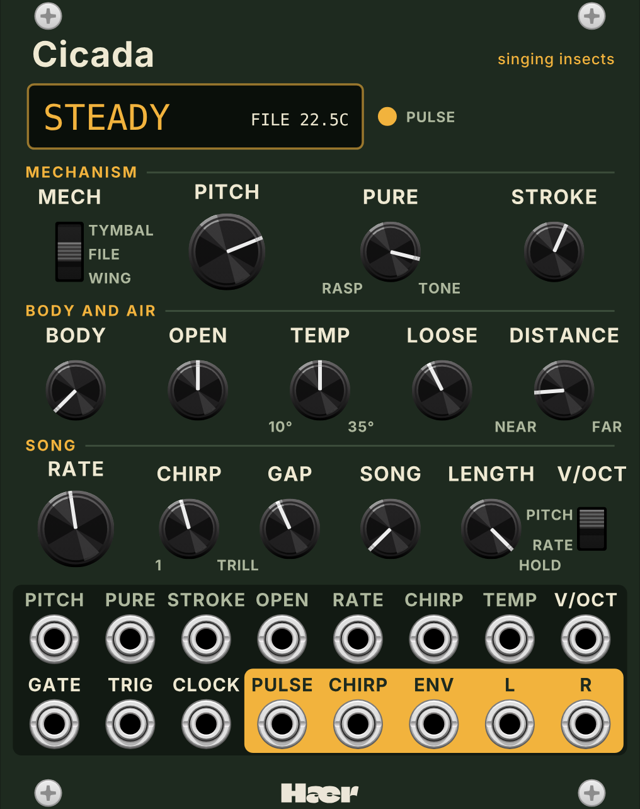

# Cicada

**Singing insects by physical model.** Cicada makes the songs of cicadas, crickets, katydids and grasshoppers, and the hum of flying insects, without a single sample. It models how the animals actually do it: a slow muscle drives a mechanical part that makes a fast train of tiny clicks, and each click rings a small resonant body part. Turn the knobs one way and you get a field cricket at the bottom of the garden. Turn them further and the same insect becomes a hi-hat, a shaker, a talking drone or an acid-style bass voice.

One insect lives on the panel. Give it a polyphonic cable, or pick a number in the right-click menu, and you get a chorus where every individual is slightly different, the way a real field at night sounds.

## How it works: three layers

| Layer | In the animal | On the panel |
|---|---|---|
| **Song** | The nervous system decides when the muscle fires: pulses, grouped into chirps, grouped into phrases. | RATE, CHIRP, GAP, SONG, LENGTH, TEMP, LOOSE |
| **Mechanism** | What one muscle twitch does. A cicada's tymbal buckles a row of ribs, each a click. A cricket drags a scraper across a file of teeth. A fly beats its wings. | MECH, STROKE, PURE |
| **Body** | What rings. The tymbal plate or the wing sets the pitch and how pure it is. A cicada's hollow abdomen is a second resonator that the animal moves, like a mouth. | PITCH, PURE, BODY, OPEN, DISTANCE |

There is no oscillator in the engine. A cricket sounds like a whistle only because its teeth hit the wing exactly once per ring of the wing, so the rings add up. Scatter the teeth with PURE and the same wing turns into the rasp of a katydid.

## Controls

### Mechanism

- **MECH** (switch). TYMBAL is the cicada: ribs buckle one after another, each a little lower in pitch, then the tymbal springs back with a quieter, higher click. Two tymbals take turns and sit slightly apart in stereo. FILE is the cricket, katydid and grasshopper: a scraper crossing a row of teeth on the closing stroke of the wing. WING is a flying insect: one impulse per wingbeat, plus a softer upstroke.
- **PITCH**. The ringing frequency of the tymbal or wing, 100 Hz to 16 kHz. Most crickets sit between 2 and 5 kHz, most large cicadas between 4 and 7 kHz. Turn it down for giant insects.
- **PURE**. From rasp to whistle. Up high the resonance is sharp and the teeth lock to it (cricket). Low down the resonance is broad and the teeth fall where they like (katydid, grasshopper, noise).
- **STROKE**. What one twitch does. TYMBAL: how many ribs buckle (1 to 12, more is a longer, more tonal pulse). FILE: how long the wing scrapes, as a share of the cycle. WING: how strong the upstroke is.

### Body and air

- **BODY**. How much the abdomen colours the sound. Zero leaves the raw tymbal or wing.
- **OPEN**. Where the abdomen is tuned, from half to double the carrier. In the middle it is tuned to the carrier and loudest. This is the cicada "wah": with BODY up, move OPEN and the insect talks. The PULSATE, SINK and TALK songs move it themselves.
- **TEMP**. Night temperature, 10 to 35 °C. Insects are cold-blooded and sing faster when it is warm: every rate speeds up together and the pitch rises a little. For a tree cricket, the number of chirps in 13 seconds plus 40 is roughly the temperature in Fahrenheit.
- **LOOSE**. From machine-exact (every chirp identical) to a live animal (timing and loudness wobble, dropped pulses, the odd pause). The default matches what was measured on real crickets.
- **DISTANCE**. Air and leaves between you and the insect: treble loss and a scatter of short reflections.

### Song

- **RATE**. Pulses per second, 1 to 1000. A field cricket is about 25, a tree cricket about 65, a big cicada 150 to 250, a mosquito 500. With the V/OCT switch at RATE this knob becomes a transposer of up to four octaves either way.
- **CHIRP**. Pulses per chirp, 1 to 32. Fully up the insect trills without stopping.
- **GAP**. Silence between chirps, 20 ms to 4 s.
- **SONG**. The long gesture of a phrase. See the table below.
- **LENGTH**. How long one phrase lasts before it releases and rests, 0.5 to 30 s. Fully up (HOLD) it never ends.
- **V/OCT switch**. PITCH: the V/OCT input transposes the carrier, so you play the insect's pitch. RATE: V/OCT plays the pulse rate instead (0 V is C4), which turns the insect into a formant voice whose "filter" is PITCH.

### The eight songs

| Song | What it does | After |
|---|---|---|
| STEADY | Just chirps or a trill. | crickets, katydids |
| SWELL | Grows over the first half, holds, then dies off lower and slower. | large cicadas |
| PULSATE | SWELL with a slow throb in loudness and body. | dog-day cicada |
| RISE | Each phrase grows louder. | grasshopper |
| SLUR | A long tone that falls away at the end. | 17-year "pharaoh" cicada |
| TICK-BUZZ | Slow single ticks, then a buzz that rises and falls. | periodical cicadas, meadow katydid |
| SINK | Chirps speed up, shorten, sink in pitch and fade. | evening cicada "kana-kana" |
| TALK | The tymbal runs on while the abdomen opens and closes in syllables. | min-min cicada |

Each phrase is followed by a rest, so a free-running Cicada sings, pauses and sings again.

### Jacks

- **CV inputs** (PITCH, PURE, STROKE, OPEN, RATE, CHIRP, TEMP). Add to the knob; 5 V is a full turn. All are polyphonic.
- **V/OCT**. Pitch or rate, see the switch. A polyphonic cable here gives one insect per channel.
- **GATE**. When patched, the song follows the gate: it starts at the rising edge, holds while high, releases at the falling edge, and is silent between gates.
- **TRIG**. When patched, Cicada becomes a triggered voice: one chirp per trigger, at full level, nothing in between. The song is ignored.
- **CLOCK**. When patched, each clock edge starts a chirp in place of the GAP timer. The song still shapes it.
- **PULSE** out. A 1 ms trigger at every pulse: the insect as a clock.
- **CHIRP** out. A gate while a chirp is sounding.
- **ENV** out. The loudness of the song as a voltage, 0 to 10 V.
- **L, R** out. Stereo. If only L is patched it carries the mono mix.

### Right-click menu

- **Individuals**: 1, 2, 3, 4, 6 or 8 insects when no poly cable sets the number. Each one differs a little in pitch, speed and gap, starts at a different moment, and has its own place in the stereo field.

## Presets

Right-click, Preset, Factory presets.

| Preset | What it is |
|---|---|
| Field Cricket | Five-pulse chirps at 4.5 kHz, fitted to a real recording. The default. |
| Tree Cricket | A steady 3.1 kHz trill, 65 pulses a second, fitted to a recording. |
| Ground Cricket | Low, slow, long chirps of 21 pulses, fitted to a recording. |
| Katydid | Harsh "ka-ty-did" rasps in twos and threes. |
| Meadow Katydid | Very high ticks that become a buzz. |
| Grasshopper | Noisy leg strokes in swelling phrases. |
| Dog-Day Cicada | 220 pulses a second, swell, throb and die-off. |
| Pharaoh Cicada | The low 1.3 kHz tone of the 17-year cicada, with the falling slur. |
| Tick-Buzz Cicada | Ticks, then a shrill buzz that rises and falls. |
| Evening Cicada | Chirps that speed up, sink and fade at dusk. |
| Min-Min Cicada | The abdomen talking: "miiin-min-min-min". |
| Rasp Cicada | Dry rasping bursts, four or five a second. |
| Greengrocer | A big, loud, fairly pure cicada swell. |
| Mosquito | A thin 520 Hz whine. |
| Bumblebee | A low, rough 170 Hz hum. |
| Cricket Hats | Meant for TRIG: short bright chirps as hi-hats. |
| Tymbal Bass | Meant for V/OCT with the switch at RATE: a formant bass. |
| Leaf Shaker | Meant for CLOCK: a raspy shaker. |
| Giant | A cicada the size of a dog. |
| Sine Night | Almost pure tones, far away. |

## Patch recipes

**A summer night.** Field Cricket with Individuals at 6. Add a second Cicada on Tree Cricket further away (DISTANCE up). Run a very slow LFO into both TEMP inputs and the whole field speeds up and slows down together.

**Cricket hi-hats.** Load Cricket Hats. Patch a sequencer's trigger into TRIG and a CV row into CHIRP so steps give one, two or three pulses. Turn PURE down for a dirtier, open hat; lower PITCH a little on the off-beats with a second CV row. Works anywhere a closed hat would.

**Clocked shaker that builds.** Leaf Shaker, eighth notes into CLOCK, SONG at SWELL and LENGTH at about eight bars. Each pass grows into the drop.

**Tymbal acid bass.** Tymbal Bass with the V/OCT switch at RATE. Sequencer pitch into V/OCT, an envelope into PITCH CV (this is your cutoff), PURE as resonance. Put a VCA after it, opened by your envelope or by ENV. Slides on the sequencer glide the pulse rate just like a 303 note.

**Talking drone.** Greengrocer, SONG at STEADY, BODY high. An LFO or a sequencer into OPEN makes vowels. A random source into OPEN at a slow rate sounds like an animal thinking.

**Insect as a clock.** PULSE into a drum module for a rhythm that breathes with the animal; CHIRP into a sample-and-hold to pick a new note each chirp; ENV to duck a pad under the song.

**Fly-by.** Mosquito into a VCA and a panner, both moved by one slow envelope. Bend V/OCT up a semitone on the way in and down on the way out for Doppler.

**Riser.** Dog-Day Cicada with a long gate into GATE, LENGTH long, and TEMP swept up over the riser. Release the gate on the drop and it dies away lower and slower by itself.

**Dub siren cousin.** Pharaoh Cicada with GATE from a button, into a tape delay with feedback. Each release slurs down into the echoes.

**Giants.** Any preset with PITCH turned down two or three octaves and RATE down by the same amount. A cricket becomes a slow, wooden creak.

## Honest limits

The three cricket presets are fitted to measurements of real recordings (clips from the ESC-50 research set: carrier, pulse rate, pulse length and the pitch glide inside each pulse). The cicadas, katydids, grasshopper and flying insects follow published descriptions and measurements (Bennet-Clark and Young on cicada tymbals, and standard insect bioacoustics), not recordings, so they are plausible rather than matched. Presets are named by type, not as species identifications. If a preset sounds wrong to your ear, tell us which one.

Cicada Fable 2.0.0. Design by Fable, build by Opus. Hær.
