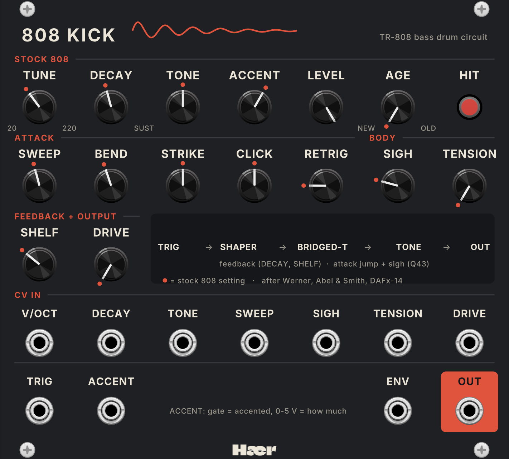

# 808 Circuits

Circuit models of the Roland TR-808's instruments, one module per instrument. Each one starts
from a faithful model of the original voice, then puts the circuit's inner parts on the panel
and takes them past their stock ranges. Hats and cymbal are the separate [808 Metal](https://github.com/hardyfinn/808Metal) plugin.

Modules: **808 Kick, 808 Snare, 808 Clap, 808 Tom / Conga, 808 Rim, 808 Clave, 808 Maracas, 808 Cowbell** (all 28 HP).

## 808 Kick (28 HP)

The TR-808 bass drum as Werner, Abel and Smith describe it ("A Physically-Informed,
Circuit-Bendable, Digital Model of the Roland TR-808 Bass Drum Circuit", DAFx-14):
a 1 ms trigger pulse (4 V, up to 14 V when accented) goes through a pulse shaper with a diode
clamp into a **bridged-T resonator** at 49.5 Hz. There is no VCA: the ring time comes from a
feedback buffer around the bridged-T. For about 6 ms after the hit a transistor (Q43) shorts
part of the bridged-T, so the first cycle runs more than an octave high (the "attack jump");
Q43 lets go as its drive decays, so the pitch glides back down over those 6 ms.
On big negative swings the same transistor leaks, so loud early cycles run sharp and settle
back (the "pitch sigh", roughly 58 to 49.5 Hz). Then a one-pole tone filter and the output stage.

A **red dot** beside each knob marks the stock 808 setting. Right-click → *Reset to stock 808*
puts every knob back (LEVEL is left alone).

| Knob | What it is in the circuit | Stock | Range |
|---|---|---|---|
| TUNE | bridged-T centre (a trimmer on the 808) | 49.5 Hz | 20-220 Hz, + V/OCT |
| DECAY | feedback buffer (the 808's DECAY pot) | 0.43 s ring | 80 ms - 1.6 s stock range, then to 8 s, then SUSTAIN (self-oscillation, on TUNE: the sigh fades out) |
| TONE | output low-pass | 1.2 kHz | 150 Hz - 10 kHz |
| ACCENT | global accent level (VR3) | 60 % | accented hit 4-14 V |
| LEVEL | output level | | (not randomized) |
| AGE | part tolerances + drift + wear | 0 (new) | see below (not randomized) |
| SWEEP | size of the attack jump | 1.1 oct | 0-2.5 oct |
| BEND | how long the jump lasts | 6 ms | 1-60 ms (long = zaps) |
| STRIKE | trigger pulse | 1 ms | below 1 ms a shorter, harder pulse; above, rounded edges (soft mallet). The ring level is held |
| CLICK | shaped pulse straight through the bridged-T | 1x | 0-2x |
| RETRIG | second pulse into the bridged-T | small, right after the jump | up = louder and later: a flam |
| SIGH | Q43 leak: loud cycles sharp | 808 amount | off to a deep boom drop |
| TENSION | louder = higher, at all levels (like a skin) | off | |
| SHELF | feedback buffer's high shelf | flat decay | up: raised pitches die faster, down: they ring |
| DRIVE | output op-amp into its rails | clean | |

**AGE.** The 808 was built from ±20 % capacitors and ±5 % resistors, so no two units sounded the
same. Every 808 Kick has a serial number (saved with the patch, shown and re-rollable in the
right-click menu) that fixes where its parts sit inside those tolerances; AGE scales how far
they are off (pitch about ±12 %, decay ±25 %, tone ±20 %, sigh, jump and level). Each hit also
drifts a little. Past about 70 % the capacitors are worn: shorter ring and a little hiss.
At 0 every unit is exactly the stock 808.

**Jacks.** TRIG, ACCENT (gate = accented; 0-5 V = how much, read at each hit), CV for
V/OCT, DECAY, TONE, SWEEP, SIGH, TENSION and DRIVE (±5 V = full knob range), ENV out
(ring amplitude 0-10 V) and OUT (about 4.5 V peak unaccented, 8.5 V accented).

**Notes.** Retriggering adds to the ring that's already going, as on the 808. The paper prints
no component values, so the stock numbers are fitted to its reported behaviour; `make test`
checks them (49.5 Hz, the sigh inside 48-58 Hz, attack jump, accent, bounded sustain, AGE).

## The other seven voices

All seven share one layout and one module template (`src/Voice808.hpp`); their knob tables live in
`res/voices.py`, which draws the panels and writes `src/VoiceSpecs.hpp`. Every voice has a STOCK 808
row (with ACCENT, LEVEL and AGE), its circuit controls, CV inputs, TRIG, ACCENT, ENV and OUT, the
stock dots and *Reset to stock 808*, and the same AGE (serial number in the patch, part tolerances,
per-hit drift, worn parts with a little hiss past 70 %). LEVEL and AGE are never randomized.

| Module | Circuit | Controls beyond the stock 808 |
|---|---|---|
| 808 Snare | two bridged-T shells (about 180 and 330 Hz), balanced by TONE as on the 808, + white noise through high-pass (COLOUR) and low-pass (HISS) into its own VCA (SNAPPY) | TUNE, RATIO, HISS, DECAY, SWEEP, STRIKE, SNAP DECAY, COLOUR, DRIVE |
| 808 Clap | white noise -> band-pass -> VCA from a sawtooth that fires evenly spaced bursts (the last rings longer), plus a reverb envelope | BAND, RES, TONE, BURSTS (1-8), SPREAD, SNAP, TAIL, MIX, DRIVE |
| 808 Tom / Conga | one bridged-T with a downward bend; toms add pink noise. LOW/MID/HIGH and TOM/CONGA switches (toms about 90/130/180 Hz, congas 165/250/370 Hz) | TUNE, DECAY, BEND, STRIKE, MUTE, DOUBLE, TONE, SLAP, DRIVE |
| 808 Rim | two high resonators (about 455 Hz and 1.67 kHz) through a fast, asymmetric transistor VCA and a high-pass | TUNE, RATIO, RING, GATE, SNAP, STRIKE, DRIVE |
| 808 Clave | one bridged-T near 2.5 kHz, very short ring | TUNE, RING, STRIKE, BEND, OVERTONE, RATIO, DRIVE |
| 808 Maracas | white noise -> high-pass -> short attack/decay VCA | LENGTH, CUT, GRAINS, SHAKE, ATTACK, DRIVE |
| 808 Cowbell | two pulse oscillators (540 and 800 Hz, as in 808 Metal) -> two-stage VCA -> band-pass | TUNE, DECAY, INTERVAL, WIDTH, FILTER, RES, SHAPE, DRIVE |

Stock values for these seven are the commonly published figures for the 808 voices, fitted by
ear and by test, not read from component values (Werner, Abel and Smith's cowbell paper, AES 2014,
is behind a paywall). `make test` checks levels, accent, 40 random and extreme settings per voice,
AGE, the clap's burst count and the conga's stock SLAP, plus the 2.2.0 review checks below.

## How all eight behave (2.2.0)

- **STRIKE** is the trigger pulse. Below 1 ms it gets shorter and harder; above 1 ms it stays 1 ms
  with rounded edges (a soft mallet: darker, at most about 4 dB quieter). The ring level is held:
  each hit works out how hard its pulse rings the resonator at the current tuning and makes up
  the difference, so neither STRIKE nor TUNE / V/OCT is a hidden volume knob.
- **Accent** follows one law on every voice: the trigger rises from 4 V towards 14 V and the
  sound grows by about +5 dB at the stock ACCENT setting. Accent is read over the first 0.5 ms
  after a trigger, so an accent that arrives a sample or two late (through a mult or logic
  module) still counts; every voice waits the same 0.5 ms, so a kit stays in time.
- **Noise** has the same level at any sample rate (44.1 to 192 kHz). All noise voices share
  one noise sequence, as the real 808 has one noise generator feeding snare, clap and maracas;
  two copies of the same voice layered together therefore sound like one louder copy.
- **Output stage.** DRIVE and LEVEL are smoothed (5 ms), a 10 Hz DC blocker follows the drive,
  and worn-part hiss sits ahead of the output amp on every voice.
- **CPU.** Knob curves are worked out every 16 samples, and a voice that has been silent for
  0.1 s (with AGE hiss off) is skipped until its next trigger.
- **V/OCT** ignores NaN and is limited to ±10 V.

2.2.0 also fixes the clave's stock pitch (2.5 kHz; it was 1.77 kHz), makes the snare's
noise as loud as its shells at stock SNAPPY, moves the snare's shell balance onto the stock row
as TONE (the noise low-pass is now HISS), sets the snare's stock SWEEP to 0, gives maracas
GRAINS beads on every hit at a rate per second, levels the six tom/conga sizes, holds the level
across clap BAND/RES and cowbell RES, and puts the cowbell's envelope before its band-pass as in
the circuit (no click). The kick's attack-jump size is unchanged until it is checked against the
schematic.

## 808 Circuit Bench (48 HP)

All thirteen voices of the kit in one module: BD, SD, LT, MT, HT, RS, CL, CP, MA, CB from the
808 Circuits engines above, and CY, OH, CH from the 808 Metal engine. They sound exactly like
the single modules at the same settings.

- **Screen.** It draws the selected voice's circuit as blocks (for the snare: TRIG, 2 SHELLS,
  NOISE, VCA, OUT) with each part's value and a red dot: filled at the stock 808 setting, a ring
  once moved. Tap a block to select it; drag a value up or down to change it (SHIFT held = fine);
  double-click a value to put it back to stock.
- **Knobs.** The four knobs under the screen take the selected block's parts (their names are
  shown above them); SELECT steps through the blocks.
- **Voice buttons** select a voice. **SHIFT** then a voice button hits it.
- **STOCK** puts the block on screen back to the 808 (SHIFT + STOCK: the whole voice).
  **COPY** then another voice of the same kind (tom to tom, hat to hat) pastes the settings.
  **KITS** steps through four kit memories (A-D), all saved in the patch; SHIFT + KITS puts the
  current kit back to the stock 808.
- **Jacks.** A TRIG input and an OUT for every voice. A patched OUT takes that voice out of the
  mix. ACC: mono = accent for all voices, poly = one channel per voice (BD first). POLY: poly
  triggers, channel 1 = BD ... 13 = CH. L/R: the stereo mix, 6 dB below the single outputs,
  with a PAN for each voice in its OUT block.
- The closed hat chokes the open hat, as on the 808. LT, MT and HT are the LOW, MID and HIGH
  tom; each has the TOM/CONGA switch in its BRIDGED-T block.
- Silent voices are skipped, so an idle kit costs little CPU.

## Build

`make test` runs the offline checks (kick, voices, bench) and writes demo WAVs to `test/out/`.
`python3 res/make_kick_panel.py` and `python3 res/make_voice_panels.py` draw the panels;
`python3 tools/preview.py out.png` and `python3 tools/preview_voices.py outdir` render previews.
The repository's GitHub Action builds the plugin.

## Licence

The 808 Circuits plugin as a whole is distributed under the **GPL-3.0-or-later** (`LICENSE-GPLv3.txt`),
because 808 Circuit Bench includes the 808 Metal engine (`src/metal/MetalEngine.hpp`, GPL-3, which
follows mjsyts' cymbal model). Every other file here is our own and stays under the **MIT** licence
(`LICENSE.txt`), so it can be reused on its own under MIT.
