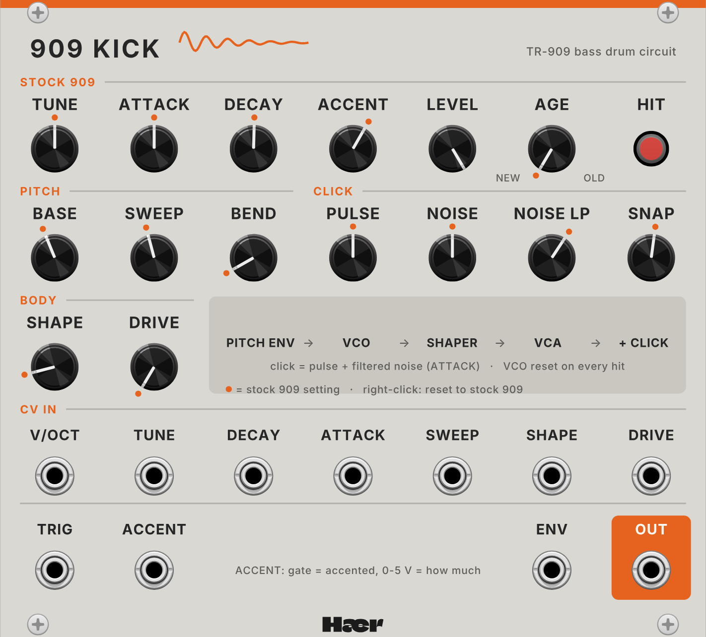

# 909 Circuits

Circuit models of the Roland TR-909's instruments, one module per instrument, in the same
spirit as [808 Circuits](../Circuit808/): a model of the stock voice first, then the circuit's
inner parts on the panel with ranges past stock. No samples are used or shipped.

Modules (all 28 HP): **909 Kick, 909 Snare, 909 Tom, 909 Rim, 909 Clap, 909 Cymbals**.

Every module has a **STOCK 909** row (the 909's own knobs, plus ACCENT, LEVEL and AGE),
the circuit controls, CV inputs (±5 V = full knob range), TRIG, ACCENT, ENV and OUT, and a HIT
button. An **orange dot** beside each knob marks the stock 909 setting; right-click →
*Reset to stock 909* puts every knob back (LEVEL and switches are left alone).

- **ACCENT** stands in for the 909's TOTAL ACCENT knob. The ACCENT jack takes a gate
  (accented) or 0-5 V (how much); it is read over 0.5 ms after the trigger so an accent that
  arrives a sample late still counts. One accent law for every voice: about +5 dB at stock.
- **AGE**: every module has a serial number (saved with the patch, re-rollable in the
  right-click menu) that sets where its parts sit inside the 909's component tolerances; AGE
  scales how far off they are, adds a little hit-to-hit drift, and past about 70 % wears the
  capacitors (shorter decays, a little hiss). AGE 0 = every unit exactly stock.
- LEVEL and AGE are never randomized.

## The voices

| Module | Circuit | Controls beyond the stock 909 |
|---|---|---|
| 909 Kick | ramp VCO reset on every hit, waveshaped towards a sine; pitch sweeps from high down to the base note (TUNE = how long); VCA with DECAY; ATTACK adds a click (square pulse + low-passed noise burst) | BASE, SWEEP, BEND (slower last drop), PULSE, NOISE, NOISE LP, SNAP, SHAPE (sine ↔ triangle ↔ ramp), DRIVE |
| 909 Snare | two swept VCOs (about 185 and 330 Hz) through one VCA, plus white noise through a high-pass and TONE low-pass into its own VCA (SNAPPY) | RATIO, BALANCE, DECAY, SWEEP, BEND, SHAPE, SNAP DEC, COLOUR, DRIVE |
| 909 Tom | the 909's three tom circuits (LOW / MID / HIGH, about 100 / 145 / 210 Hz): swept VCO, waveshaper, VCA, skin noise | SWEEP, BEND, SHAPE, NOISE, DOUBLE, TONE, MUTE, DRIVE |
| 909 Rim | three high bridged-T resonators (about 500 Hz, 1.1 kHz, 1.8 kHz) through a fast transistor VCA and a high-pass | TUNE, RATIO, RING, GATE, SNAP, STRIKE, DRIVE |
| 909 Clap | band-passed noise into a VCA from a sawtooth that fires bursts (the last rings on), plus a reverb envelope | BAND, RES, TONE, BURSTS, SPREAD, SNAP, TAIL, MIX, DRIVE |
| 909 Cymbals | the 909's 6-bit sample path: clocked DAC (TUNE = clock), BITS, reconstruction filter, analogue VCA, output high-pass | TYPE (HAT / CRASH / RIDE), METAL, NOISE, BITS, RECON, CH DEC, CUT, DRIVE |

**909 Cymbals.** On the real 909 the hats, crash and ride are 6-bit recordings in ROM. Those
recordings are Roland's, so they are not here; the module models the path around them. Its
source is a built-in synthesised metal sound (six square oscillators plus noise, with its own
decay, shaped per type) or a WAV you load (right-click → *Load sample WAV*; the path is saved
with the patch). TRIG plays the closed hat and chokes the open hat; OPEN plays the open hat
(DECAY). For crash and ride both inputs play the cymbal, and DECAY fully up leaves the
recording's own decay. At stock TUNE a loaded WAV plays at its own pitch.

**Sources and honesty.** The structures follow the TR-909 service notes' block diagrams and
the 909's widely published behaviour. Stock pitches and times are fitted, not read from
component values, and have not yet been compared with recordings of a real 909.

**Built in from the start** (lessons from the 808 Circuits DSP review): the same level at
44.1, 48 and 96 kHz (noise scaled to the sample rate), band-limited VCOs and DAC steps, the
rim's STRIKE and TUNE holding the level, clap BAND and RES holding the level, knob maths at
control rate, smoothed DRIVE and LEVEL, a DC blocker after DRIVE, NaN-safe V/OCT, and voices
that sleep when silent.

## Build

`make test` runs the offline checks (levels, accent, sample rates, 40 random and extreme
settings per voice, AGE, kick pitch, tom sizes, cymbal choke, BITS, user WAV pitch) and writes
demo WAVs to `test/out/`. `python3 res/make_voice_panels.py` draws the panels from
`res/voices.py` and writes `src/VoiceSpecs.hpp`; `python3 tools/preview_voices.py outdir`
renders previews. The repository's GitHub Action builds the plugin.

MIT licence.
