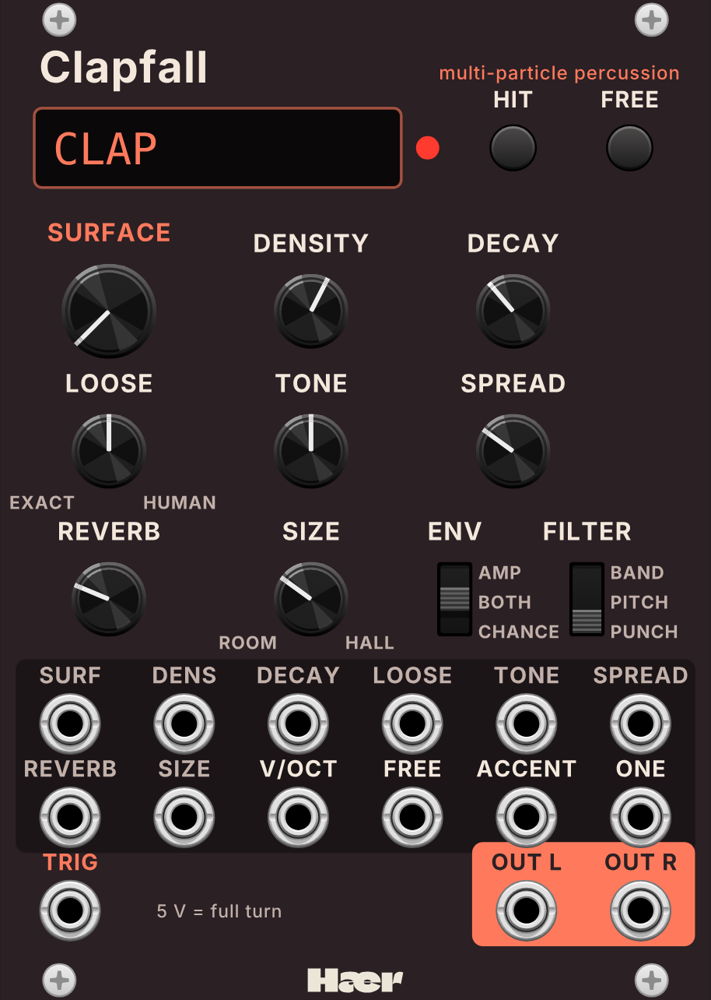

# Clapfall

**Multi-particle percussion for VCV Rack.** Plugin *Clapfall Fable* by Hær, version 2.0.0. 18 HP, stereo.

## What it is

Clapfall makes percussion out of many tiny impacts. Every trigger releases a burst of short "particles": a single hand clap, a finger snap, a stick tap, a coin, or the noise pulse inside a drum machine's clap. How many particles arrive, how long the burst lasts and how tightly they line up decide what you hear. A few particles in strict time make a classic 808 or 909 clap. A few hundred particles a second with loose timing become a room of people clapping on 2 and 4. Leave it running and it turns into applause.

None of it is sample playback. Each particle is modelled: a short burst of noise strikes a small set of resonances that stand for the object. The hand claps were fitted to measurements of real claps (flat palms ring near 1.9 kHz, an ordinary clap near 1.6 kHz, cupped hands near 700 Hz), and every surface has 24 slightly different versions, so no two particles in a row are the same. The 808 and 909 surfaces copy the drum machines' trick of three fast noise pulses followed by a longer one.

## Quick start

1. Patch a clock or sequencer gate into **TRIG** and **OUT L** to your mixer (L alone gives a mono mix).
2. Leave everything at default and press **HIT**: one person clapping a quick flam.
3. Turn **DENSITY** up for more people, **DECAY** up for a longer burst, **LOOSE** up to make them less together.
4. Turn **SURFACE** to *808* and **LOOSE** fully left for a drum-machine clap that is identical every time.

## Controls

Every knob has a CV input below it in the jack field. CV adds to the knob; **5 V turns a knob through its whole range** (so 1 V is a fifth of a turn). Hover over any control in Rack for a one-line reminder.

| Control | What it does |
|---|---|
| **SURFACE** | What each particle is. 22 built-in surfaces plus USER (your own samples). The name shows on the screen. CV of 5 V sweeps the whole list, so a sequencer can play a different surface on every step. A change applies to the next particle; ones already sounding finish. |
| **DENSITY** | Particles per second, from 1.5 to 600. Think "how many people". Around 20 is one person, 100 to 200 is a handful, 400 and up is a crowd. |
| **DECAY** | How long a burst lasts after a trigger, from 12 ms to 6 s. In FREE mode it sets the cloud's level or chance directly (see FREE). |
| **LOOSE** | From EXACT to HUMAN. Fully left, nothing is random: the particles come on a strict clock with fixed loudness, so every hit is identical, like a drum machine. Turned up, timing becomes as irregular as real people and loudness varies. Most of the change happens in the first quarter of the turn for loudness and across the whole turn for timing. |
| **TONE** | Centre of the band-pass filter, 150 Hz to 10 kHz. In the PITCH and PUNCH filter modes it also moves the pitch of the particles, two octaves either way (noon is natural pitch). |
| **SPREAD** | How far particles scatter in pitch (up to 1.5 octaves either way) and across the stereo field. Low settings sound like one person; high settings like people all around you. Very high settings smear into noise. |
| **REVERB** | Send into the built-in room / hall. The dry sound is never turned down. The reverb keeps ringing when the send closes, so an envelope into the REVERB CV jack that opens just after the hit gives a late, separate tail. |
| **SIZE** | Small room (0.25 s) to big hall (3.2 s), with darker, later reflections as it grows. |
| **ENV** switch | Where the burst's envelope goes. **AMP**: particles keep coming at a steady rate and each one is quieter, a smooth fade. **BOTH**: particles get quieter and rarer, a punchy burst with a gentle tail. **CHANCE**: particles keep their loudness but become rarer, the burst thins out. |
| **FILTER** switch | **BAND**: band-pass only; TONE sets the colour. **PITCH**: band-pass, and TONE also moves the particles' pitch. **PUNCH**: the dry sound plus the band-pass on top, for a fuller, harder clap; TONE moves pitch. PUNCH is the default. |
| **HIT** button | Same as a trigger at TRIG. |
| **FREE** button | Free-running cloud (lights yellow), see below. |
| Particle light | Red light beside the screen blinks on every particle. |

### Jacks

| Jack | What it does |
|---|---|
| **TRIG** | Starts a burst. The first particle sounds on the trigger itself, so it is tight to the beat. Threshold 2 V. |
| **ACCENT** | If this is high (above 2 V) when a trigger arrives, that burst is 1.5 times louder and its envelope 1.6 times longer. Patch the sequencer's accent gate here. |
| **ONE** | Plays a single particle at full level on each trigger, separate from any burst. Good for rimshots, ticks and ghost notes. |
| **FREE** | While this gate is above 2 V the module runs free, as if the FREE button were on. |
| **V/OCT** | 1 V per octave pitch for the particles. When patched it replaces TONE's pitch role in every filter mode (TONE still moves the filter). 0 V is natural pitch. |
| **SURF ... SIZE** | CV for the eight knobs, 5 V = full turn. |
| **OUT L / OUT R** | Stereo out, about 5 V peak for a single particle, soft-limited at 10 V. If only OUT L is patched it carries a mono mix of both sides. |

### FREE mode: continuous clouds

With FREE on, there is no burst envelope. Particles run all the time at DENSITY, and **DECAY** takes the envelope's place: with ENV on AMP it sets the level, on CHANCE it sets how likely each particle is, on BOTH it does both. At DECAY fully left the cloud is silent, so DECAY becomes a "how much" control you can ride by hand or CV. A trigger or HIT in FREE mode doesn't start a burst; it briefly pushes DENSITY up (a surge inside the cloud). ONE still works.

### Right-click menu

- **Same every hit**: every burst replays the same random choices, even with LOOSE up. Useful when you want a loose, human clap that is still repeatable. (With LOOSE fully left this happens anyway.)
- **Load sample folder...**: pick a folder of WAV files (up to 64, each trimmed to 2 s). They become the USER surface, the last SURFACE position. The folder is remembered with the patch. **Clear sample folder** removes it.

## Surfaces

| # | Surface | What it is |
|---|---|---|
| 1 | CLAP | An ordinary hand clap, palms at an angle. The reference sound. |
| 2 | PALMS | Flat palm on flat palm: brighter, harder, slappier. |
| 3 | CUPPED | Cupped hands: round, low, hollow "pock". |
| 4 | FINGERS | Fingers on palm: thin and high. |
| 5 | GROUP | A mix of the four hands, as in a real crowd. Best for groups and applause. |
| 6 | SNAP | Finger snap. |
| 7 | SLAP | Hand slap on a thigh or body. |
| 8 | STOMP | Foot stomp on a wooden floor. |
| 9 | STICKS | Drum sticks clicked together. |
| 10 | BLOCK | Wood block. |
| 11 | RIM | Rimshot click. |
| 12 | PING | Ping-pong ball. |
| 13 | SWITCH | Toggle switch, mechanical double click. |
| 14 | COINS | Coins hitting each other. |
| 15 | GLASS | Glass tap, long ring. Good for melodies with V/OCT. |
| 16 | TIN | Tin can. |
| 17 | PEBBLE | Small stones. |
| 18 | DROP | Water drop (a falling bubble). Rain in FREE mode. |
| 19 | CRACKLE | Tiny bright crackles. Vinyl surface noise in FREE mode. |
| 20 | 808 | The drum-machine clap pulse: fast noise spike then a longer tail; each new particle cuts the last one off. |
| 21 | 909 | Same idea, brighter and longer. |
| 22 | NOISE | Plain noise bursts, also cut off by the next. Build your own machine clap with TONE. |
| 23 | USER | Your own folder of samples (right-click to load). |

## Patch recipes

Knob positions are given in percent of a full turn (0 % fully left, 50 % noon, 100 % fully right). Switch positions are named. All of these assume TRIG from a sequencer and a stereo out.

### 808 clap
SURFACE **808**, DENSITY 69 %, DECAY 32 %, LOOSE 0 %, TONE 47 %, SPREAD 0 %, ENV **CHANCE**, FILTER **PUNCH**, REVERB 12 %, SIZE 20 %.
Exactly three pulses and a tail, identical every time. Push ACCENT on the last beat of the bar for the louder, longer version.

### 909 clap
SURFACE **909**, DENSITY 67 %, DECAY 38 %, LOOSE 0 %, TONE 53 %, SPREAD 0 %, ENV **CHANCE**, FILTER **PUNCH**, REVERB 20 %, SIZE 30 %.

### Late reverb clap (house)
The 909 recipe with REVERB at 0 % and SIZE 85 %. Patch an envelope (attack about 50 ms, hold 150 ms) triggered by the same gate into the **REVERB** CV jack. The dry clap stays dry and a big tail blooms just after it.

### One person
SURFACE **CLAP**, DENSITY 43 %, DECAY 0 %, LOOSE 50 %, TONE 56 %, SPREAD 5 %, ENV **BOTH**, FILTER **PUNCH**, REVERB 25 %, SIZE 20 %.
One clap, occasionally a natural flam.

### Five people on 2 and 4 (soul, funk, hip-hop)
SURFACE **GROUP**, DENSITY 79 %, DECAY 26 %, LOOSE 100 %, TONE 55 %, SPREAD 22 %, ENV **CHANCE**, FILTER **PUNCH**, REVERB 30 %, SIZE 30 %.

### Gospel room
SURFACE **GROUP**, DENSITY 94 %, DECAY 36 %, LOOSE 100 %, TONE 53 %, SPREAD 30 %, ENV **CHANCE**, FILTER **PUNCH**, REVERB 50 %, SIZE 55 %.

### Applause
SURFACE **GROUP**, FREE on, DENSITY 35 % rising to 95 %, DECAY 5 % rising to 100 %, LOOSE 100 %, TONE 58 %, SPREAD 40 %, ENV **CHANCE**, FILTER **PUNCH**, REVERB 35 %, SIZE 70 %.
Ride DECAY and DENSITY together (by hand, or one slow envelope into both CV jacks) to swell the crowd and let it die away. Hits on TRIG make a surge of extra clapping.

### Crowd into the drop (techno, house)
The Applause recipe with FREE driven by a gate that opens four bars before the drop and a slow ramp into DECAY CV. Close the gate on the drop.

### Snaps
SURFACE **SNAP**, DENSITY 62 %, DECAY 15 %, LOOSE 90 %, TONE 71 %, SPREAD 12 %, ENV **BOTH**, FILTER **PUNCH**, REVERB 30 %, SIZE 30 %.

### Rimshot and clap from one module (reggae, hip-hop)
Clap settings of your choice on TRIG; SURFACE CV switching to **RIM** for the off-beats, or simply patch a second gate into **ONE** with SURFACE on RIM and use another Clapfall for the clap. ONE ignores DECAY, so the rim stays a single click.

### Layered clap and snare
Mult the snare's trigger to TRIG. GROUP or PALMS, DENSITY around 60 %, DECAY 20 %, LOOSE 60 %, FILTER **BAND**, TONE around 60 %. Mix it under the snare; it adds the human edge without stealing the body.

### Percussion line from SURFACE
Sequence the **SURF** CV jack (steps of about 0.23 V move one surface) with LOOSE at 0 % and DECAY near 0 %. Each step plays a different object.

### Stick roll
SURFACE **STICKS**, DENSITY 49 %, DECAY 60 %, LOOSE 15 %, TONE 67 %, SPREAD 15 %, ENV **AMP**, FILTER **PUNCH**, REVERB 20 %, SIZE 30 %.

### Glass melody
SURFACE **GLASS**, DENSITY 23 %, DECAY 63 %, LOOSE 20 %, SPREAD 2 %, ENV **AMP**, FILTER **PUNCH**, REVERB 35 %, SIZE 60 %, and a sequencer's pitch into **V/OCT**.

### Rain
SURFACE **DROP**, DENSITY 55 %, DECAY 89 % (or FREE with DECAY around 50 %), LOOSE 100 %, TONE 50 %, SPREAD 60 %, ENV **CHANCE**, FILTER **PITCH**, REVERB 40 %, SIZE 60 %.

### Vinyl crackle bed
SURFACE **CRACKLE**, FREE on, DENSITY 47 %, DECAY 50 %, LOOSE 100 %, TONE 75 %, SPREAD 20 %, ENV **CHANCE**, FILTER **BAND**, REVERB 0 %. Turn it well down in the mix under drums.

### Dropped coins, ping-pong
COINS: DENSITY 64 %, DECAY 60 %, LOOSE 100 %, SPREAD 35 %, ENV **CHANCE**. PING: DENSITY 30 %, DECAY 86 %, LOOSE 30 %, ENV **AMP**: a ball bouncing slower and slower is the next thing to try, with DENSITY falling by CV during the burst.

## Your own samples

Right-click, **Load sample folder...**, and choose a folder of short WAVs: claps you recorded, hits, foley. Up to 64 files are read (in name order), mixed to mono, cut to 2 seconds and normalised. Turn SURFACE fully right to USER and they play exactly like the built-in surfaces: never the same one twice running, scattered by SPREAD, pitched by TONE or V/OCT. The screen shows how many files were loaded. Short, dry, single hits work best.

## Notes and limits

- The hands and the 808 were tuned against measurements of real recordings. The other surfaces (PING, SWITCH, COINS and so on) are modelled from general acoustics and are plausible rather than exact copies of a particular object.
- The module has no audio input, gives stereo out, is monophonic (one burst engine), and uses about 1 to 2 % of one CPU core even in dense applause.
- Clapfall is inspired by the idea of multi-particle clap synthesis, best known from WMD's Fracture Eurorack module. It has its own name, panel, particle models and code, and shares no sounds or artwork with that module.
