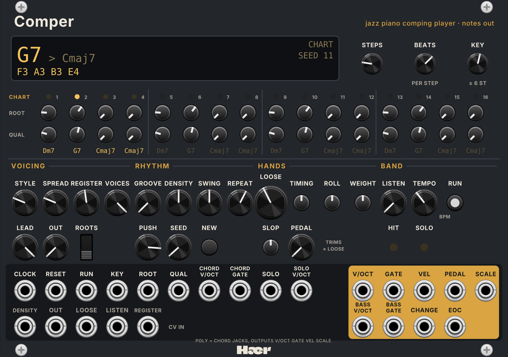
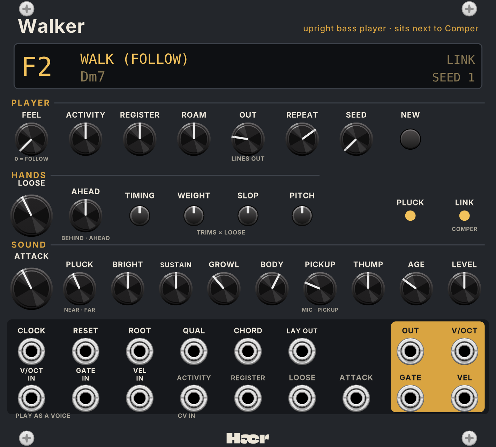

# Comper

**A jazz piano comping player for VCV Rack.** Comper Fable 2.0, by Haer.

Comping is what a jazz pianist does behind a soloist: plays the chords of the tune, but never as a block on every beat. The left hand (often both hands) picks a few notes of each chord, moves them as little as possible to the next chord, and drops them into the bar in short rhythmic figures, often a little ahead of the chord they belong to. Comper does that, and plays it with human hands.

Comper makes **notes only**. Patch its poly V/OCT, GATE and VEL into a piano (Joanna, from the same collection, is the intended partner) or any polyphonic voice.

What it is not: it does not play melody or bass lines (it does give you the bass roots and the chord scale to build them with), and it only knows 4/4.

## Quick start

1. Put Comper next to Joanna. Patch Comper **V/OCT** to Joanna V/OCT, **GATE** to GATE, **VEL** to VEL, and **PEDAL** to Joanna's SUS input.
2. Joanna's outputs to your audio interface.
3. Comper runs as soon as it is added, at 120 bpm, on a ii-V-I in C. You should hear swung piano chords.
4. Right-click Comper, open the preset menu, and try *01 Medium Swing*. Then turn **LOOSE** fully left and fully right to hear what it does.

To play along with the rest of a patch, patch a clock into **CLOCK** (one pulse per beat by default; 2, 4 or 24 per beat from the right-click menu) and a reset into **RESET**.

## Words used in this manual

- **Root**: the note a chord is named after (D in Dm7).
- **Guide tones**: the 3rd and 7th of a chord. They say whether it is major, minor or dominant, so Comper keeps them when it thins a chord out.
- **Shell voicing**: just the 3rd and 7th (sometimes one more note). The bebop pianist's left hand.
- **Rootless voicing**: four notes, 3rd, 5th, 7th and a colour note (9th or 13th), with no root. The sound of most jazz piano since the late 1950s. The bass player has the root.
- **Quartal voicing**: notes stacked in fourths. Open, modern, modal.
- **Spread voicing**: five notes over a wide range, for ballads and solo piano.
- **Voice leading**: moving each note of one chord to the nearest note of the next, so the chords connect instead of jumping.
- **Push** (anticipation): playing the next chord on the upbeat before it arrives.
- **Altered dominant** (7alt): a dominant chord with its 5th and 9th bent up or down; tense, it wants to resolve.
- **Tritone substitute**: replacing a dominant chord with the dominant six semitones away (Db7 for G7). It shares the guide tones.
- **Side-slip**: a quick chord a semitone above or below, slid into the real one.

## The chord chart

The top half of the panel is a chart of up to 16 steps. Each step has a **ROOT** (C to B) and a **QUAL** (quality) trimpot. The chord name is shown under each step, and the step that is playing lights up.

- **STEPS**: how many steps the chart has (1 to 16).
- **BEATS** per step: 1, 2, 4 or 8. Four is one chord per bar.
- **KEY**: transposes the whole chart, plus or minus six semitones. The KEY input adds V/oct (rounded to the nearest semitone) on top.

The ten qualities are maj7, 6, m7, m6, mMaj7, 7, 7alt, m7b5, dim7 and 7sus.

**Load progression** (right-click) fills the chart with one of 14 progressions: ii-V-I major, ii-V-i minor, the two together, an 8-bar jazz blues in F with two chords a bar, a 12-bar blues, falling fifths, a I-vi-ii-V turnaround, a rhythm-changes bridge, a modal two-chord vamp, a bossa, a ballad, a soul vamp, a house vamp and a single chord.

**Type a chart** (right-click): type chords separated by spaces and press Enter. `%` repeats the previous step and `|` bar lines are ignored. Spellings: C, C#, Db and so on, then maj7 (or M7, maj9), 6 (or 6/9, a bare letter), m7 (or m, -7, m9, m11), m6, mMaj7, 7 (or 9, 13), 7alt (or 7b9, 7#9, alt), m7b5, dim7 (or dim, o7), 7sus (or sus). Example: `Dm7 G7 | Cmaj7 % | Dm7b5 G7alt | Cm6 %`. If a chord can't be read, the field shows it and nothing changes. Typing sets STEPS and the ROOT and QUAL knobs; it does not change BEATS.

## Three ways to give it chords

| Source | How | What you get | What you lose |
|---|---|---|---|
| **CHART** | Nothing patched into ROOT or CHORD | Comper knows what comes next, so it can **push** chords early and pick substitutes that resolve properly | |
| **CV** | Patch **ROOT** (V/oct) and optionally **QUAL** (1 V per quality, in the order above; unpatched uses step 1's QUAL) | Chords from any sequencer | No pushes: Comper can't see the future. It plays 4 ms after each beat so cables settle |
| **POLY** | Patch **CHORD V/OCT** (and **CHORD GATE**) with a chord, from a MIDI keyboard or a poly sequencer | Comper works out the chord from the notes (any inversion, with or without the root) and comps on it | No pushes, as with CV |

POLY wins over CV, and CV wins over the chart. The display shows which source is in use.

When a CV or POLY chord changes between Comper's own hits, Comper lets go of what it is holding and, about half the time (more at high DENSITY), catches the new chord straight away, the way a pianist reacts.

## Controls

### VOICING

| Control | What it does |
|---|---|
| **STYLE** | SHELL, ROOTLESS, QUARTAL, SPREAD or MIXED (picks again every two bars). |
| **SPREAD** | Close to open. Turned up, Comper also considers *drop-2* voicings (the second note from the top dropped an octave), and prefers them toward the right. |
| **REGISTER** | Where the top note of the chords likes to sit, A4 by default. The REGISTER input adds 1 V per octave. |
| **VOICES** | The most notes in a chord, 2 to 5. Turned down, inner notes go first; the guide tones stay. |
| **LEAD** | Voice leading. Full: every chord is the nearest one to the last. Zero: chords are chosen with no memory, and jump about. |
| **OUT** | 0 plays it straight. Up: dominants are altered, sometimes replaced by their tritone substitute (most often when they resolve, most of all into a minor chord), colour voicings with a #11 or an upper-structure triad appear, and quick side-slips lead into some chords. |
| **ROOTS** | OFF (the bass has them), SOME (a low root under about half the new chords), ALL (solo piano). |

### RHYTHM

| Control | What it does |
|---|---|
| **GROOVE** | SWING, BOSSA, BALLAD (swung eighths, long chords, slow rolls), SOUL and HOUSE (sixteenths). |
| **DENSITY** | From a few long chords to busy figures. |
| **SWING** | At 0 the swing follows tempo, as real players do: nearly triplet at medium tempo, flatter when fast. Turn it to add or take away. On SOUL and HOUSE it pushes the off-sixteenths. |
| **REPEAT** | Comper plays two-bar figures. Up, it keeps a figure (with small variations); down, it reinvents it every two bars. |
| **PUSH** | How often an upbeat hit takes the coming chord (chart mode only). |
| **SEED** and **NEW** | The take. The same seed, settings and chart play the same notes. NEW picks a new seed; a new seed starts at the next bar line. |

### HANDS

| Control | What it does |
|---|---|
| **LOOSE** | One knob for the human part. At 0 Comper is a sequencer: on the grid, one velocity, chords struck together. At 1 it plays like a good pianist: a few milliseconds behind the beat, chords rolled over 4 to 18 ms (usually bottom to top), the top note louder and the inner notes softer, accents on pushed chords, a slow drift in loudness, staggered releases, the odd note dropped from a short stab and the odd ghosted chord. Up to 2.5 it gets sloppy and then drunk. The LOOSE input adds 0 to 2.5 for 0 to 10 V. |
| **TIMING, ROLL, WEIGHT, SLOP** | Trims behind LOOSE, each multiplying it for one family: timing; the chord roll; accents and top-note weight; lengths, dropped and ghosted notes. |
| **PEDAL** | Sustain pedal depth on the PEDAL output. The pedal lifts as each chord lands and catches again 70 ms later under long chords, as a pianist does. 0 never pedals. |

### BAND

| Control | What it does |
|---|---|
| **LISTEN** | With a soloist patched into **SOLO**: while the soloist plays, most of Comper's hits are dropped and the rest are short and soft; in the two and a half beats after a phrase ends, every hit of the figure plays, a little louder, and extra answers may land on the upbeats. With **SOLO V/OCT** patched as well, Comper keeps its top note at least four semitones under the soloist. |
| **TEMPO** | 40 to 260 bpm when CLOCK is unpatched. |
| **RUN** | Start and stop. The RUN input overrides it (high runs). Stopping drops every note and the pedal at once; starting carries on from where it stopped. |
| **HIT**, **SOLO** lights | A chord was played; the soloist is heard. |

**RESET** goes back to the start of the chart, lets go of everything, and (by default) replays the same take from the top. Right-click *Reset replays the same take* to turn that off.

## Inputs and outputs

| Jack | |
|---|---|
| CLOCK | Pulses per beat from the menu (1, 2, 4, 24). Comper measures the tempo from the pulses and follows changes. Until two pulses arrive it assumes 120 bpm. After a reset it waits for the next pulse. |
| RESET, RUN, KEY | As above. |
| ROOT, QUAL | CV chords. |
| CHORD V/OCT, CHORD GATE | Poly chords. With the gate unpatched, every channel counts. |
| SOLO, SOLO V/OCT | The soloist: a gate, or audio (anything over 0.5 V counts, held for 30 ms), and their pitch. |
| DENSITY, OUT, LOOSE, LISTEN, REGISTER | CV added to the knobs. |
| **V/OCT, GATE, VEL** | The notes, polyphonic, 12 channels (8 or 16 from the menu). 0 V is middle C, VEL is 0 to 10 V. Each note has its own channel, so rolled chords stay rolled. |
| **PEDAL** | 0 to 10 V sustain pedal. |
| **SCALE** | Polyphonic: the notes of the current chord's scale, one per channel. Into a quantiser, it keeps a melody in the changes. |
| **BASS V/OCT, BASS GATE** | The root of the current chord (before any substitution), from E1 to Eb2, and a gate that is high while running and drops for 5 ms at each chord change (and every bar if you tick *Bass retriggers every bar*). |
| **CHANGE, EOC** | A trigger at each chord change; a trigger when the chart starts again. |

## The 12 presets

All presets use seed 11.

| Preset | |
|---|---|
| 01 Medium Swing | Rootless voicings on a falling-fifths progression at 132. The default sound. |
| 02 Fast Bebop Shells | Three-note shells, low and tight, on a rhythm-changes bridge at 208. |
| 03 Ballad | Spread voicings, long rolled chords and pedal at 62. |
| 04 Bossa | Straight eighths, bossa figures, steady. |
| 05 Modal Quartal | Fourths on a two-chord modal vamp at 176, busy. |
| 06 Open Spread | Wide drop-2 voicings, a little out. |
| 07 Blues Shells | Shells on a 12-bar blues, loose, a little out. |
| 08 Soul Sixteenths | Sixteenth-note figures at 94. |
| 09 House Stabs | Tight offbeat stabs at 122, almost machine. Try it into House Keys. |
| 10 Out And Sparse | Few chords, all of them altered or substituted. |
| 11 Solo Piano Roots | Roots in the left hand, spread chords, pedal. No band needed. |
| 12 Duo Listening | LISTEN full. Patch a soloist into SOLO. |

## Patch recipes

**1. Trio.** Comper into Joanna. BASS V/OCT and BASS GATE into a bass voice (a plucked or sine voice with a short envelope). A drum machine clocked from the same clock as Comper. For a walking line, quantise a random walk to SCALE and let BASS V/OCT land it on beat one.

**2. Duo with a soloist.** Any melody source (a sequencer through a horn-like voice, or a MIDI keyboard) into SOLO (its gate) and SOLO V/OCT. LISTEN up. Comper leaves the phrases alone and answers in the gaps.

**3. Weighted-random melody over the changes.** A random source through a quantiser whose scale input is Comper's SCALE output (a quantiser with a poly scale input; otherwise use the notes as a weighted random table). Gate it from a probability gate. Patch the result into SOLO and SOLO V/OCT as well, and the comping makes room for it.

**4. Chords from a sequencer.** A sequencer's pitch out into ROOT, a second row into QUAL (1 V per step: 0 maj7, 2 m7, 5 dom7, 6 7alt, 7 m7b5). Comper comps over whatever it is fed. For pushes, use the chart instead.

**5. Chords from a MIDI keyboard.** MIDI-CV in polyphonic mode, V/OCT into CHORD V/OCT, GATE into CHORD GATE. Hold a chord with your left hand and Comper comps it; change chord and it follows within a few milliseconds.

**6. House stabs.** Preset 09 into House Keys (or any stab sound), clock from your drum machine. DENSITY under a slow LFO for a stab pattern that breathes. REPEAT high keeps the figure locked.

**7. Two hands.** Two Compers on the same clock and chart. One with STYLE SHELL, REGISTER low (C4), VOICES 2 to 3, DENSITY low: the left hand. The other with STYLE ROOTLESS or QUARTAL, REGISTER high (D5), DENSITY a little higher: the right. Different seeds so they don't hit together.

**8. A set that breathes.** Slow random CV (a few bars per cycle) into DENSITY and LOOSE; another into OUT, so the harmony gets more adventurous as the band gets louder.

**9. Ballad with pedal.** Preset 03 or 11. PEDAL into Joanna's SUS. Turn ROLL up for wider arpeggiated chords.

**10. Comping a pad.** Comper into a slow polyphonic pad instead of a piano, DENSITY low, LOOSE low: voice-led chord changes with no effort.

**11. Arrangement by EOC.** EOC into a counter that switches presets or charts every chorus (via a second Comper and a switch), or into the reset of a drum sequencer so everything turns around together.

**12. Machine to player.** Start a performance with LOOSE at 0 (a sequencer) and bring it up over a few minutes. The chords stay the same; the hands arrive.

## Notes

- The voicing choices, rhythm figures and timing come from a reference engine designed and measured offline (Python). The module reproduces it note for note: the build tests 99 takes against it. What it plays was checked by measurement (voice movement, density, overlap with the soloist), not by ear.
- All randomness comes from the seed. Moving a knob changes what happens from then on, never what has already been decided.
- CPU is negligible (well under one percent of one core).

---

# Walker

**An upright bass player for Comper.** Comper Fable 2.1, by Haer.

Walker is the bass player in Comper's band. Put it next to Comper and it reads Comper's chart, tempo and bar position with no cables, makes up its own bass line, and plays it on a modelled upright bass. It sends out audio, and the notes as V/OCT, GATE and VEL so you can double the line on any other voice.

It can also follow chord cables from any other sequencer, or be played as an upright bass voice from a sequencer or keyboard.

## Quick start

1. Put Walker directly to the left or right of Comper, touching it. The **LINK** light comes on.
2. Patch Walker **OUT** to a mixer or your audio interface, next to your piano.
3. That is all. Walker plays as soon as Comper runs. With **FEEL** at FOLLOW it takes its feel from Comper's GROOVE: swing walks, bossa plays bossa, and so on.
4. Try the presets in pairs: Walker's *01 Medium Swing* with Comper's *01 Medium Swing*, and so on. They are made for each other.

When Walker sits next to Comper, Comper stops playing roots in the left hand (a pianist stops playing roots when a bassist arrives). To keep them, right-click Comper and tick *Keep roots with Walker attached*.

## Words used in this chapter

- **Walking**: one note on every beat, each a step or two from the last, arriving on the root of each chord as it comes. The sound of a swinging jazz bass.
- **Two-feel**: two notes to the bar, usually root and fifth. Calmer than walking; often the first chorus of a tune.
- **Approach note**: the note just before a new chord, a half step, a scale step or a fifth away from its root, so the line leans into the chord before it arrives.
- **Skip**: an extra note on the swung upbeat between two beats.
- **Dead note**: a note the left hand damps as the right hand plucks it, so it is all thump and no pitch. A percussive skip.

## Three ways to drive it

**Next to Comper (LINK).** The chart, tempo, position and swing come from Comper, and Walker looks one chord ahead in the chart, so every approach note leans the right way. CLOCK, RESET and the chord jacks are ignored. Comper's RESET resets Walker too: the same seed, chart and settings give the same line again. If Comper is following chords from cables rather than its chart, Walker behaves as in cable mode, below.

**From cables (CABLE).** Patch a clock into **CLOCK** (pulses per beat from the right-click menu) and the chords into **ROOT** and **QUAL**, or a poly chord into **CHORD**. Walker can't see ahead in a cable, so it learns the tune: the first time through it plays a plain line on every beat, decided as the chord arrives (the display says LEARNING). Once it has heard the whole tune it plays its full line from then on, leaning into each chord because it now knows what comes next (CABLE). It needs to know how long the tune is: either send two RESET pulses (the tune is the time between them, rounded to whole bars) or set *Tune length* in the right-click menu. *Forget the learned tune* starts again.

**As a voice (PLAY).** Patch **GATE IN**, and Walker becomes an upright bass you play: each rising gate plucks the note at **V/OCT IN**, at the velocity at **VEL IN** (0 to 10 V; 0.75 when unpatched). It chooses a string and fret like a player, and a new note on the same string stops the old one. The player is silent in this mode.

## The feels

| FEEL | |
|---|---|
| FOLLOW | Takes the feel from Comper's GROOVE (SWING walks). In cable mode it walks. |
| WALK | Four to the bar, with skips, dead notes and triplet runs by ACTIVITY. |
| TWO | Two-feel: half notes, root and fifth, with pickups. |
| BALLAD | Two-feel with long notes, whole notes and vibrato. |
| BOSSA | Root, pickup, fifth, pickup: the bossa nova bass. |
| SOUL | Sixteenth-note bar figures, repeated and varied. |
| HOUSE | Offbeat house figures. |

A new feel starts at the next bar line, from the note the bass is on.

## PLAYER

- **ACTIVITY**: how busy the line is. Low: plain quarter notes. Middle: a skip or a dead note now and then. High: skips, runs and pickups everywhere. In SOUL and HOUSE it thins or fills the figure.
- **REGISTER**: the middle of the line, Bb1 to Bb2 (the default is E2). The line drifts up and down around it, from the open low E string (E1) up to G3 at most.
- **ROAM**: how far it drifts, and how much chance there is in each choice.
- **OUT**: how often the approach is chromatic, and how many outside notes there are on the way.
- **REPEAT**: in SOUL and HOUSE, how often a bar figure is kept for the next bar.
- **SEED**: a different line from the same settings. A new seed takes effect at the next bar line. **NEW** picks one at random.

## HANDS

- **LOOSE** (large knob): everything human at once. 0 is a sequencer: on the grid, every note the same. 1 is a good player. 2.5 is very loose.
- **AHEAD**: how far the bass leans in front of the beat. Jazz bass players sit a little ahead of the drummer's ride cymbal, which is a large part of what makes a band swing. At 0 the bass sits on the beat; at 1 it pushes.
- **TIMING**, **WEIGHT**, **SLOP**, **PITCH** (trims, times LOOSE): timing drift and scatter; accents (2 and 4 heavier, phrases that swell and fall); note lengths, and now and then a note that does not speak; intonation (high notes a little sharp, a scoop from below after a leap, vibrato on long notes).

The hands also choose a string and a fret for every note, as a player would. When a new note is on the same string as the one sounding, the plucking finger lands on the string just before the pluck and stops the old note dead, with a tiny tick. That is part of the sound of a real walking line.

## SOUND

The sound is a physical model of an upright bass, fitted to recordings of a real one.

- **ATTACK** (large knob): the pluck. The burst of energy as the finger pushes the string and lets it go, the finger noise, and the knock of the wooden body. 1 is as measured on a real bass. Lower is softer and rounder; higher is a harder, more slapped attack.
- **PLUCK**: where the finger plucks, from near the end of the string (thinner, more nasal) to near the middle (rounder, hollow).
- **BRIGHT**: gut strings and soft fingers to steel strings and a bright attack.
- **SUSTAIN**: how long notes ring.
- **GROWL**: the string slapping against the fingerboard on hard notes; the growl of a jazz bass.
- **BODY**: how much the wooden box resonates and rings after each note.
- **PICKUP** (MIC / PICKUP): 0 is a microphone in front of the bass; 1 is a pickup under the bridge (drier, more middle, the sound of many 1970s records).
- **THUMP**: the finger noise.
- **AGE**: old strings: duller, shorter notes, more buzz.
- **LEVEL**: output level. A loud note peaks near 5 V at LEVEL 1.

The PLUCK light flashes on every note.

## Inputs and outputs

| Jack | |
|---|---|
| CLOCK, RESET | Cable mode: the clock (pulses per beat from the menu) and reset. Two resets also mark the tune's length. |
| ROOT, QUAL | The chord in cable mode: ROOT as V/OCT (the pitch class counts), QUAL at 1 V per step in Comper's order (0 maj7, 1 6, 2 m7, 3 m6, 4 mMaj7, 5 7, 6 7alt, 7 m7b5, 8 dim7, 9 7sus). ROOT alone gives 7sus. |
| CHORD | A poly chord (V/OCT): Walker works the chord out from its notes, as Comper does. A patched ROOT overrides its root. |
| LAY OUT | A gate: the bass stops playing while it is high, and comes back on the next note after it falls. Its line carries on silently, so it comes back in the right place. |
| V/OCT IN, GATE IN, VEL IN | Played as a voice. |
| ACTIVITY, REGISTER, LOOSE, ATTACK | CV added to the knobs: 0.1 per volt (ACTIVITY), 1.2 semitones per volt (REGISTER), 0.25 per volt (LOOSE, ATTACK). |
| **OUT** | The upright bass, audio. |
| **V/OCT** | The notes, 0 V = middle C (so bass notes are negative). With *V/OCT carries slides* ticked (the default) it also carries each note's intonation, scoop and vibrato. |
| **GATE** | 10 V while a note sounds. It drops for 1 ms between notes that touch. |
| **VEL** | Velocity, 0 to 10 V. Dead notes send their notes too. |

Right-click menu: *Clock pulses per beat* and *Tune length* (cable mode), *Forget the learned tune*, *V/OCT carries slides*.

## The 12 presets

Each is made for the Comper preset with the same number and name. All use seed 11 on Comper; Walker's seed is its own.

| Preset | |
|---|---|
| 01 Medium Swing | Walking at 132, every control at its default. |
| 02 Fast Bebop Shells | Walking at 208, plainer, further ahead, shorter notes. |
| 03 Ballad | Ballad feel, long notes and vibrato, a little loose. |
| 04 Bossa | Bossa figures, kept steady, a little darker. |
| 05 Modal Quartal | Walking that roams the neck over a modal vamp. |
| 06 Open Spread | Two-feel, lower, longer notes. |
| 07 Blues Shells | A busier, looser, more chromatic blues walk with more growl. |
| 08 Soul Sixteenths | Soul figures, brighter, half pickup. |
| 09 House Stabs | House figures, almost machine, pickup-heavy and short. |
| 10 Out And Sparse | Sparse and chromatic walking on older strings. |
| 11 Solo Piano Roots | A quiet ballad bass with old strings, for a duo. |
| 12 Duo Listening | Walking for the duo preset, a little more pickup. |

## Patch recipes

**1. Piano trio.** Comper, Walker next to it, Comper into Joanna. Walker OUT and Joanna into a mixer. A drum module clocked from the same clock as Comper (Comper's CLOCK input). Pair the presets by number.

**2. Duo ballad.** Comper preset 03 or 11 with Walker preset 03 or 11, no drums. Turn AHEAD down a little and SUSTAIN up for long notes that bloom.

**3. Bass as a sequenced voice.** Any sequencer's pitch into V/OCT IN and gate into GATE IN (and velocity into VEL IN). Walker is now an upright bass. Set ATTACK and PICKUP to taste; LOOSE has no effect in this mode.

**4. Upright plus synth bass.** Walker next to Comper, its V/OCT and GATE into a synth bass voice as well as its own OUT. Mix the synth low under the upright for a fat modern sound, or mute OUT and use the line only. Untick *V/OCT carries slides* if the synth should stay perfectly in tune.

**5. From another chord sequencer.** The sequencer's clock into CLOCK, its chord root into ROOT and quality into QUAL (or its poly chord into CHORD). Set *Tune length* to the tune's length in bars, or send a reset at the top of every chorus. Walker plays plainly the first time through and properly from the second.

**6. Lay out for the solo.** A gate from a sequencer or an envelope into LAY OUT: the bass drops out for a drum break or the first chorus of a ballad and comes back exactly where it would have been.

**7. Breathing intensity.** One slow random CV into Walker's ACTIVITY and Comper's DENSITY, so the bass and piano get busier together.

## Notes and limits

- 4/4 only. Pizzicato only (no bow).
- In cable mode the first pass through a tune is plain (one note per beat, no lookahead), and a chord change in the tune is learned on the next pass.
- What Walker plays comes from a reference engine designed offline (Python). The module reproduces it note for note (97 lines are tested). The sound was fitted to recordings of a real upright and approved by ear; the module matches the reference within 0.02 dB in 62 test cases. As with Comper, the line was checked by measurement, not by ear.
- CPU: about 4% of one core for a fast walking line at 48 kHz (up to six notes ringing at once).
