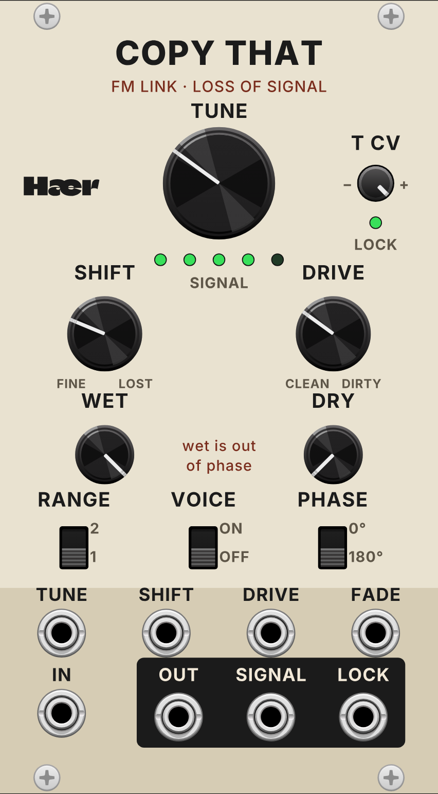

# Copy That

An FM radio link that loses the signal, for VCV Rack. Inspired by the Fairfield Circuitry
**Roger That** pedal ("a simplified FM modulator/demodulator" that mimics a radio signal
breaking up). It is a behavioural model of our own: Fairfield's circuit isn't published and
nothing here comes from it. 14 HP, polyphonic (16 voices), MIT licence.



## What happens to your sound

```
IN -> DRIVE preamp -> FM transmitter (pre-emphasis, broadcast clipper)
   -> the air: noise, mains hum, crackle, phone buzz, a neighbouring station (RANGE 2)
   -> receiver tuned by TUNE, tracking set by SHIFT (IF filter + AFC)
   -> FM discriminator -> de-emphasis -> wet (out of phase) + dry -> OUT
```

The radio is simulated the way software radios work (complex baseband), so the clicks,
hiss, distortion and squeals are not pasted on: they come from the receiver struggling
with a weak or mistuned station, just as on a real FM set. Like the pedal, the controls
are very sensitive near the point where the receiver loses the station.

## Controls

| Control | What it does |
|---|---|
| **TUNE** | The receiver dial. Fully left sits on the station; turning right drifts off it: whistle, warble, distortion, the FM "threshold" clicks, then hiss. |
| **T CV** | Attenuverter for the TUNE CV input (±5 V sweeps the whole dial). |
| **SHIFT** | How well the receiver tracks. FINE = wide IF filter and a quick, steady AFC. LOST = narrow IF (acts like a filter) and a slow AFC that overshoots and hunts. Interacts strongly with TUNE. |
| **DRIVE** | Input level into the transmitter, 0 to +30 dB: clean to dirty. Acts on wet and dry (like the pedal). |
| **WET / DRY** | Output levels. The wet is out of phase, so turning DRY up against WET cancels the clean part and leaves only the radio's damage. |
| **RANGE** | 1 normal. 2 extended: the dial passes the station and reaches a **neighbouring station** that plays your own input 130 ms late; near it the receiver flips between the two. |
| **VOICE** | 300 Hz to 3 kHz band-pass on the wet only. With the dry cancelling, this gives a mid-scoop. |
| **PHASE** | 180° (pedal behaviour) or 0° (wet in phase, no cancellation). |
| **SIGNAL lights / LOCK light** | The receiver's signal meter and whether it holds the station. |

Jacks: **TUNE, SHIFT, DRIVE** CV (SHIFT and DRIVE: 0-10 V adds the full range), **FADE**
(signal strength: 10 V full, 0 V gone, -40 dB in between; unpatched = full), **IN**,
**OUT**, **SIGNAL** (0-10 V signal strength), **LOCK** (gate). Right-click: mains hum at 60 Hz
instead of 50 Hz.

Wet and dry levels are excluded from Rack's randomize.

## Patch ideas

- Slow triangle LFO into **FADE**: a car driving out of range and back.
- Sample & hold into **TUNE CV**: channel surfing.
- **RANGE 2**, TUNE about three quarters up, play a drum loop: it stutters between the beat and its 130 ms ghost.
- DRY up to match WET, **VOICE** on: only the damage, mid-scooped.
- **LOCK** into a drum trigger or a sample-and-hold clock: the signal dropping becomes rhythm. **SIGNAL** into a filter cutoff so the rest of the patch dims when the station fades.

## Files

- `src/CopyThatDSP.hpp` the radio engine, `src/CopyThat.cpp` the Rack module
- `res/make_panel.py` draws the panel (`pip install fonttools`), `tools/preview.py` the preview picture
- `make test` runs offline checks and writes a demo WAV (no Rack needed)
