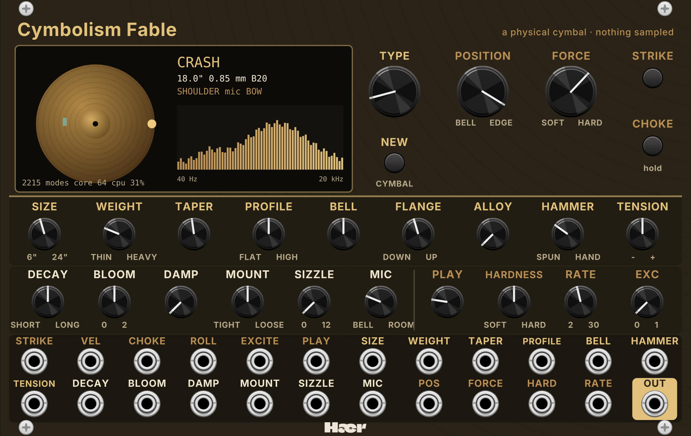
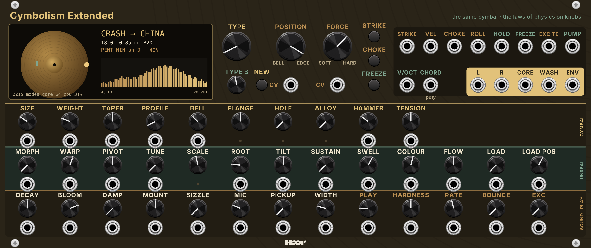

# Cymbolism Fable

A physical cymbal for VCV Rack: ten types from splash to china, computed from their
geometry (shell-of-revolution finite elements), with a nonlinear core for the crash
bloom, contact beaters (tip, shoulder, mallet, rods, brush, bow), rivets, choke, tape,
a swinging mount and a modelled mic. Nothing is sampled. 40 HP, mono.

**Cymbolism Extended** (60 HP, stereo) is the same cymbal with the laws of physics on knobs: MORPH between two types, WARP and TUNE the spectrum to scales or chords, SUSTAIN and FREEZE, slow-motion bloom, a weight on the cymbal, live tension with an audio-rate PUMP, bounce, rain, stereo mics, a contact pickup, and CORE, WASH and ENV outputs. Six more types (gong, thunder sheet, singing bowl, bell plate, ring, dome) and three more materials (aluminium, glass, wood).

- Manual: [docs/Cymbolism-Fable-Manual.pdf](docs/Cymbolism-Fable-Manual.pdf) (source `docs/guide.html`)
- Extended manual: [docs/Cymbolism-Extended-Manual.pdf](docs/Cymbolism-Extended-Manual.pdf) (source `docs/extended-guide.html`), design in [docs/EXTENDED-SPEC.md](docs/EXTENDED-SPEC.md)
- Design: [docs/BUILD-INSTRUCTIONS.md](docs/BUILD-INSTRUCTIONS.md), review in `docs/FABLE-REVIEW.md`
- Offline checks and demo WAVs (no Rack needed): `make test` (writes `test/out/`)
- Factory presets (20 per module): `python3 tools/make_presets.py` writes `presets/`, `make test` renders each one
- Panel: `python3 res/make_panel.py`; preview: `python3 tools/preview.py panel-preview.png <Rack/res/ComponentLibrary>`
- Extended panel: `python3 res/make_panel_extended.py`; preview: `python3 tools/preview_extended.py panel-preview-extended.png <Rack/res/ComponentLibrary>`

Source: `src/CyGeometry.hpp` (types, materials, profile), `src/CyModes.*` (mode solver,
coupling tensors, pickup table), `src/CyEngine.hpp` (nonlinear modal engine, beaters,
rivets, cascade), `src/CyRunner.hpp` (engine thread, background rebuilds),
`src/CyUnreal.hpp` (the UNREAL frequency laws), `src/Cymbolism.cpp` and `src/CymbolismExtended.cpp` (modules, panels, screens).
