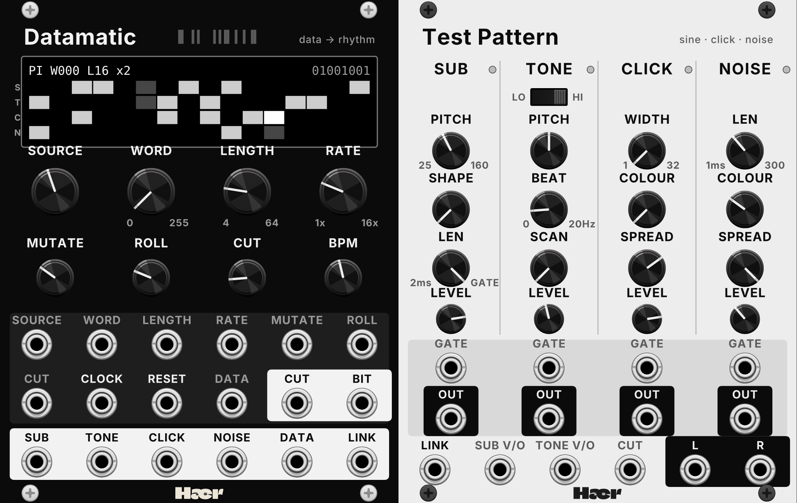

# Datamatic (VCV Rack plugin, 2.0.0)

Two modules in the spirit of Ryoji Ikeda (*test pattern*, *datamatics*): numbers become rhythm, and the rhythm plays pure, hard-edged digital sounds.

## Quick start
1. Add **Datamatic** and **Test Pattern**.
2. Patch one cable: Datamatic **LINK** → Test Pattern **LINK**.
3. Test Pattern **L / R** → your mixer or Audio module. It runs at 130 BPM on its own; patch a 16th-note clock into **CLOCK** to sync it.

## Datamatic (20 HP): data → gates
A loop of 4-64 bits is taken from a data source. Four lanes read the **same** loop in different orders and speeds, so they always interlock.

| Control | What it does |
|---|---|
| SOURCE | COUNT, PRIMES, FIB, PI, E (both as binary-coded decimal digits), TEXT (right-click to type), RANDOM (seed = WORD), INPUT (the DATA jack is sampled into the loop byte by byte) |
| WORD | Where in the data the loop starts (0-255). Turn it to scroll through pi, the primes and so on. |
| LENGTH | Loop length in bits (4-64) |
| RATE | Steps per clock: 1x, 2x, 4x, 8x, 16x. SUB always stays at 1x and TONE at half, so the low end holds while clicks go micro. |
| MUTATE | Each time the loop comes round, a bit may flip (two at high settings). Mutations stay until you change SOURCE/WORD or pick "Clear mutations" on the right-click menu. |
| ROLL | Chance that a step turns into an accelerating ratchet (sometimes over a whole clock) |
| CUT | Chance that the second half of a 16-clock bar (or all of it, at high settings) drops into total digital silence |
| BPM | Internal tempo (16ths) when nothing is patched to CLOCK |

The lanes: **SUB** reads forwards, once per clock, and runs of 1s hold the gate. **TONE** reads backwards at half RATE, only where SUB is silent. **CLICK** reads every 3rd bit at full RATE. **NOISE** needs two bits to agree, so it is sparser.

Jacks: CV for SOURCE, WORD, LENGTH, RATE, MUTATE, ROLL, CUT; CLOCK, RESET, DATA in. Outs: four lane gates, DATA (the byte under the playhead as 0-10 V, great for pitch through a quantiser), LINK (6-channel poly), CUT gate, BIT (the raw bit stream).

The screen shows each lane's pattern in the order that lane reads it, the playhead, and the current byte.

## Test Pattern (20 HP): four voices, no envelopes
| Voice | Controls |
|---|---|
| SUB | PITCH 25-160 Hz, SHAPE sine → square, LEN 2 ms → as long as the gate, LEVEL |
| TONE | LO / MID / HI zone switch (MID at noon = the 1 kHz test tone; HI = 4-18 kHz), PITCH, BEAT (detunes the right side up to 20 Hz so the two sides interfere), SCAN (the DATA byte picks a harmonic 1-16 on each note), LEVEL |
| CLICK | WIDTH 1-32 samples, COLOUR sharp → dull, SPREAD (alternate clicks hard left/right), LEVEL |
| NOISE | LEN 1-300 ms, COLOUR white → thin hiss, SPREAD mono → wide, LEVEL |

Each GATE input overrides its LINK channel, so you can drive any voice from elsewhere. SUB V/O and TONE V/O add pitch. CUT silences everything while high. Each voice has its own OUT; L / R is the stereo mix.

LINK channels: 1-4 gates SUB, TONE, CLICK, NOISE; 5 DATA; 6 CUT.

## Things to try
- **test pattern**: SOURCE COUNT, LENGTH 64, RATE 16x, TONE in HI. Turn WORD slowly.
- **Autechre drift**: PI, LENGTH 24, MUTATE 0.4, ROLL 0.2. It never quite repeats.
- **Feed it**: Marbles or K-Accumulator CV into DATA with SOURCE on INPUT.
- **Use the gates elsewhere**: SUB → Boohm, CLICK → 808 Metal, DATA → a quantiser → Just Fiends.

## Offline test + demo
`make test` runs engine checks and renders `test/datamatic-demo.wav`.

Licence: MIT.
