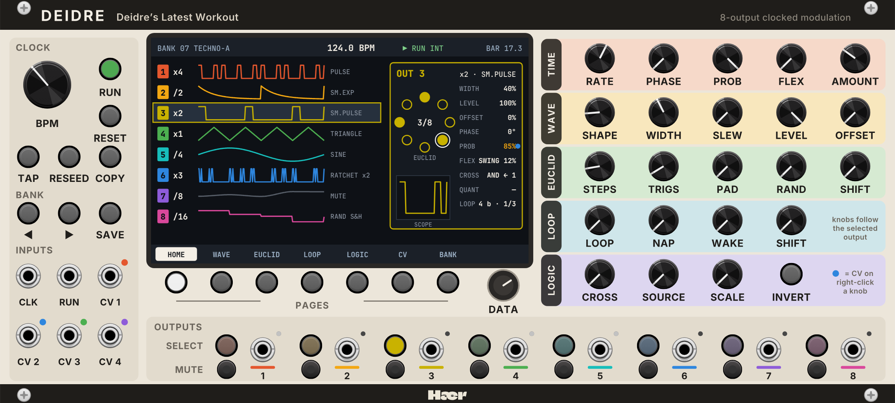

# Deidre's Latest Workout

Eight clocked modulation outputs, after Pamela's Pro Workout (ALM034, firmware 132), with
nothing hidden behind one encoder. Every per-output setting has its own knob, and a large
screen shows all eight outputs at once.

*(The preview's screen is a still from the mockup. In Rack the screen is drawn live.)*

## How it's laid out

**CLOCK (left).** BPM (10-330), RUN (stop also resets, like the hardware), RESET, TAP tempo,
RESEED (new random choices for the selected output), COPY, and BANK back / forward / SAVE.
Inputs: CLK, RUN and CV 1-4. CLK and RUN can be turned into extra CV inputs or bank
steppers on the BANK page.

**Screen (middle).** Seven pages, picked with the buttons under the screen or by clicking
the tabs. You can click almost everything on the screen. Turn DATA (drag it or scroll) to
fine-tune whatever is highlighted.

| Page | What it shows |
|---|---|
| HOME | All 8 outputs as live 4-beat waveforms. Click a lane to select it. The selected output's Euclid ring, values and scope are on the right |
| WAVE | Big scope of the selected output, plus its TIME and WAVE values |
| EUCLID | The selected output's ring, and every output's pattern as a row |
| LOOP | Loop length with a playhead, and the WAKE / NAP cycle for the next loops |
| LOGIC | Cross routing of all 8 outputs, and the quantiser keyboard. With USER 1-3 selected, click the keys to edit that scale |
| CV | Every parameter of the selected output: click the source (CV 1-4, CLK, RUN) and click or drag the amount bar (-100 to +100) |
| BANK | 64 banks: click one to load it. SAVE stores all 8 outputs and the tempo in the highlighted bank. Also CLK and RUN input modes and PPQN |

**Knob bank (right).** 22 knobs and an INVERT button. They always edit the **selected**
output, so pressing a different SELECT button moves all the knobs to that output's
settings. Touch a knob and the screen jumps to its page (you can turn this off in the
right-click menu). Right-click any knob to give it CV on the selected output. A coloured dot
on a knob means it has CV, in that CV jack's colour.

| Band | Controls |
|---|---|
| TIME | RATE (/64 to x32, plus GATE, START, STOP, OFF), PHASE, PROB, FLEX (Human, Swing, Ramp Up, Ramp Down, Hump, Delay, Pwr2), AMOUNT |
| WAVE | SHAPE (14 shapes, including firmware 131's Smooth Pulse / Exp / Log), WIDTH, SLEW, LEVEL, OFFSET |
| EUCLID | STEPS (0 = off), TRIGS, PAD, RAND (extra random hits), SHIFT |
| LOOP | LOOP (beats, 0 = off), NAP, WAKE, SHIFT |
| LOGIC | CROSS (18 operations: Mix, Mult, Add, Sub, Min, Max, Hold, S&H, Mask, Not, Or, Xor, And, BitOr, BitXor, BitAnd, Seed, Latch), SOURCE (another output or CV 1-4), SCALE (18 scales + 3 user), INVERT |

**OUTPUTS (bottom).** Each output has SELECT and MUTE buttons, a 0-5 V jack and a level
LED. Press COPY, then another output's SELECT, to copy the selected output onto it.

## Clock

With nothing in CLK, Deidre runs on its own BPM. Patch a clock into CLK (24 PPQN by
default, which matches Live's CV Tools clock; change it on the BANK page) and it follows,
starting and stopping with the clock. With RUN patched in RUN GATE mode, the gate starts and
stops it (DIN-sync style).

## What differs from the hardware

- Ranges the manual doesn't state are my choices: RATE has 31 steps rather than every ratio
  from /16384 to x192, Euclid steps go to 64, LOOP to 64 beats, NAP and WAKE to 16.
- The four triggered-envelope rate types aren't included (the manual doesn't name them).
- Two extra CV inputs (CV 3, CV 4), standing in for an Axon expander.
- SLEW works on every shape, not only the random ones.
- Mute isn't stored in banks, so you can perform mutes while changing banks.

## Build

`make` with the Rack SDK. `make test` runs the offline engine checks.
