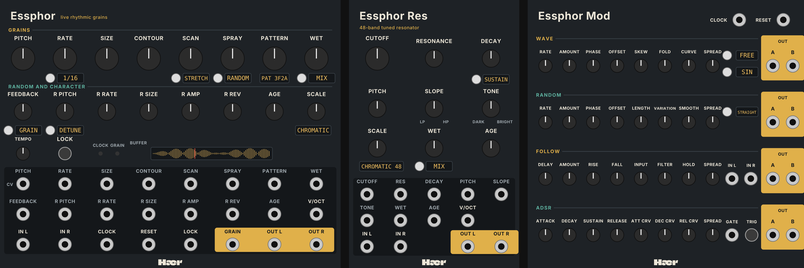

# Essphor Fable

Three VCV Rack 2 modules for live, rhythmic granular processing:

- **Essphor** (32 HP): a clock-locked granular processor that records what you play into it and plays it back as grains.
- **Essphor Res** (16 HP): a 48-band tuned filter bank and resonator that snaps to scales.
- **Essphor Mod** (26 HP): four modulators (wave, random steps, envelope follower, ADSR), each with a second "spread" output.

The modules are modelled on the granular device and the tuned resonator of a well-known four-track "sculpting sampler", with additions. They are not affiliated with that instrument or its maker. The three modules are independent: connect them with cables.

*Panel picture drawn by the build script with simple circles for knobs and jacks. In Rack you see the standard knobs and jacks.*

## Voltages

- Audio: ±5 V is full scale. Outputs are soft-limited above about ±8 V and never pass ±12 V.
- CV inputs add to their knob. ±5 V sweeps the knob's whole range and the sum is clamped to the range. There are no attenuverters; use Essphor Mod's AMOUNT or a separate attenuator.
- Gates, clocks and triggers switch at 1 V.
- Every R input follows its L input when nothing is patched to it.

---

## Essphor

### What it does

Essphor keeps recording its input into a buffer that is 4 seconds long (8 or 16 from the right-click menu). On every step of a tempo grid it starts a grain: a short window into that buffer, played at its own pitch, direction and place in the stereo field. Up to 64 grains sound at once. The output is a mix of the dry input and the grains.

Everything about a grain is decided when it starts. Turning a knob changes the next grains, not the ones already sounding, which is why fast knob moves sound smooth.

### Tempo

With nothing in **CLOCK**, the grid runs at **TEMPO** (30 to 300 BPM). With a clock patched, Essphor measures the clock and follows it, staying in phase. The right-click menu sets how many clock pulses make a beat (1, 2, 4 or 24). **RESET** restarts the beat, the grain grid and the pattern. The **CLOCK** light blinks on each beat.

If the clock stops for more than two seconds, grains keep running at the last tempo, unless you untick "Grains keep running without a clock" in the menu.

### Top row: the grain

| Control | What it does |
|---|---|
| **PITCH** | Shifts every grain by −36 to +36 semitones. CV and **V/OCT** (1 V per octave) add to it, and the total snaps to **SCALE**. |
| **RATE** | How often grains start. In SYNC (the default) it steps through 4/1, 2/1, 1/1, 1/2, 1/4, 1/8, 1/16, 1/32, 1/64 of a bar, where 1/4 is one beat. In FREE it runs from 0.25 to 250 Hz, which reaches audio rate. The small button beside it switches SYNC and FREE; the window shows the current division or frequency. |
| **SIZE** | Grain length, 1/64 of a beat to 8 beats. It follows the tempo, so the same knob setting keeps the same feel at any BPM. |
| **CONTOUR** | Shape of each grain. Left: sharp attack and a falling tail (plucks). Centre: a smooth bell. Right: a slow swell with a sharp end (reversed feel). |
| **SCAN** | Where grains read from. Its meaning depends on the mode button beside it (below). |
| **SPRAY** | Random spread in time (up to a second) and in the stereo field. The mode button chooses RANDOM, RANDOM MONO, WARP or WARP MONO. WARP replaces the random jumps with slow, smooth wandering, like warped tape. The MONO modes keep the grains in the centre. |
| **PATTERN** | A fixed 16-step pitch pattern, up to two octaves deep, applied grain by grain. It turns held chords into arpeggios. The window shows which pattern you have; "New pattern" in the menu rolls another. It is saved with the patch. |
| **WET** | MIX: crossfade from dry to grains (equal power). SEND: dry stays at full level and WET sets the grain level, for use on a mixer send. |

### SCAN modes

| Mode | SCAN knob |
|---|---|
| **STRETCH** | Speed of a playhead that moves through the buffer: −2 to +2 times real time, 0 at the centre. 0.5 plays the recent past at half speed without changing pitch (time stretch). At 0 it holds one place. Negative goes backwards. |
| **POSITION** | A fixed place in the buffer, 0 to 100%. Unlocked, this is a place in the moving buffer. Locked, it is measured from the point where the buffer froze, so 0% is the oldest audio and 100% the newest. |
| **DLY SYNC** | Distance behind the input in tempo divisions: 1/64 to 4/1, including 1/8 and 1/4 dotted. A granular delay locked to the clock. |
| **DLY FREE** | Distance behind the input in seconds, up to the buffer length. |

The knob keeps its position when you change mode; only the meaning changes.

Grains never read across the point where new audio is being written, so there is no click from the write head however you set PITCH and SIZE. Long, high-pitched grains are shortened to make room when they must.

### Second row: random and character

| Control | What it does |
|---|---|
| **FEEDBACK** | Sends the grains back into the buffer. The mode button chooses **GRAIN** (the grains are fed back through a gentle limiter; at full they build into a steady cloud without running away) or **SOS** (sound on sound: the buffer is overdubbed, keeping its old contents at FEEDBACK's level; at full it layers forever). |
| **R PITCH** | Random pitch. The mode button chooses **DETUNE** (up to ±100 cents, applied after the scale), **RANDOM** (up to ±2 octaves, snapped to the scale, with random stereo position) or **RANDOM MONO** (the same in the centre). |
| **R RATE** | Random timing of each grain, up to half a grid step early or late. The grid itself never drifts. |
| **R SIZE** | Random shortening of each grain, down to an eighth. |
| **R AMP** | Random level of each grain. |
| **R REV** | Chance that a grain plays backwards. |
| **AGE** | 0 is the clean machine. Turning it up gives an older, cheaper sampler: duller and grittier recording, hiss that gets granulated with the sound, fewer bits, slowly drifting pitch and looser timing. |
| **SCALE** | 20 scales for PITCH, PATTERN and RANDOM pitch: CHROMATIC, MAJOR, MINOR, DORIAN, LYDIAN, SUPER LOCRIAN, MIXOLYDIAN, HEX AEOLIAN, HEX DORIAN, BLUES, PENTATONIC, HIRAJOSHI, KUMOI, IWATO, WHOLE TONE, PELOG, TETRATONIC, FIFTHS, OCTAVES and FREE (no snapping). A shift of 0 is always allowed. |

### Third row

- **TEMPO**: the internal tempo, used only while CLOCK is unpatched.
- **LOCK**: freezes the buffer. Over 10 ms the recording fades into what is already there and then stops, so the loop has no click. While locked, grains keep playing from the frozen audio and FEEDBACK does nothing. The **LOCK** jack does the same while its gate is high; button and gate are combined.
- **CLOCK** and **GRAIN** lights: the beat, and each grain as it starts.
- **BUFFER** window: the buffer's contents, the write head (red; grey when locked) and a dot for each sounding grain.

### Jacks

- A CV jack for each of the fifteen knobs in the first two rows, plus **V/OCT**.
- **IN L**, **IN R**, **CLOCK**, **RESET**, **LOCK**.
- **GRAIN** out: a 1 ms, 10 V pulse each time a grain starts. Use it to trigger drums, envelopes or a sample and hold.
- **OUT L**, **OUT R**.

### Right-click menu

- **Buffer length**: 4, 8 or 16 seconds. Changing it clears the buffer.
- **Clock input**: 1, 2, 4 or 24 pulses per beat.
- **Grains keep running without a clock**.
- **New pattern**.
- **Load WAV into buffer**: reads a WAV file (8, 16, 24 or 32-bit, or float; mono or stereo), converts it to Rack's sample rate, cuts or pads it to the buffer length and locks. Unlock to start recording over it.
- **Save buffer with patch (while locked)**: when ticked and LOCK is on, the buffer is saved with the patch and comes back locked when you open it.

---

## Essphor Res

### What it does

A bank of 48 band-pass filters per channel, spread over eight octaves from C1 and tuned to a scale. With the knobs at their defaults it passes the sound almost unchanged (within a few dB). The filter controls draw a curve across the bands, so the bank behaves like a low-pass, band-pass or high-pass filter. Turn up **DECAY** and every band rings at its own note, turning noise, drums or grains into chords.

### Controls

| Control | What it does |
|---|---|
| **CUTOFF** | 20 Hz to 20 kHz. Its CV is 1 V per octave around the knob. |
| **RESONANCE** | Raises the bands near the cutoff, like a resonant filter's peak. |
| **DECAY** | How long the bands ring: from 0.05 s to 20 s at middle C, longer in the bass and shorter in the treble. The mode button chooses **SUSTAIN** (a ringing band keeps ringing when the filter moves away from it) or **CHOKE** (closing the filter silences the ringing). |
| **PITCH** | Moves the whole bank by −24 to +24 semitones, in semitone steps. CV and **V/OCT** move it smoothly. |
| **SLOPE** | Left low-pass, centre band-pass, right high-pass, with blends between. |
| **TONE** | Tilts the bank darker or brighter around 1 kHz. |
| **SCALE** | The same 20 scales as Essphor. The window shows the scale and how many bands it uses (bands that land on the same note merge: PENTATONIC 41, FIFTHS 17, OCTAVES 9). FREE spaces the bands a whole tone apart. |
| **WET** | MIX or SEND, as on Essphor. WET at 0 in MIX is a true bypass. |
| **AGE** | An old, drifting bank: each band slightly mistuned, with its own ring time and level, slowly wandering pitch, input drive and a little hiss, so long DECAY settings sing faintly on their own. Left and right age differently, which widens the sound. "New unit" in the menu draws a new set of errors. |

Jacks: **IN L**, **IN R**, **OUT L**, **OUT R**, **V/OCT** and CV for CUTOFF, RES, DECAY, PITCH, SLOPE, TONE, WET and AGE.

---

## Essphor Mod

Four modulators on one panel, each with outputs **A** and **B**. B is A shifted by that section's **SPREAD**. **CLOCK** and **RESET** at the top are shared (same pulses-per-beat menu as Essphor; without a clock the synced rates use 120 BPM).

### WAVE

Output `5 V × (OFFSET + AMOUNT × wave)`, limited to ±10 V. **RATE** has a mode button: **FREE** (0.01 to 100 Hz), or **STRAIGHT**, **TRIPLET** and **DOTTED** divisions from 8/1 to 1/64. **SHAPE** button: SIN, TRI, SQUARE. **PHASE** offsets the wave (RESET returns to it). **SKEW** leans the wave towards a ramp or a saw-like envelope. **CURVE** fattens (right) or thins (left) the peaks. **FOLD** drives the wave into a fold for extra peaks. **SPREAD** puts B up to 180° ahead of A.

### RANDOM

A looping sequence of random steps, one step per cycle of **RATE** (same modes as WAVE, default 1/8). **LENGTH** 1 to 32 steps. **VARIATION** is the chance a step is re-rolled when it comes round: 0 loops forever, 1 never repeats. **SMOOTH** glides between steps. **SPREAD** crossfades B from A's sequence to an independent second sequence. The sequences are saved with the patch; "New random sequences" in the menu rolls fresh ones.

### FOLLOW

An envelope follower on **IN L** and **IN R**. Output `10 V × AMOUNT × envelope`; a 5 V peak at INPUT 1 gives the full 10 V. **AMOUNT** below 0 turns it upside down for ducking. **RISE** (0 to 1 s) and **FALL** (0 to 4 s) set how fast it follows. **INPUT** is gain before the detector (up to 4×). **FILTER** listens to only the lows (left, low-pass from 20 kHz down to 80 Hz) or only the highs (right, high-pass from 20 Hz up to 5 kHz), so a kick or a hi-hat can drive it. **DELAY** delays the envelope by up to 0.5 s. **HOLD** samples and holds the envelope: off fully left, then clocked divisions (1/1 to 1/32) with a clock patched, or 0.5 to 50 Hz without. **SPREAD** sends A towards the left channel's envelope and B towards the right's.

### ADSR

An envelope on **GATE**, or on the **TRIG** button, which acts as a gate while held. Output 0 to 10 V. **ATTACK** and **DECAY** 1 ms to 10 s, **RELEASE** 1 ms to 20 s, **SUSTAIN** 0 to 100%. The three **CRV** knobs bend each stage: 0 is a straight line, left starts fast (logarithmic), right starts slow (exponential). **SPREAD** delays B by up to 250 ms.

---

## Presets

### Essphor

| # | Name | What it is |
|---|---|---|
| 01 | Grain Delay Eighths | Octave-up granular delay at a dotted eighth, with some feedback |
| 02 | Half Speed Cloud | The recent past at half speed, soft and wide |
| 03 | Chord To Arpeggio | Plucked grains on a pentatonic pattern: hold a chord, hear an arpeggio |
| 04 | Frozen Scan | POSITION mode. Press LOCK, then move SCAN or patch an LFO to it |
| 05 | Backwards Glass | Reversed and scattered grains in a major scale |
| 06 | Shimmer | Octave-up grains fed back into themselves |
| 07 | Warped Tape | Smooth wandering offsets and slight detune |
| 08 | Buzz Tone | Grains at 110 Hz: a pitched buzz from any input. Play RATE from a sequencer |
| 09 | Scatter | Everything random, an octave down |
| 10 | Stutter Sixteenths | Hard-edged repeats with sound-on-sound feedback |
| 11 | Octave Ghost | A swelling half-note echo an octave down, low in the mix |
| 12 | Worn Sampler | Half Speed Cloud with AGE at 70% |

### Essphor Res

| # | Name | What it is |
|---|---|---|
| 01 | Open Bank | The defaults: nearly flat |
| 02 | Low-pass Classic | A resonant low-pass at 700 Hz |
| 03 | Pentatonic Ring | Pentatonic bands ringing, half wet |
| 04 | Fifths Drone | Long ringing fifths |
| 05 | Band-pass Shimmer | Band-pass around 900 Hz with a short ring |
| 06 | Choke Sweep | Minor bank in CHOKE mode. Patch an LFO to CUTOFF |
| 07 | Bright Glass | Hirajoshi bank an octave up, tilted bright |
| 08 | Old Bank | Pentatonic Ring with AGE at 70% |

### Essphor Mod

| # | Name | What it is |
|---|---|---|
| 01 | Slow Sine And Steps | 0.1 Hz sine; random quarter-note steps with a little glide |
| 02 | Skewed Envelope Wave | A unipolar, envelope-like wave on each beat |
| 03 | Evolving Eight Steps | Eight sixteenth-note steps that slowly change, B half-independent |
| 04 | Duck And Swell | FOLLOW set to duck; a slow ADSR swell |

---

## Patch recipes

1. **Grains into the bank.** Essphor OUT L/R into Essphor Res IN L/R. Essphor on preset 03 (Chord To Arpeggio), Essphor Res on 03 (Pentatonic Ring) in the same key. The arpeggiated grains excite the bank, which rings on between them.

2. **Play the bank from a sequencer.** A melodic sequencer's pitch CV into Essphor Res **V/OCT**. Feed noise or a drum loop into IN. DECAY around 0.7, SCALE FIFTHS or OCTAVES: each note re-tunes the whole chord of resonances.

3. **Grains fire a drum.** Essphor **GRAIN** out into a drum module's trigger. With R RATE up, the drum follows the grains' loose timing exactly, because each pulse is a grain.

4. **Catch one bar.** A clock divider's one-bar gate into **LOCK** (or a gate from a sequencer step). While the gate is high the buffer holds the bar; Essphor keeps granulating it. Release and it records again, without a click.

5. **Random positions in a frozen buffer.** Essphor in POSITION mode, LOCK on. Essphor Mod **RANDOM A** into Essphor **SCAN** CV, RANDOM at 1/16 with LENGTH 8. The grains jump between eight places in the frozen audio, repeating as a pattern; raise VARIATION to let it evolve.

6. **Duck the grains.** Kick drum into Essphor Mod FOLLOW **IN L**, AMOUNT −1, RISE short, FALL about 150 ms. FOLLOW A into Essphor **WET** CV with WET set high. The grain cloud drops away on each kick and swells back between.

7. **Two Essphors, one clock.** One clock into both CLOCK inputs and one reset into both RESETs. One Essphor at RATE 1/16 and PITCH +12, the other at 1/8 dotted (DLY SYNC 1/8D) and PITCH −12, each panned with its own WET. They stay locked to each other.

8. **AGE compared.** Load preset 02 three times on the same input, with AGE at 0, 50% and 100%, and switch between them. 0 is clean; 50% is a dusty early sampler; 100% is dull, noisy and wobbly. Patch a slow WAVE into AGE CV to move between them.

9. **Scan a WAV.** Right-click, "Load WAV into buffer", choose a file. The buffer locks. STRETCH 0.25 slows it to a quarter without changing pitch; POSITION with an LFO on SCAN scrubs through it. Tick "Save buffer with patch" to keep it.

10. **Shimmer through the bank.** Essphor OUT into Essphor Res IN; Essphor Res OUT into a mixer; a mixer send back into Essphor IN along with the dry source. Essphor on preset 06 (Shimmer), Essphor Res on 07 (Bright Glass). Keep the send below unity: every pass goes up an octave and through the ringing bank.

11. **Buzz synth.** Essphor preset 08. A sequencer's pitch CV into Essphor V/OCT, an envelope from Essphor Mod ADSR into WET CV. Any held sound becomes a pitched, buzzy voice.

12. **Stereo modulation with SPREAD.** WAVE A into Essphor SPRAY CV and WAVE B into PATTERN CV with SPREAD at 0.5: the two move a quarter cycle apart.

---

## Notes

- The design was checked by measurement against Python reference models (levels, timing, pitch, ring times), not only by ear. `make test` repeats those measurements on the C++ engines; the numbers are in the test output.
- CPU: offline, Essphor with all 64 grains sounding runs about 15x real time on one core, and Essphor Res about 20x (measured on the build machine, not a Mac).
- Demo recordings made by the C++ engines are in the project files (`demos/`): the 18 design sketches and one per preset.
