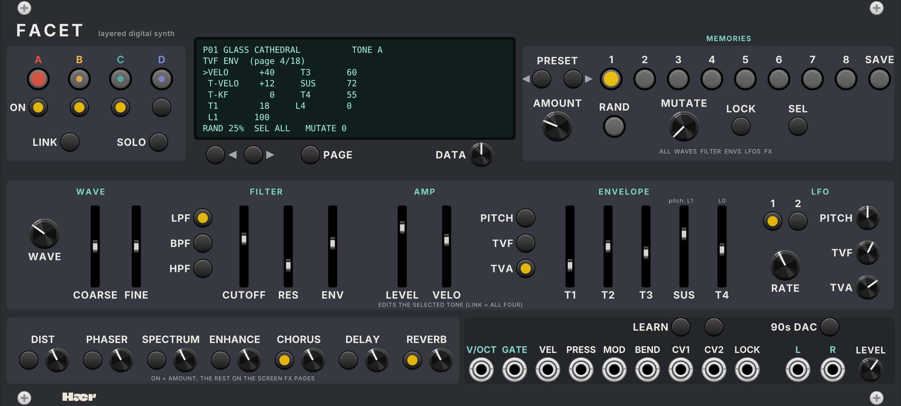

# Facet

A layered digital synth for VCV Rack in the spirit of the early-90s slider-desk synths: four tones per patch, each built from a PCM-style wave, a resonant filter, an amp and their own envelopes and LFOs, then a full effects rack. 56 HP, 16-voice polyphonic.

Every wave is our own. The ROM is built at startup from additive spectra, FM, formants, physical-model one-shots and filtered noise, so no sample data from any hardware is used.



## Signal path (per tone, four tones per voice)

```
WAVE (loop / moving / attack / noise / user) ─ TVF (LPF/BPF/HPF + env) ─ TVA (level, bias, env) ─ pan ─┐
pitch env, LFO 1, LFO 2, aftertouch, mod wheel, bend                                                    │
                                                                                                        ▼
  GROUP A (4 orders): DIST ─ PHASER ─ SPECTRUM ─ ENHANCE ─ CHORUS ─ DELAY ─ REVERB ─ 3-band EQ ─ [90s DAC] ─ LEVEL ─ L / R
```

## Waves (98)

- **16 analogue loops:** saws, squares, pulses, sync, organs, reed.
- **29 digital loops:** glass, spectra, bells, FM, vowels, combs, bitwaves.
- **15 moving waves:** these scan through 12 frames (fat saw, string ensemble, choir, vox morph, shimmer, PWM, sync sweep and others).
- **26 attacks:** one-shot transients to layer over pads (pluck, mallet, bell strike, piano attack, breath chiff, brass blat, orchestra stab and others).
- **8 noise loops.**
- **4 user slots:** use right-click > User waves to load any WAV and set it to loop or play once.

## Panel

- **Tones:** A/B/C/D pick the tone the sliders edit. ON switches a tone in or out of the patch. LINK makes every slider move edit all four tones. SOLO plays one voice, legato.
- **Screen:** 18 pages, 9 per tone and 9 for effects and common settings. These hold every parameter. PREV/NEXT move the cursor, PAGE turns the page, and DATA changes the entry under the cursor.
- **Sliders:** WAVE, COARSE, FINE; filter mode, CUTOFF, RES, ENV depth; LEVEL, VELO.
  - The envelope selector (PITCH/TVF/TVA) points the five envelope sliders at one envelope. For PITCH they are T1 T2 T3 L1 L0; for TVF and TVA they are T1 T2 T3 SUS T4.
  - The LFO selector (1/2) points RATE and the PITCH/TVF/TVA depths at one LFO.
- **Effects:** each effect has an on/off and its main amount on the panel. The rest is on the screen FX pages.
- **Presets:** the arrows step through the 96 factory presets. Right-click > Factory presets lists them by group.
- **Memories:** 8 slots that start with factory sounds. Press SAVE, then a slot, to store.
- **RAND:** nudges the current patch by AMOUNT; it does not replace it. SEL limits RAND and MUTATE to ALL, WAVES, FILTER, ENVS, LFOS or FX.
- **MUTATE:** wanders the patch a little on each note. LOCK (a button, or a gate on the jack) freezes it where it is. Right-click > Keep mutation writes the change into the patch.
- **CV1 / CV2:** press LEARN, then move any control. ±5 V covers that parameter's full range times the amount set in the right-click menu.
- **90s DAC:** a 32 kHz, 12-bit converter with a soft output stage and a 14 kHz output filter.
- **Jacks:** V/OCT, GATE, VEL, PRESS (aftertouch) and MOD/BEND inputs all accept polyphonic cables; then CV1, CV2, LOCK, and the L/R outputs (L alone gives a mono mix). The output LEVEL knob sits beside them.

## What RAND leaves alone (so patches stay in tune and playable)

- **Never randomised:** output level, octave, bend range, aftertouch bend, pitch key-follow, key ranges, solo/legato/portamento.
- **Coarse pitch** only lands on 0, ±12, +7, +19 or +24.
- **Fine pitch** stays within ±15 cents.
- **Pitch random, pitch-envelope depth and LFO pitch depth** are kept low, and MUTATE never moves pitch, including the pitch-envelope levels.
- Right-click > **Allow wild pitch** lifts these limits.

Ctrl+R does the same as RAND. Initialise (Ctrl+E) loads preset 1 and restores the 8 factory memories.

## Factory presets (96)

| Group | Presets |
|---|---|
| Glass Pads | Glass Cathedral, Ice Field, Crystal Halo, Prism Pad, Frozen Lake, Angel Glass, Digital Dawn, Quartz Bloom |
| Choirs | Cathedral Vox, Breathing Choir, Robot Monks, Ka Chant, Air Voices, Vocoderish, Low Choir, Choir Stab |
| Strings | Facet Strings, Digi Strings, Slow Strings, Pizz Ensemble, Synth Orchestra, Tremolo Strings, Cinema Strings, Bowed Glass |
| Brass | Spectral Brass, Fanfare, Soft Horns, Brass Stab 90, Fat Synth Brass, Tuba Glass, Wah Brass, Brass Section |
| Bells | Crystal Bells, Tubular Digi, Marimba Glass, Vibraphone, Kalimba Dream, Steel Sun, FM Bells, Glocken Spark |
| Keys | Digital EP, Glass Harp, Plucked Spectrum, House Keys, Clavinette, Piano Glass, Koto Digi, Mute Guitar |
| Organs | Digi Organ, Leslie Drawbars, House Organ, Church Sine, Reed Organ, Perc Organ, Digital Pipe, Dirty Organ |
| Basses | Digi Bass, Sub Sine, Acidish, Fat Square Bass, Slap Digi, Reese Drift, Wood Bass, House Bass |
| Stabs | Detroit Stab, Chord Memory, Organ Stab, Rave 92, Dub Chord, Hooverish, Piano House, String Stab |
| Leads | Glass Lead, Sync Lead, Flutish, Spectrum Lead, Digi Solo, Vocal Lead, Square Chip, Reso Lead |
| Atmospheres | Nebula, Deep Space, Metallic Drift, Slow Sweep, Underwater, Cosmic Horizon, Reversed Dream, Flying Glass |
| FX | Digital Rain, Zapper, Gated Hit, Crackle Tape, Sci-Fi Beacon, Machine Breath, Wind Chimes, Industrial |

## Building

`make` with the Rack SDK, or push and let GitHub Actions build it. `make test` checks all 96 presets, 300 random rolls, the mutation limits and CPU use, and renders demo WAVs to `test/out/` without Rack. `python3 res/make_panel.py` redraws the panel.

MIT licence.
