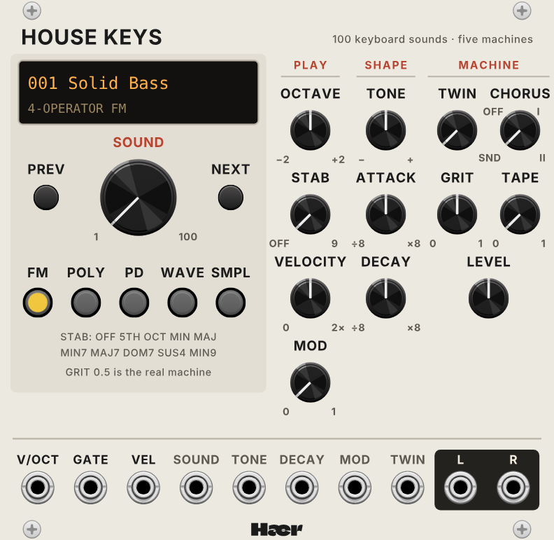

# House Keys

A polyphonic voice with 100 keyboard sounds from Detroit and Chicago records of 1986 to 1992: Derrick May, Kevin Saunderson and Mr. Fingers. It does not use samples of those records. It models the five machines the sounds came from, and plays real factory voice data where that exists.

One engine plays at a time. Pick a sound and play it from V/OCT and GATE, up to 16 voices.

## Quick start

1. Patch a polyphonic V/OCT and GATE (from MIDI-CV, or a sequencer) into **V/OCT** and **GATE**.
2. Patch **L** and **R** to your mixer. If you only patch L, it carries the mono sum.
3. Turn **SOUND**, or press an engine button to jump to its first sound.
4. Leave **GRIT** at the middle: that is the real machine.

## Controls

| Control | What it does |
|---|---|
| SOUND, PREV, NEXT | Picks one of the 100 sounds. The buttons move the knob. The display shows the number and name, and the engine below. `LOADING` appears for a moment while a sampler sound is prepared. |
| FM, POLY, PD, WAVE, SMPL | Jump to the first sound of that engine (1, 31, 55, 67, 89). The light shows the engine that is playing. |
| OCTAVE | −3 to +3 octaves, added to the sound's own octave. |
| STAB | Each key plays a chord that moves in parallel, like a sampled chord: OFF, 5TH, OCT, MIN, MAJ, MIN7, MAJ7, DOM7, SUS4, MIN9. Chord notes use voices, so a 4-note chord at polyphony 8 plays two keys at once. Chords are scaled down so they sit at the level of one note. |
| VELOCITY | How much velocity does, 0 to 200%. 100% is the sound as programmed; 0 plays everything at 64. |
| MOD | The mod wheel. Adds vibrato, or drives whatever the sound has on its wheel. |
| TONE | Brightness. The centre is the sound as programmed. On FM it changes modulator levels, elsewhere the filter or the phase-distortion depth. |
| ATTACK | Attack times ÷8 to ×8. |
| DECAY | Decay and release times ÷8 to ×8. |
| TWIN | A second unit plays every note, detuned up to ±12 cents and panned apart. At 0 it costs nothing. This is two synths layered, as on many of these records. |
| CHORUS | SND (the sound's own setting), OFF, I, II. A model of the Roland stereo chorus. |
| GRIT | The converter and the machine's age. 0 is cleaned up, 0.5 is the real machine, 1 is a worn one. |
| TAPE | Mixing down to cassette or narrow multitrack: wow and flutter, saturation that dulls loud treble, head bump, top-end loss and hiss. 0 is a true bypass. |
| LEVEL | Output level. The default is fully clockwise, 0 dB, which is also the maximum: the knob only turns the sound down. At 0 dB one note at velocity 100 peaks near 2.5 V. |

### Jacks

| Jack | |
|---|---|
| V/OCT, GATE | Polyphonic, up to 16 channels. Channel n of GATE plays channel n of V/OCT. A gate turns on above 1 V and off below 0.5 V. Pitch is followed while the gate is high, so glides and pitch CV work. |
| VEL | Polyphonic velocity, 0 to 10 V. Unpatched, notes play at a fixed velocity (see the menu). |
| SOUND | 0 to 10 V moves through all 100 sounds, added to the knob. |
| TONE, DECAY | ±5 V sweeps the whole knob range. |
| MOD, TWIN | 0 to 10 V sweeps the whole knob range. |
| L, R | Stereo out. |

### Right-click menu

- **Polyphony limit**: 4, 6, 8 (default) or 16. Most of these machines had 6 or 8 voices, and the limit is part of how they sound when chords overlap.
- **Fixed velocity when VEL is unpatched**: default is 100, or 64 for FM sounds because the DX100's keys had no velocity.
- **Load 4-operator voice bank (.syx)**: any 32-voice bank for the DX100, DX21, DX27, DX11 or TX81Z. Then **Play a voice from the bank**. The display shows `USR` and the voice name. It stays until you turn SOUND, and it is saved with the patch.

## The five engines

**FM (sounds 1 to 30).** A model of the Yamaha DX100: four operators on its sound chip, with that chip's floating-point converter. The 30 sounds are real factory voices, read from the original voice banks, so Solid Bass is the Solid Bass. LatelyBass is the TX81Z's, on that synth's chip. GRIT goes from a clean converter (0) to the DX100's (0.5) to a rougher one (1).

**POLY (31 to 54).** Roland Juno-60, Juno-106, Jupiter-6 and JX-8P, plus the Korg Poly-800. Oscillators, sub oscillator, the resonant 4-pole filter and envelopes. The Juno and JX oscillators are digitally controlled and hold pitch; the Jupiter's drift slowly. The Poly-800 has one filter shared by all its voices, so a new note retriggers the filter for everything that is sounding, and that is modelled.

**PD (55 to 66).** Casio CZ phase distortion: a cosine bent into saw, square, pulse and resonant shapes, two lines that can be detuned against each other (the Reese bass is two detuned saw lines), and the CZ's stepped amplifier and 8-bit output.

**WAVE (67 to 88).** Ensoniq SQ-80 and ESQ-1: three oscillators reading 8-bit waves, sync and ring modulation, an analog 4-pole filter, four envelopes and three LFOs. The waves are rebuilt by synthesis; Ensoniq's own wave data is not in the module.

**SAMPLER (89 to 100).** The Ensoniq Mirage: 8-bit memory, a low sample rate per sound, no smoothing between samples, and an analog 4-pole filter. The sources (strings, piano, choir, brass) are physical and spectral models "recorded" into that memory when you choose the sound. The memory and playback do most of the work of the sound.

## The 100 sounds

### FM: DX100 and TX81Z factory voices
| # | Sound | Notes |
|---|---|---|
| 1 | Solid Bass | The house bass. Detroit and Chicago, everywhere from 1987. |
| 2 | SyntheBass | Rounder, slower FM bass. |
| 3 | Mono Bass | Plain FM bass, good under busy chords. |
| 4 | Elec Bass | Electric-bass imitation with a pluck. |
| 5 | Fretless | Soft, singing bass. |
| 6 | SynthBass 1 | Bright synth bass. |
| 7 | SynthBass 2 | Darker partner to SynthBass 1. |
| 8 | Pluck Bass | Short, percussive bass. |
| 9 | LatelyBass | TX81Z. The other famous house bass preset. |
| 10 | Jazz Organ | The house organ: stabs and riffs on countless 1988 to 1992 records. |
| 11 | Ham n Eggs | Dirty organ. |
| 12 | Club Organ | Bright organ for chords. |
| 13 | 6 Tease | Thin, cutting organ. |
| 14 | Clickorgan | Organ with key click. |
| 15 | Drawbars | Full drawbar organ. |
| 16 | Organ 1 | Plain organ. |
| 17 | Organ 2 | Soft organ (quiet factory voice, trimmed up). |
| 18 | OldElectro | Electric piano, tine. |
| 19 | NewElectro | Brighter electric piano. |
| 20 | High Tines | Bell-like electric piano. |
| 21 | E Piano 1 | Classic FM electric piano. |
| 22 | Strings | FM strings. |
| 23 | Richstring | Thicker strings. |
| 24 | 5th String | Strings voiced in fifths. |
| 25 | Synvox | Synth voice. |
| 26 | Voices | Choir-like. |
| 27 | Easy Synth | Soft synth lead or pad. |
| 28 | Heavysynth | Thick synth. |
| 29 | Metal Keys | Metallic keys. |
| 30 | Hard Brass | Brass stab. |

### POLY
| # | Sound | After |
|---|---|---|
| 31 | Feel Bass | Mr. Fingers, "Can You Feel It": round, sub-heavy. |
| 32 | Feel Chords | The chords on "Can You Feel It": organ-like pulse played like strings, chorus I. |
| 33 | Mystery Bass | Mr. Fingers, "Mystery of Love". |
| 34 | Mystery Pad | Slow detuned pad, same record. |
| 35 | Washing Blips | Short resonant blips, "Washing Machine". |
| 36 | Clouds Pad | Wide PWM pad with chorus II. |
| 37 | Soft Flute | Mono flute-like lead with delayed vibrato. |
| 38 | Glass Keys | Bright, glassy keys. |
| 39 | Deep Sub | Almost pure sub bass. |
| 40 | Slow Brass | Slow detuned brass. |
| 41 | 106 Bass | Kevin Saunderson's Juno-106 bass. |
| 42 | 106 Strings | Saunderson-era Juno strings. |
| 43 | 106 Stab | Short filtered stab, chorus II. |
| 44 | 106 Pad | Pad with PWM and chorus. |
| 45 | PWM Pad | Classic pulse-width pad. |
| 46 | Sub Organ | Organ-ish square with sub. |
| 47 | Hollow Lead | Mono lead with glide. |
| 48 | Soundtrack Strings | JX-8P strings, two detuned saws. |
| 49 | JX Piano | JX-8P piano-ish keys. |
| 50 | JX Deep Bass | JX-8P bass. |
| 51 | 800 Bass | Poly-800 bass. |
| 52 | 800 Strings | Poly-800 strings with its shared filter. |
| 53 | Sync Lead | Jupiter-6 sync sweep. |
| 54 | Jupiter Stab | Jupiter-6 stab. |

### PD
| # | Sound | After |
|---|---|---|
| 55 | Reese Bass | Kevin Saunderson's Reese: two detuned saw lines. |
| 56 | Reese Single | One line, no detune: the bass before the beating. |
| 57 | Good Life Keys | Inner City, "Good Life". |
| 58 | PD Brass Stab | CZ brass. |
| 59 | PD Electric Piano | CZ electric piano. |
| 60 | PD Organ | CZ organ. |
| 61 | Resonant Bass | CZ resonant-wave bass. |
| 62 | PD Strings | CZ strings. |
| 63 | PD Vibes | CZ vibes. |
| 64 | PD Lead | CZ lead. |
| 65 | PD Clav | CZ clavinet. |
| 66 | PD Bell | CZ bell (ring modulation). |

### WAVE (SQ-80 style)
67 Digital Piano, 68 Wave Bass, 69 Square Bass, 70 Grit Bass, 71 Slap Bass, 72 Analog Strings, 73 Formant Voices, 74 Alien Choir, 75 Glint Pad, 76 Breath Pad, 77 Steam Pad, 78 Bell Keys, 79 Metal Chime, 80 Wave Organ, 81 Reed, 82 Wave Brass, 83 Wave Clav, 84 Wave Sync Lead, 85 AM Bells, 86 Pluck and Pad, 87 Wave Vibes, 88 Wave Electric Piano. These are SQ-80 style programs by type, built for the SQ-80 sounds you asked for; they are not copies of named factory programs.

### SAMPLER (Mirage chain)
| # | Sound | After |
|---|---|---|
| 89 | Life Strings | Derrick May, "Strings of Life": hard attack, quiet sustain. |
| 90 | Sustained Strings | Same section, held. |
| 91 | Low-Rate Strings | Strings at 10 kHz: dark and grainy. |
| 92 | Cello | Low strings. |
| 93 | Life Piano | The piano on "Strings of Life". |
| 94 | Dark Piano | Duller piano. |
| 95 | Choir | Sampled-choir pad. |
| 96 | Brass Section | Sampled brass. |
| 97 | Orchestra Stab | The orchestra hit. |
| 98 | Upright Bass | Plucked double bass. |
| 99 | Sampled Vibes | Vibraphone. |
| 100 | Chord Stab | A minor-7 chord sampled on one key: plays in parallel. |

## Patch recipes

1. **Solid Bass riff with TWIN.** Sound 1, OCTAVE 0, TWIN about 0.3, CHORUS OFF. A 16th-note sequence around A1. TWIN gives the two-synths-layered width of many 1988 records without smearing the attack.
2. **Jazz Organ stabs.** Sound 10, STAB on MIN7, VELOCITY 100%. Play single notes on the off-beats; the chord follows in parallel, the way a sampled stab did. Try TAPE at 0.2.
3. **Reese bass.** Sound 55, OCTAVE −1 if your sequence sits at C2. Long notes, DECAY to the right. Raise TONE slowly for the movement. Sound 56 next to it shows the bass with no beating.
4. **Mr. Fingers bass and chords.** Two House Keys: one on 31 Feel Bass, one on 32 Feel Chords. Feed both into a mixer and put TAPE around 0.35 on both. Chorus on the chords only. This is the "Can You Feel It" pairing: a cheap mixdown to cassette is part of the sound.
5. **Life Strings and Life Piano.** Sound 89 on long held minor chords, sound 93 on a second module playing the stabs. GRIT 0.5. For the darker, grainier take use 91 Low-Rate Strings instead of 89.
6. **SQ-style pad.** Sound 75 Glint Pad or 76 Breath Pad, ATTACK to the right, MOD at 0.2 for a little vibrato, CHORUS I. Slow chords, polyphony 8.
7. **Cassette-era setup.** Any sound, GRIT at 0.75, TAPE at 0.6. The tape's saturation takes the top off loud notes first, which makes stabs sit back in a mix.
8. **Loading a 4-operator voice.** Right-click, *Load 4-operator voice bank (.syx)*, choose a DX100, DX21, DX27, DX11 or TX81Z bank, then *Play a voice from the bank*. The display shows `USR` and the name. Turn SOUND to leave it.
9. **Poly-800 shared filter.** Sound 52 800 Strings. Play a held chord, then add a note: the filter envelope restarts for every sounding note, as on the real Poly-800.
10. **Sound per step.** Sequence the SOUND CV (0 to 10 V spans the 100 sounds). Sounds change after a 20 ms fade, and held notes restart on the new sound.

## What is modelled and what is estimated

This page is honest about where the module is exact and where it is a best estimate.

**Exact, or very close**
- The 30 FM voices are the original factory voice data, decoded and written to a model of the chip's registers. The chip core is ymfm (Aaron Giles, BSD licence), an accurate emulation of the Yamaha OPM-family chips.
- Note pitch on FM is within 2 cents of the real machine (tested). The operator frequency-ratio table and voice decoding are tested against the documented values.
- STAB chord intervals, polyphony limits and voice stealing behave like the hardware.

**Modelled from published circuits and measurements, with estimated constants**
- The DX100 converter's exact noise and stepping (GRIT 0.5), and the TX81Z's.
- The Roland filter, oscillators and chorus rates and delays. Chorus rates are from published Juno-60 measurements (tested within 2%).
- The Jupiter-6's oscillator drift; the Poly-800's shared filter.
- The CZ's stepped amplifier and its converter.
- The SQ-80 envelope time and LFO speed curves. **One known doubt:** with the current LFO speed curve, the delayed vibrato in Analog Strings, Formant Voices, Reed and Wave Sync Lead runs at about 0.6 Hz. That is a slow wobble, more than a vibrato. It is one constant and may change after review.
- The tape stage (wow, flutter, saturation, head bump, hiss) is a general cassette model, not a particular deck.

**Rebuilt, not copied**
- The SQ-80's waves and the Mirage's samples are Ensoniq's and are not in the module. The waves are rebuilt by synthesis; simple shapes are very close, sampled attacks (pick, slap, chiff) less so.
- The Mirage sources (strings, piano, choir, brass, orchestra hit, upright bass, vibes) are models of the instruments, recorded into a model of the Mirage's 8-bit memory. They are not the Mirage library disks.
- The POLY, PD, WAVE and SAMPLER sounds named after records are built from the documented machine and how it was used. They were not fitted to the records by measurement. Clips of the sounds that matter most would let them be fitted.

**Loudness:** every sound is trimmed so one note at velocity 100 peaks at the same level, so you can flick through sounds without riding the fader.

## Credits and licences

House Keys is GPL-3.0-or-later. The FM chip core is ymfm by Aaron Giles, BSD 3-clause (`LICENSE-ymfm.txt`). The 4-operator factory voice banks are parameter data, not audio. Panel text: Inter. Display: Share Tech Mono, from Rack.
