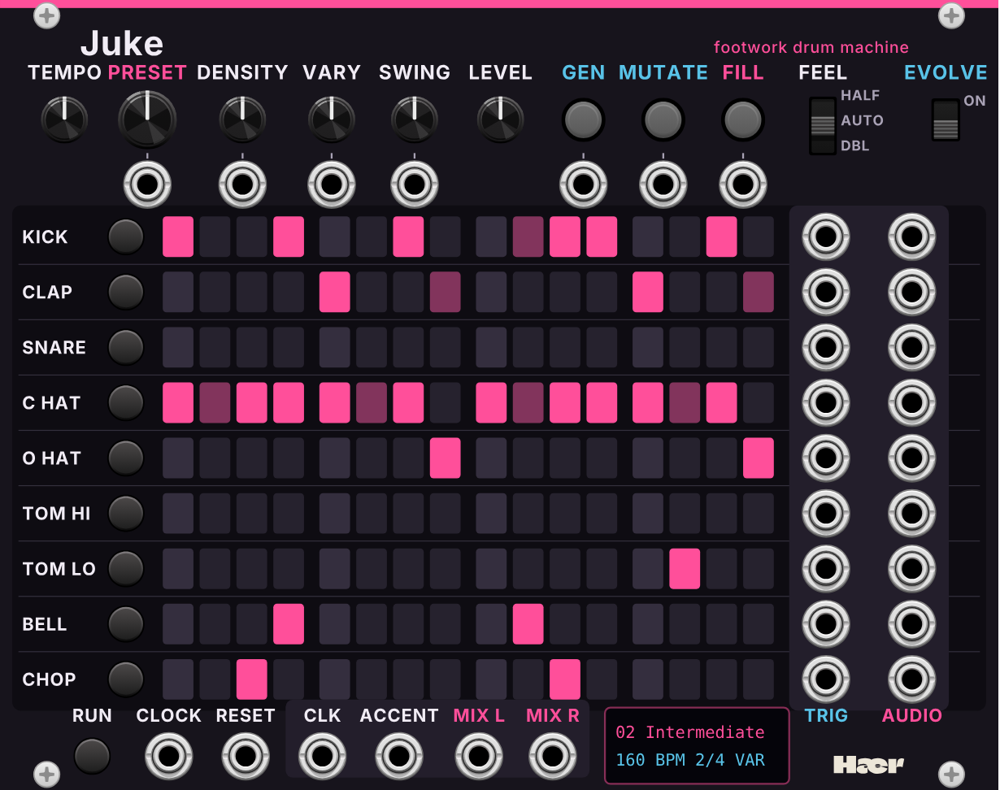

# Juke

Footwork / juke drum machine for VCV Rack 2 (32 HP), built around 160 BPM and the
3-3-2 kick feel. Nine synthesised voices (kick, clap, snare, closed and open hat, hi and
lo tom, cowbell, vocal chop), each with a trigger out and an audio out, plus a stereo mix.

## Playing it

- **Grid**: click a step to cycle off, hit, ghost. The grid shows the bar being played.
- **PRESET** (and its CV, 0-10 V across the list) loads one of 14 patterns: the guide's
  Basic, Intermediate, Roll / fill and 3-3-2 vs 4, then Half-time heavy, Juke drive, Tom
  runner, Chop stutter, Cowbell hook, Ghost shuffle, Broken 3-3-2, Clap roll build, Sparse
  intro and Blank. Only a change of preset loads it, so your edits stay put.
- **GEN** writes a new bar in the style. DENSITY sets how busy it is, FEEL picks
  half-time (clap on 9), double-time (claps on 5 and 13) or either. The screen shows the
  seed.
- **MUTATE** makes small changes that keep the style: kicks nudged a step, hits and
  ghosts swapped, percussion rotated, stutters. VARY sets how many changes.
- **FILL** turns the second half of this bar (or the next one, if you're past step 9)
  into a roll: snare, clap, toms or chop.
- **EVOLVE** plays phrases (4 bars, or 8 / 16 from the menu): the base bar, variations,
  then a fill. The base drifts a little every phrase.
- **Mute** buttons on each row silence that lane's trigger and sound.
- **Clock**: runs on its own at TEMPO (160 BPM default) while RUN is lit. Patch 16ths
  into CLOCK to override it. CLK out sends 16ths either way. SWING delays the off 16ths
  (50-75%).
- **ACCENT** out: a CV of how busy each step is, for modulating anything else.
- Ghost-note triggers are 5 V by default (menu: off, 5 V or 10 V).

The generator is the same code as the browser prototype, so a seed with the same
density and feel gives the same bar in both.

Build: `make dist RACK_DIR=...`. Engine checks and a demo WAV without Rack: `make test`.
Panel: `python3 res/make_panel.py` (needs fonttools). MIT licence.
