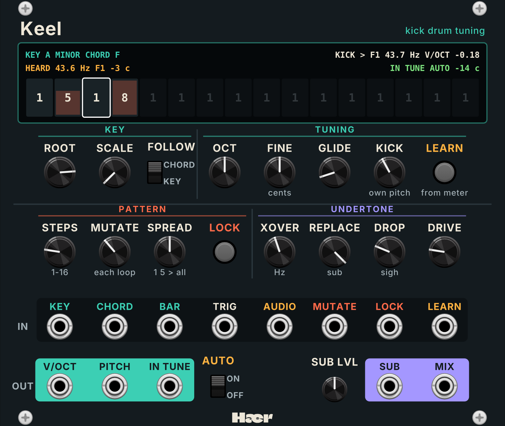

# Keel

Keel keeps a kick drum in the key of the track. It is one 30 HP module with four parts:

- **KEY and TUNING**: picks the note the kick should sit on and sends a V/OCT voltage to any kick with a V/OCT input.
- **PATTERN**: up to 16 steps of intervals (root, 5th, 4th, octave, 3rd, 7th) that move on with every kick, with MUTATE and LOCK.
- **METER**: listens to the kick, shows the pitch it really plays and how far that is from the target. AUTO corrects it and LEARN finds the kick's own pitch.
- **UNDERTONE**: swaps the kick's low end for a sub tone tuned to the target. This works for samples and hardware kicks that can't be retuned.

## Why

The classic Roland kicks have a fixed pitch. The 808 and the 909 both settle on about 49.5 Hz, a slightly sharp G1, and the 909's TUNE knob only changes how high the click starts. A 606 rings at about 60 Hz, and a 707 is a fixed sample that ends near 58 Hz. Short kicks below 60 Hz barely read as a note, but a long, boomy kick a semitone off the bassline beats against it. Keel moves the kick to the key instead of the key to the kick.

## Quick start (any kick with V/OCT)

1. Patch your kick trigger to the kick **and** to Keel's **TRIG**.
2. Patch Keel's **V/OCT** out to the kick's V/OCT in (808 Circuits, 909 Circuits, Boohm in tracking mode, Thunder).
3. Set **ROOT** and **SCALE** to the track's key. The screen shows the note, for example "KICK > A1 55.0 Hz".

Keel puts the note in the octave nearest the kick's own pitch (**KICK** knob, 49.5 Hz for 808 and 909 Circuits), so the kick never moves more than six semitones and keeps its character. **OCT** moves it by whole octaves and **FINE** by cents.

## Following chords

- Patch the chord (poly V/OCT, from the Hapax through a MIDI-CV, or from Changes) to **CHORD** and flip **FOLLOW** up to CHORD. The kick takes the chord's lowest note.
- Patch a bar clock to **BAR** and key or chord changes wait for the downbeat.
- Changes always land on the next **TRIG**, so a ringing kick is never bent halfway through. **GLIDE** slides between notes if you want that bend.
- **KEY** in takes a V/OCT root (any octave) and overrides the ROOT knob.

## Pattern, MUTATE and LOCK

- **STEPS** 1 is the default: the kick always plays the root. With 2 to 16 steps, each kick moves to the next step.
- Click a step on the screen to change its interval; Shift-click goes back.
- **MUTATE** is the chance each step re-rolls at the end of every loop. **SPREAD** sets what it can roll: low means roots and a few 5ths, high means 5ths, 4ths, octaves, 3rds and 7ths as well. 3rds and 7ths follow the SCALE (minor or major).
- **LOCK** (button or gate) freezes the pattern when you like it.

## Meter, AUTO and LEARN

Patch the kick's audio to **AUDIO**. After each hit Keel ignores the click, measures the body and shows "HEARD 49.3 Hz G1 +10 c" plus IN TUNE, SHARP or FLAT. **IN TUNE** out is 10 V while the last hit was within 15 cents.

- **LEARN** (button or trigger): sets the KICK knob to the kick's real pitch at 0 V. Use it once for any kick Keel doesn't know.
- **AUTO** on: after every hit Keel nudges its V/OCT so the next hit lands on the note. It gets there in two or three hits.
- With no TRIG patched, Keel spots the hits in the audio itself.

## Undertone

With AUDIO patched, **MIX** out is the kick with everything below **XOVER** replaced by a sine at the target note. It keeps the kick's own click and top, and its envelope follows the kick's low end so the length stays the same.

- **REPLACE**: 0 is the kick as it was, 1 is all tuned sub.
- **DROP**: the sub starts this many semitones sharp and falls into the note in about 20 ms, like an 808's sigh.
- **DRIVE**: soft harmonics so the sub carries on small speakers.
- **SUB LVL**, and **SUB** out on its own for a separate channel.

## Patch ideas

- **Static tune**: TRIG and V/OCT only, STEPS 1. The kick sits on the root of the track.
- **Hardware kick**: Bohm or 810 kick into the disting NT, into AUDIO; take MIX back out. Use REPLACE about 0.7 so the kick keeps some of its own body.
- **Moving low end**: STEPS 4, SPREAD 0, MUTATE 30%. Roots and 5ths wander every bar; LOCK when it grooves.
- **Bass from the kick**: PITCH out to a bass voice so bass and kick share one note.

## Building

`make` with the Rack SDK. `make test` runs offline checks (no Rack needed): the meter reads swept kicks exactly at 44.1, 48 and 96 kHz, notes are placed correctly in every key, MUTATE and LOCK behave, AUTO pulls an unknown kick into tune and LEARN finds it, and UNDERTONE retunes the body. `./test/render kick.wav` measures any 16-bit WAV kick.

Panel: `python3 res/make_panel.py` (needs fonttools). Preview: `python3 tools/preview.py panel-preview.png`.

MIT licence.
