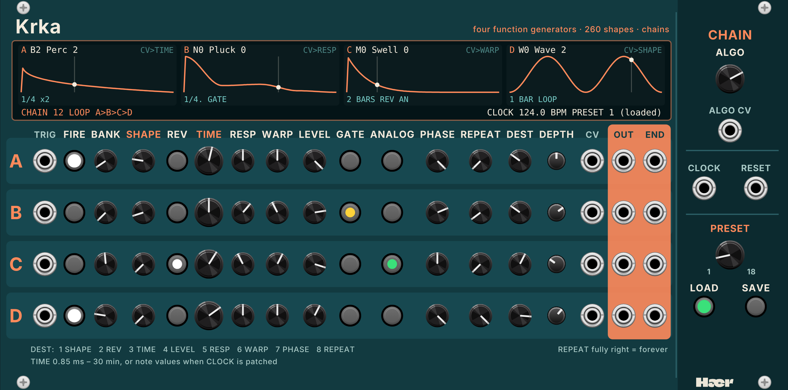

# Krka

Four function generators (envelopes, LFOs, one-shot shapes) with a library of
260 drawn shapes, chains, assignable CV and 18 presets. It does what a quad
complex envelope generator such as the XAOC Zadar does, but every parameter has
its own knob, so there are no menus. The shapes, code and panel are our own.

## Each row (channels A-D)

| Control | What it does |
|---|---|
| TRIG / FIRE | Trigger or gate in, and a manual button |
| BANK, SHAPE | Pick one of 260 shapes: bank A-Z, shape 0-9 (sheet: [docs/shapes-sheet.png](docs/shapes-sheet.png)) |
| REV | Play the shape backwards |
| TIME | 0.85 ms to 30 min. With CLOCK patched it picks note values from 1/32 to 16 bars |
| RESP | Bends the level axis (fatter or thinner) |
| WARP | Bends the time axis (early or late) |
| LEVEL | Output level (0-10 V at full) |
| GATE | Lit: while TRIG is high, the shape stops at its peak and waits; it finishes after the gate is released |
| ANALOG | Lit: a new trigger carries on from the level it is at instead of jumping back to the start |
| PHASE | In a chain: start when the channel before reaches this far through its cycle (100 % = when it ends) |
| REPEAT | Play the shape this many more times; fully right = forever (an LFO) |
| DEST, DEPTH, CV | The CV input goes to one parameter: 1 SHAPE (1 V = one bank), 2 REV (flips above a threshold), 3 TIME (1 V/oct, + = longer), 4 LEVEL, 5 RESP, 6 WARP, 7 PHASE, 8 REPEAT. DEPTH is an attenuverter |
| OUT, END | The envelope, and a trigger when the run ends (every cycle with REPEAT forever) |

## Chains (ALGO)

1 FREE · 2 A>B · 3 A>B C>D · 4 A>B>C · 5 A>B>C>D · 6 A>B+C · 7 A>B+C+D · 8 A>B>C+D ·
9 LOOP A>B · 10 LOOP A>B C>D · 11 LOOP A>B>C · 12 LOOP A>B>C>D · 13 A then LOOP B>C>D ·
14 A>B then LOOP C>D · 15 LOOP A>C B>D · 16 A>B+C+D, D>A

A channel that is started by an earlier channel ignores its own TRIG input. Chain
heads and loop heads still listen. ALGO CV: 1 V = 1.6 algorithms.

## Clock, reset, presets

CLOCK (1, 2, 4 or 24 pulses per beat, right-click) turns TIME into note values. A
channel can ignore the clock (right-click). RESET stops every channel.
PRESET picks a slot 1-18; SAVE stores everything, LOAD recalls it (LOAD lights
when the slot holds something).

## Building

`python3 res/make_shapes.py` regenerates the shape library, `python3 res/make_panel.py`
the panel and `src/KrkaLayout.hpp`, `make test` runs the engine checks.
MIT licence.
