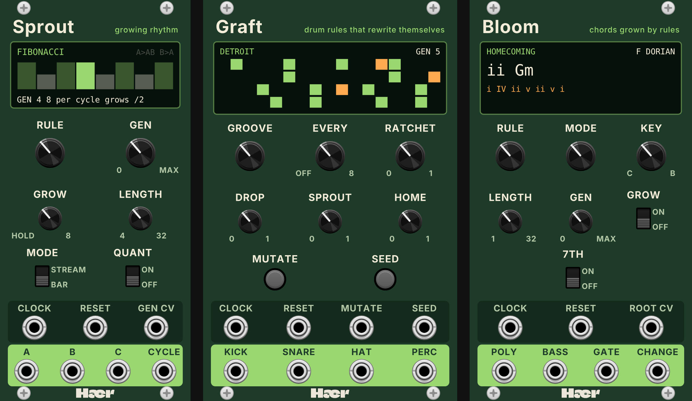

# Lindenmayer

Three quick L-system sketches, made so we can hear whether the idea is worth
taking further. Clock them all with 16ths.

## Sprout: a rhythm that grows
A rule like Fibonacci (`A>AB B>A`) grows a string: A, AB, ABA, ABAAB, ABAABABA...
In **BAR** mode the current generation is spread evenly over one cycle (LENGTH
clocks), so each generation packs more, finer hits into the same bar. Some land
between clocks unless QUANT is on. **GROW** steps up a generation every N
cycles and starts again from **GEN** when the string gets too dense (48 hits).
**STREAM** mode reads one symbol per clock from the endless word instead. It
never loops, but it always sounds related. Rules: Fibonacci, Thue-Morse,
Doubling, Cantor, Tribonacci (3 symbols), Padovan (3 symbols). Outs: A, B, C
triggers and CYCLE. GEN CV is 1 V per generation and overrides GROW.

## Graft: drum rules that rewrite themselves
A four-lane groove (Detroit, Electro, Break or Broken). Every EVERY bars, each
step is rewritten once by chance rules, like one generation of a stochastic
L-system:
- **RATCHET**: a hit splits into two at half length (x → xx), up to four per step.
- **DROP**: a hit disappears. The kick on the beat is never dropped.
- **SPROUT**: a rest grows a hit, sometimes on the off half of the step.
- **HOME**: the step goes back to the seed, so the groove stays related.

MUTATE (button or trigger) runs a generation now. SEED goes back to the groove as
written. The screen shows changed steps in amber. The grown pattern is saved with
the patch.

## Bloom: chords grown by rules
Rules on scale degrees, for example HOMECOMING `1>14 4>25 5>51` grows
i → i IV → i IV ii v → i IV ii v ii v i... Each chord lasts LENGTH clocks. With
**GROW** on, the next generation plays after each full pass, and it starts again
from **GEN** when the progression passes 32 chords. Rules: Homecoming,
Falling, Circle, Fibonacci, Drift and Two Step. Modes: major, Dorian, minor,
Mixolydian, Phrygian and Lydian. KEY sets the root, 7TH switches to seventh
chords, and the voicing moves as little as it can. Outs: POLY (3 or 4 voices),
BASS, GATE and CHANGE. ROOT CV transposes in semitones.

## Demos
`make test` renders WAVs from the real engines with plain drum and pad voices:
`test/sprout-demo.wav`, `graft-demo.wav`, `bloom-demo.wav` and `together-demo.wav`.

MIT licence.
