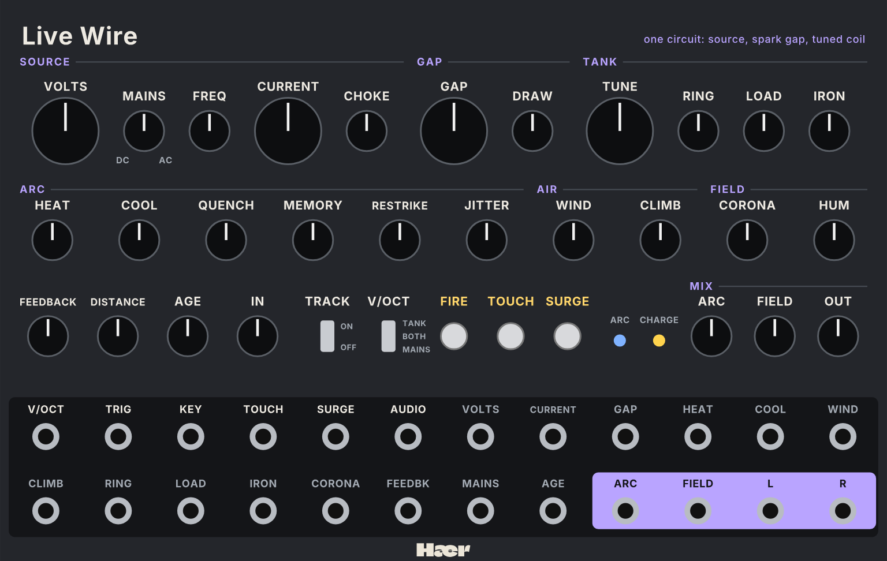

# Live Wire Fable

One VCV Rack module, **Live Wire** (40 HP): one live electrical circuit. A source (DC, mains AC or both) feeds a spark gap through a ballast and a choke; across the gap sit an arc, a saturating coil-and-capacitor tank and corona. Buzzing arcs that sputter and tear, a Jacob's ladder, a singing arc that tracks V/OCT, sparks as drums, corona sizzle and transformer hum.

Design and reference engine by Fable (`docs/BUILD-INSTRUCTIONS.md`, `tools/proto/`), build by Opus. Manual: `docs/MANUAL.md` and `docs/LiveWire-Manual.pdf`.

## Build

`make dist RACK_DIR=...` as for any Rack plugin. The repository workflow builds it for Apple silicon.

## Tests

`make test` (no Rack needed): mapping round trip; port fidelity (the C++ engine against the C reference on the `arc` and `kit2` scenes: they agree exactly, sample for sample); 11 fuzz runs of 30 s with every control random (48, 44.1, 96 and 192 kHz: no NaN, no guard events); CPU; all 22 presets with a driver each (not silent, not clipped, no guards); the singing presets' pitch at 0 V and over four octaves. `make tune` prints the singing pitch; `make demos` renders the scenes and presets.

## Changes from the spec

- Preset levels: OUT, ARC and FIELD adjusted so loud moments peak at 5 to 9 V (Runaway Ladder, Fault, Mains Hum turned down; Singing Arc, Starved Arc, Relaxation Buzz, Geiger, Plasma Speaker up).
- Relaxation Buzz: CURRENT 0.05 instead of 0.2. At 0.2 the supply holds a steady arc and it goes silent. It buzzes at about 1.8 kHz and the rate depends only weakly on CURRENT, so the manual does not promise CURRENT as a rate control.
- Plasma Speaker (UNTESTED in the spec): IN 1.6 (knob about 89%) and OUT 2.0 so the audio actually comes through. Tested only with a synthetic drum loop, not by ear.
- Singing presets tuned to C4 at 0 V on FIELD (measured): TUNE offsets of -128, -365, -120 and +252 cents for Singing Arc, Starved Arc, Iron Throat and Howl. Tracking over C2 to C6 stays within 33 cents (Starved Arc wanders most).
- Test tolerance for singing octaves is 40 cents rather than a tighter figure, for the same reason.
- CPU: Init costs about 16% of one core of the Linux build container at 48 kHz (single thread, `-O2`). Not measured in Rack on Apple silicon; no optimisation was done, to keep the port sample-exact. If it is heavy in Rack, see spec section 3.9.
- AGE and the erratic trigger features are implemented exactly as in the reference and pass the fuzz, but nobody has listened to them in Rack yet.
