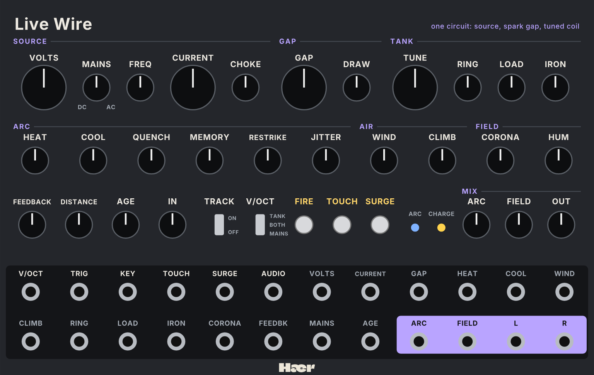

# Live Wire

**One live electrical circuit for VCV Rack.** A source feeds a spark gap. Across the gap sit an arc, a tuned coil and capacitor, and the air around it. Everything you hear, from a buzzing arc to a singing bass line, a spark drum kit, corona sizzle or transformer hum, is that one circuit in a different state. Every range runs past what real hardware does, on purpose.

Design by Fable, build by Opus, for Haer. 40 HP.



## The circuit

```
 SOURCE ── ballast (CURRENT) ── choke (CHOKE) ──┬────────────┬─────────────┐
 DC + AC (VOLTS, MAINS, FREQ)                   │            │             │
 + AUDIO + FEEDBACK                            ARC         TANK        CORONA
                                         (GAP, HEAT,   coil + cap    (sizzle near
                                          COOL, ...)   (TUNE, RING,   breakdown)
                                                        LOAD, IRON)
```

- **The arc** strikes when the voltage across the gap beats its strike voltage. Once lit it conducts more the more power it gets, so it is unstable by nature: it sputters, stretches in the wind, climbs, tears and re-strikes.
- **The tank** (coil and capacitor) rings when a spark dumps into it, and a DC arc held across it oscillates at its pitch. This is Duddell's **Singing Arc** of 1899, one of the first electronic instruments.
- **What you hear** is not a voltage. ARC is the air pushed by the arc heating up (how real arcs make sound). FIELD is a pickup coil on the wires (cleaner, more pitched). HUM is a transformer case shaken by the mains.

## Six ways to get a sound

| Sound | How |
|---|---|
| Buzzing arc | MAINS to AC, VOLTS above GAP. Longer GAP or less MEMORY: harder re-strikes, then sputter and dropouts. |
| Jacob's ladder | AC, small GAP, turn up CLIMB. It climbs, tears, starts again. |
| Singing arc | MAINS to DC, TRACK on, LOAD up, RING up. CURRENT high is a silent arc; lower it until it sings; lower still and it tears. Patch V/OCT, and a gate to KEY. |
| Spark drums | DC, CURRENT very low, VOLTS below GAP, HEAT low. Fire TRIG: the capacitor dumps into the coil. TUNE sets the drum's pitch, IRON its pitch drop, JITTER makes it erratic. |
| Relaxation buzz | DC, CURRENT very low, VOLTS above GAP: it fires itself as it recharges. Ticks to buzz. |
| Corona and hum | AC, VOLTS just below the strike, CORONA up, HUM up. SURGE for a flashover. |

## Controls

**SOURCE**
- **VOLTS**: source voltage, in units of "strikes a gap of 1".
- **MAINS**: DC to AC. DC sings and sparks; AC goes out at every zero crossing and buzzes at twice the mains frequency.
- **FREQ**: mains frequency, 20 to 500 Hz (50 Hz at about 28%).
- **CURRENT**: the ballast. How much current the supply allows. Also bends the singing pitch: lower current, flatter note.
- **CHOKE**: inductance in the supply. Smooths and delays the current. Long chokes keep arcs alive; short ones make sparks snappy.

**GAP**
- **GAP**: electrode spacing. **DRAW**: after TOUCH is released, how long the electrodes take to pull apart.
- **TOUCH** (button and gate): closes the electrodes. Release to draw an arc out to a gap far too long to strike by itself.

**ARC**
- **HEAT**: power the arc needs per length. Low: thin, crackling, sparks ring. High: a fat, steady arc.
- **COOL**: how fast the arc channel heats and cools. Fast arcs follow high frequencies. With **TRACK** on it follows pitch, which a singing arc needs.
- **QUENCH**: how easily the arc goes out. High stops a spark from becoming a steady arc.
- **MEMORY**: how long a hot gap stays easy to re-strike. **RESTRIKE**: how much easier.
- **JITTER**: randomness of every strike. On triggered sparks it gives misfires, late strikes with leader ticks before them, a different ring every hit and ghost re-strikes.

**AIR**: **WIND** stretches the arc with turbulence. **CLIMB** lengthens it while it burns, as on a Jacob's ladder.

**TANK**: **TUNE** (C0 to C10, plus V/OCT), **RING** (Q), **LOAD** (lower impedance, bigger currents, stronger pitch), **IRON** (the coil saturates: pitch rises with current, so hits drop in pitch and singing growls).

**FIELD**: **CORONA** (micro-discharges near breakdown, more and smaller on the negative half cycle), **HUM** (transformer case).

**Row 3**: **FEEDBACK** feeds the output back into the source after **DISTANCE** (0.3 to 20 ms): the arc hears itself and can howl. **AGE**: worn electrodes, a loose connection that drops out, dirty mains, drifting parts. **IN**: level of the AUDIO input, which is added to the source. **TRACK**: COOL follows the tank pitch. **V/OCT** switch: V/OCT goes to the tank, both, or the mains frequency. **FIRE**, **TOUCH**, **SURGE** buttons. Lights: **ARC** (burning), **CHARGE** (how close the gap is to striking).

**MIX**: **ARC** and **FIELD** levels, **OUT** drive into a soft clip.

**Jacks**: V/OCT, TRIG (fires the gap), KEY (the tank is in while high; each new key starts the note from a fresh capacitor; unpatched the tank is always in), TOUCH, SURGE, AUDIO (5 V = 1). CVs for VOLTS, CURRENT, GAP, HEAT, COOL, WIND, CLIMB, RING, LOAD, IRON, CORONA, FEEDBACK, MAINS, AGE: 10 V sweeps the whole knob, added to the knob. Outputs: ARC and FIELD on their own, and the mix on L and R (the arc wanders in the stereo field).

## Presets

| # | Preset | What to patch |
|---|---|---|
| 1 | Init | Buzzing AC arc. Nothing. |
| 2 | Drawn Arc | Press TOUCH, let go. |
| 3 | Jacobs Ladder | Nothing. |
| 4 | Runaway Ladder | Nothing; it feeds back. |
| 5 | Singing Arc | V/OCT and a gate into KEY. 0 V is C4. |
| 6 | Starved Arc | As 5. Torn, rough. |
| 7 | Iron Throat | As 5. Growls. |
| 8 | Howl | As 5. Feedback. |
| 9 | Spark Kick | Triggers into TRIG. |
| 10 | Erratic Kick | Triggers into TRIG. Late, missing and doubled hits. |
| 11 | Spark Snare | A 5 V gate of about 100 ms into both the VOLTS and CURRENT CV jacks. |
| 12 | Spark Hat | Triggers into TRIG. |
| 13 | Erratic Hat | Triggers into TRIG. |
| 14 | Relaxation Buzz | Nothing. |
| 15 | Geiger | Nothing. Random ticks. |
| 16 | Substation | Nothing, or SURGE now and then. |
| 17 | Fault | Nothing. |
| 18 | Mains Hum | Nothing. No arc at all. |
| 19 | Power Line | Nothing. Corona and the odd flashover. |
| 20 | Plasma Speaker | Audio into AUDIO: the arc plays it, rawly. |
| 21 | Worn Out | Init with AGE at 80%. |
| 22 | Tesla | V/OCT (goes to the mains frequency). |

## Patch recipes

1. **Draw an arc by hand.** Preset 2. Press TOUCH: the electrodes close and the arc strikes. Let go: they pull apart over DRAW seconds, the arc stretches, sputters and snaps. Patch a slow gate into TOUCH to repeat it. Turn GAP down and it never breaks.
2. **Ladder breathing.** Preset 3. A slow LFO (0 to 5 V) into CLIMB: calm stretches, then frantic climbs. Add a second LFO on WIND.
3. **Acid line on a singing arc.** Preset 5. A sequencer's pitch into V/OCT and gate into KEY. An envelope or LFO into CURRENT works like a filter that ends in destruction: high current is quiet, lower sings, lower still tears. IRON for growl, FEEDBACK for howl. CURRENT also bends pitch, so modulate it gently if you want to stay in tune.
4. **Spark drum kit.** Three Live Wires: Spark Kick and Spark Hat with triggers into TRIG, Spark Snare with a 100 ms gate into its VOLTS and CURRENT jacks. Then turn JITTER up on each, or load the Erratic presets: hits come late with a ticking leader, miss, double, and ring differently every time.
5. **Substation drone.** Preset 16. A slow random trigger into SURGE gives flashovers. A very slow LFO on VOLTS walks it between quiet hum, sizzle and arcing.
6. **Corona hats.** Preset 19 with a sequencer gate into VOLTS CV: sizzle comes and goes in rhythm.
7. **Plasma speaker.** Preset 20. Drums or a bass into AUDIO. The arc rides the signal and adds its own crackle. Lower CURRENT for more breakup.
8. **Feedback howl.** Preset 8 or 4. Sweep DISTANCE slowly: the howl jumps between pitches set by the delay.
9. **Mains in key.** Preset 18 or 16. Set FREQ (or V/OCT with the switch on MAINS) to the root of your track: the hum lands on the key. Preset 22 plays the mains frequency as a melody.
10. **Age everything.** Any preset, AGE to taste: loose connections cut out, the mains gets dirty, strikes go wild.

## Notes

- The singing presets are tuned so 0 V on V/OCT gives C4. Changing CURRENT, LOAD or IRON moves the pitch; retune with TUNE.
- The arc and spark sounds are deliberately random. Two instances on the same settings never sound the same.
- This is a model. Nothing here is advice about real electricity.
