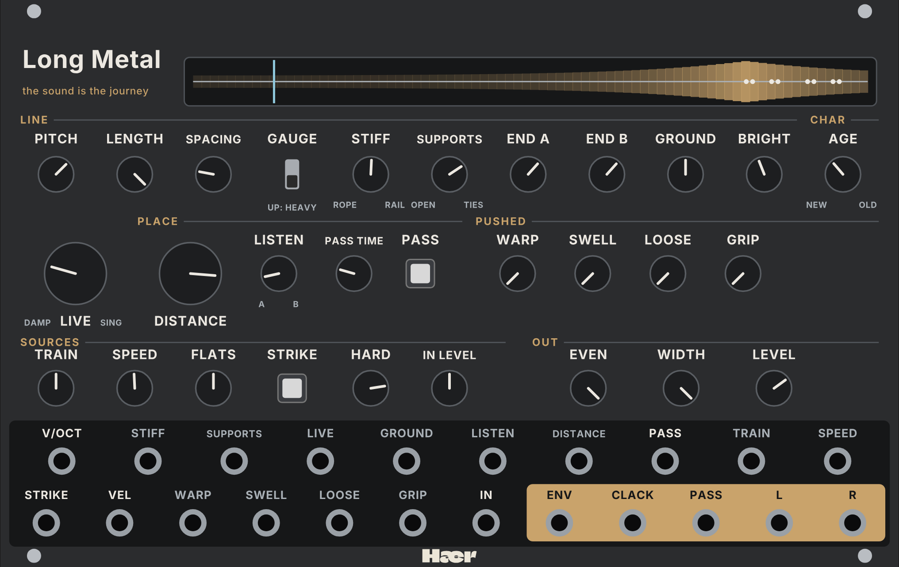

# Long Metal Fable

A VCV Rack plugin by Haer with one module, **Long Metal** (40 HP): a very long line of metal heard from one point on it. Rails that sing before the train arrives, struck cables that zing and crack, and a line that amplifies itself and screams. The sound is the journey: distance is the instrument.

Designed by Fable (spec: [docs/BUILD-INSTRUCTIONS.md](docs/BUILD-INSTRUCTIONS.md), reference engine: `tools/proto/longmetal_ref.c`), built by Opus.

- Manual: [docs/MANUAL.md](docs/MANUAL.md) and [docs/LongMetal-Manual.pdf](docs/LongMetal-Manual.pdf)
- 20 factory presets in `presets/LongMetal/`
- Apple silicon Mac build from CI (the "preview" release while it is on a branch)

## Layout

| Path | What |
|---|---|
| `src/dsp/LineEngine.hpp` | The waveguide: cells, allpasses, supports, losses, GRIP, train, strike. No Rack code. |
| `src/dsp/Mapping.hpp` | Knobs to engine, PITCH re-clocking, train placement and PASS, output chain. Shared by the module and the tests. |
| `src/LongMetal.cpp` | The Rack module and the line display. |
| `res/make_panel.py` | Draws `res/LongMetal.svg` (text as paths). |
| `tools/make_presets.py` | Writes the presets and `test/presets.txt`. |
| `test/render.cpp`, `test/bridge.h` | Offline checks: `make test` (no Rack needed). `make demos` renders demo WAVs. |
| `tools/make_pdf.py`, `tools/preview.py` | Manual PDF and panel picture (need node + playwright). |

## Offline checks

`make test` runs the 18 checks of the spec's section 7 plus preset checks. All pass. Measured on a cloud core (x86, double precision):

- Reference match: `rail` is bit-identical to the reference; `zaps`, `hard`, `live`, `live2` match exactly until their chaotic parts.
- Lossless line (WARP, SWELL, LOOSE on, STIFF and SUPPORTS moving): energy constant to 7e-13 over 10 s.
- Zing: 8 kHz arrives at 21 ms, 1 kHz at 177 ms. Support tones 838, 1807, 2963, 4353 Hz. PITCH tracks to 0.3 cents.
- Fuzz: 400 random patches x 20 s, plus 100 patches at 44.1, 48 and 96 kHz: no guard event, no NaN, output within 11 V.
- CPU at 48 kHz, 320 cells: 14% of a core at PITCH 0, 27% at PITCH +1; with WARP, SWELL and LOOSE on, 23% and 41%.

## Deviations from the spec

1. **Double precision, not float.** In float, every cell's fixed allpass pair (a, b) and support pair (cos, sin) misses a² + b² = 1 by one rounding in the same direction, and the "lossless" line drifted 1 to 2% in 10 s. Double keeps it at 1e-12. Cost is about 14% of a core at PITCH 0, below the 20% target.
2. **LOOSE** rotates the cached support angle by the extra angle with a short series and renormalises, rather than a polynomial sine with `c = sqrt(1 - s^2)`: the spec's form loses the sign of cos above 90°, which LOOSE can reach.
3. **Test 1, chaotic parts.** WARP, SWELL and LIVE make some scenes chaotic: the reference compiled with `-ffast-math` differs from itself by up to 4.9 dB in those windows. The test therefore matches every 2 s window to 2 dB until the chaos starts (zaps 20 s, hard 8 s, live and live2 14 s), and the chaotic part's averaged spectrum to 3 dB (measured: 1.1, 0.7, 1.8, 1.7 dB).
4. **PASS end point.** The spec sends the train to the listener's mirror point. With the listener near one end that point is off the line, and the last third of a pass was silence. The train now runs to just past the far end of the line (60 cells beyond it), so a pass ends when the train leaves.
5. **EVEN defaults to 100%,** not 75%, which matches the levelling of the approved sketch (ratio 3). Init peaks at about 4.5 V; LEVEL's output scale was set for that.
6. **Leveller** has a 5 ms look-ahead and a 5 ms attack, 250 ms release, so a hard hit after silence is not blasted up by the gain the quiet line had.
7. **Test 6's three-peak check** runs on the Live Line preset's line. Init with LIVE up sings on two tones only (its strong supports leave few slow waves); that is reported in the test line.
8. **Test 11** uses LISTEN 50% and DISTANCE 40% so that the train is still on the line after its last axle passes the listener; it checks the balance after the whole train has passed.
9. **AGE extras.** Dead and over-tight sleepers scale support angles by `1 - AGE` and `1 + AGE` as specified. At AGE near 1 with strong supports the disorder traps the waves (the line goes quiet between source and listener), so the Rust Rail preset uses AGE 0.85, SUPPORTS 0.62 and a closer train. Thermal drift and worn wheels as specified.
10. **Silence.** When nothing is injected, LIVE is below the centre and no energy has been written for 256 samples, the line is cleared and the cell loop skipped; output is exactly zero.
11. **CLACK** also fires for the lead axle's wheel flats only while the axle is on the line.
12. **Panel preview** uses stand-in knob graphics (`tools/preview.py`), since Rack's component library is not in this repository.
13. **Not tested in Rack yet.** The module compiles on CI; it has not been opened in Rack.
