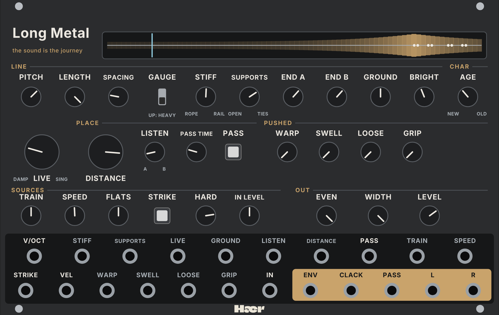

# Long Metal

A very long line of metal, heard from one point on it. Rails that sing before the train arrives, struck cables that zing and crack, and a line that amplifies itself and screams. In Long Metal the sound is the journey: everything you hear has travelled along the metal to reach you, and distance is the instrument.

Long Metal is a VCV Rack module by Haer, designed by Fable and built by Opus. It is 40 HP, stereo, monophonic.

## What it is

Picture a railway line a few hundred metres long. You stand at one point on it. Somewhere else on the line, something happens: a train rolls, a hammer hits, or a sound from your patch is fed in. The waves set off along the metal in both directions, and you only hear them when they reach you.

Three things shape what arrives.

- **Stiffness makes zings.** In stiff metal, high frequencies travel faster than low ones. A click far away therefore arrives as a falling "zing": the highs first, the lows trailing behind. Each echo off the ends comes back longer and more smeared than the last, so no two are alike.
- **Supports make tones.** A rail sits on sleepers and a cable on clamps. Each support bounces a little of the wave back. Regular supports block some frequency bands completely and let others through, and waves at the edges of the open bands travel very slowly. Those slow waves are the glassy, inharmonic tones of a singing rail.
- **Distance makes the difference between shimmer and impact.** Far away, only the slow tones survive the journey, so you hear a thin, glassy shimmer. Close up, everything arrives at once: clicks, rumble and the full roar.

The module goes past what real metal does. LIVE turns the line's loss past zero so that it amplifies itself and sings with nothing playing it. WARP, SWELL, LOOSE and GRIP make the metal behave differently when it is pushed hard.

## The display

The strip at the top shows the line from above. Brightness along it is the wave energy at each point. The blue line is you (LISTEN). The small dots are the train's axles, and the triangle underneath is where the train, hammer and input enter the line (DISTANCE). The ends are drawn brighter when they reflect and fainter when they absorb. With GRIP on, the line dims where it is held fast.

## Controls

### LINE

| Control | What you hear |
|---|---|
| PITCH + V/OCT | The size of the whole structure, from 2 octaves down to 1 up. Support tones, echo times and zing lengths all move together, so V/OCT plays the line in tune. |
| LENGTH | How much of the line is in play, from a short pitched cable (16 cells) to the full 320. Shorter lines echo faster. |
| SPACING | Distance between supports. Coarse tuning of the support tones and of the echo time. It steps on purpose. |
| GAUGE | LIGHT or HEAVY (switch up). Heavy metal is more dispersive: longer zings, darker tones. |
| STIFF | From rope (no zing, plain echoes) to rail (long falling sweeps). |
| SUPPORTS | Below about 30% the supports only notch the sound and the rail sounds like hiss. Above about 60% it rings on glassy tones. Near 100% it becomes a chain of separate ringing cells. |
| END A, END B | What the two ends do: 0 absorbs, plus or minus 100% reflects, and the sign flips the wave. Reflecting ends give the echoes. |
| GROUND | How much low end the ballast soaks up. More GROUND makes distant sound thinner. |
| BRIGHT | Less high-frequency loss along the line. |

### LIVE

The large knob on the left is the line's loss. At the centre the line is lossless. Below the centre it is damped and every sound dies away. Above the centre the line amplifies itself: it picks up its own tiny noise and starts to sing with nothing playing it, then pushes up into a soft ceiling and screams. It is built to be modulated at audio rate. A square wave into LIVE gates the singing in bursts.

### PLACE

| Control | What you hear |
|---|---|
| DISTANCE | Where the train, the hammer and the input are, measured from you. Positive is to your right. Far away is a glassy shimmer, close is the full impact. It also sets where a PASS starts. Audio-rate CV is fine. |
| LISTEN | Where you stand on the line, from end A to end B. |
| PASS TIME, PASS | Press PASS (or send a trigger) and the train comes through: from DISTANCE, past you, and off the far end of the line in PASS TIME seconds. Then it fades and returns to its place. The PASS output is high while it runs. |

### PUSHED

| Control | What you hear |
|---|---|
| WARP | Stiffness follows the signal itself, so loud waves travel differently from quiet ones. A hard hit sprays into new frequencies. |
| SWELL | Energy stiffens the line: loud passages bend the pitch. |
| LOOSE | The supports rattle and reflect more as the wave gets bigger. |
| GRIP | Off at 0. The line is held by friction until a wave is strong enough to tear it loose. Then it cracks, and the release runs down the line as an avalanche. Soft hits do nothing at all. Use it with the hammer. |

None of these can make the line blow up. Every stiffness and support stage only moves energy around, even when it changes at audio rate.

### SOURCES

| Control | What you hear |
|---|---|
| TRAIN | Eight wheels in bogie pairs rolling on the line. At rest the train rolls on the spot, so you get a steady shimmer from wherever DISTANCE puts it. |
| SPEED | Wheel rate and how gritty the rolling is. |
| FLATS | Wheel flats knocking once per turn and the clack at rail joints. |
| STRIKE, VEL | The hammer. VEL sets how hard (0 to 10 V; 6 V when unpatched). |
| HARD | Hammer hardness: soft mallet to steel. |
| IN, IN LEVEL | Audio from your patch, fed into the line at DISTANCE. |

### CHARACTER

**AGE** turns a perfect line into a used one: irregular sleeper spacing, uneven stiffness, dead and over-tight fastenings, patchy loss, worn wheels with uneven flats, and a slow thermal drift. At 0 the support tones are clean. Turned up, waves get trapped in pockets between irregular supports and the shimmer gets richer and less even.

### OUT

| Control | What you hear |
|---|---|
| EVEN | Near and far differ by about 40 dB. EVEN rides the level so both are usable. At 100% (the default) a whole approach fits in about 13 dB. At 0 you hear the real difference. |
| WIDTH | Stereo width. The left output is the wave arriving from the left, the right output the wave arriving from the right. |
| LEVEL | Output level. Init peaks at about 4 V. Everything passes a soft limit at 11 V. |

### Outputs

- **L, R**: the sound, as described under WIDTH.
- **ENV**: wave energy around you, 0 to 10 V. A live line at its ceiling reads about 8 V.
- **CLACK**: a trigger for each rail-joint clack, each wheel flat of the lead axle and each GRIP release (at most one every 30 ms).
- **PASS**: a gate, high while a pass runs.

## Where the ranges go past real

- LIVE above the centre: real metal never amplifies itself.
- WARP, SWELL and LOOSE at their tops bend the physics until the line sprays, glides and rattles in ways no rail would.
- GRIP thresholds and avalanches are inspired by stick-slip friction, then exaggerated.
- PITCH -2 makes a structure four times larger than the default line, with everything slow and huge.

## Presets

| # | Preset | What to patch |
|---|---|---|
| 1 | Init | Nothing. The rail singing with a train at rest far away. Press PASS and it comes. |
| 2 | Train Coming | Press PASS. A 30-second approach and pass. |
| 3 | Close Rail | Nothing. Knocks, flats and roar right on top of you. |
| 4 | Live Line | Nothing; a slow LFO into STIFF makes it glide. |
| 5 | Live Glide | Slow LFOs into STIFF and SUPPORTS. |
| 6 | Live Scream | Nothing. LIVE at full with WARP and LOOSE. |
| 7 | Live Gated | A square LFO at 2 to 4 Hz into LIVE, +5 V swing. |
| 8 | Knocked Alive | Triggers into STRIKE throw the singing line into new states. |
| 9 | Hard Hits | Triggers into STRIKE, with varying VEL. |
| 10 | Hard Cable | Triggers into STRIKE. A plain stiff cable with WARP. |
| 11 | Rattling Sleepers | Triggers into STRIKE. LOOSE and WARP high. |
| 12 | Break Loose | Triggers into STRIKE: soft ones do nothing, hard ones crack. |
| 13 | Laser | Triggers into STRIKE. The clean far zap, for contrast. |
| 14 | Never Repeats | Triggers into STRIKE. Long spacing: discrete echoes, each longer than the last. |
| 15 | Glass Rail | Nothing. Strong supports, no AGE: pure tones. |
| 16 | Rust Rail | Nothing. AGE at full. |
| 17 | Giant | Nothing. Everything two octaves down: slow and huge. |
| 18 | Wire | A sequencer into V/OCT and triggers into STRIKE. A short pitched cable. |
| 19 | Feedback Rail | Nothing. The train excites a line just below the point where it sings. |
| 20 | Resonator | Audio into IN; sweep DISTANCE while it runs. |

## Patch recipes

1. **A train every few minutes.** A slow clock (one pulse every two or three minutes) into PASS, Init preset. Patch PASS out to a mixer's mute to duck other parts as it goes by.
2. **Your own approach.** A long envelope or a slow ramp into DISTANCE, from far to close and back. Faster than PASS, and you choose the curve.
3. **Gated singing.** Live Gated, with a square LFO into LIVE. Change the LFO rate to play rhythms with the line's own tones.
4. **Living drone.** Live Line or Live Glide with very slow LFOs (20 to 60 seconds) into STIFF and SUPPORTS. The tones glide and lock and never repeat.
5. **Wire melodies.** Wire, with a sequencer into V/OCT and its gate into STRIKE. Add WARP for notes that bend when hit hard.
6. **Hit harder to break.** Break Loose, with a sequencer sending rising VEL into STRIKE. The quiet hits do nothing until one tears the line loose.
7. **Clacks as a clock.** Close Rail or Train Coming, with CLACK out driving a drum or a sequencer. The rhythm comes from the train's wheels and joints.
8. **Loud passages warp themselves.** ENV out into WARP (attenuated) on Live Line or Hard Hits.
9. **Drums on the rail.** A drum loop into IN on Resonator, with DISTANCE swept slowly. Far away the drums turn into a shimmer of support tones; close up they come back.
10. **Audio-rate distance.** An oscillator at a few hundred hertz into DISTANCE on a live or train patch. The source smears along the line and the tones fracture.
11. **Two rails.** Two Long Metal modules an octave apart (PITCH 0 and -1), each panned by its own L and R, with the same PASS trigger.
12. **Rail as a reverb.** IN LEVEL up, TRAIN 0, LIVE just below the centre, SUPPORTS around 60%, any sound in. The line rings on its own tones after the sound stops.
