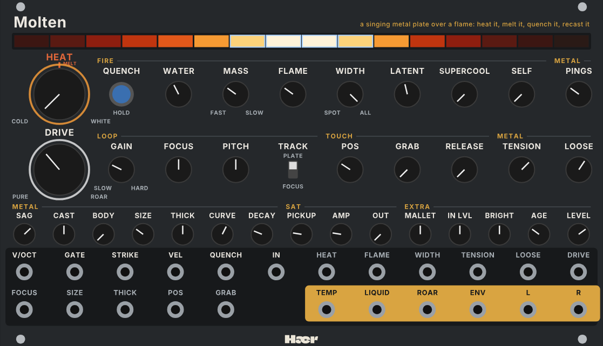

# Molten

Molten is Plate Driver's singing sheet with a flame under it. A thin metal plate is held in a feedback loop: a pickup listens to it, an amplifier boosts what it hears, and a driver pushes that signal back in. On its own that loop sings one tone, splits into chords as you push it, and roars when you push harder. Molten adds temperature. You heat the sheet, it softens, sinks, melts into a ringing liquid, and when you quench it, it sets again as a slightly different bell.

The body never jumps to the flame. It follows with a lag, zone by zone, so turning HEAT is more like turning up a gas burner than turning a filter knob. The strip of sixteen cells across the top shows each part of the sheet as it warms, glows and melts. Watch it, because the sound follows it, not the knob.

## Quick start

1. Patch **L** and **R** to your mixer. With nothing else patched the cold sheet sings a pure C4.
2. Turn **HEAT** slowly up to about ten o'clock. As the cells glow red the tone splits into a shimmering chord at the same drive. Hot metal is looser than cold metal.
3. Keep going. The pitch sinks as the metal softens. Past noon (the MELT mark) the cells grow blue edges: the sheet is liquid, and its ringing changes completely.
4. Hold **QUENCH**. The flame goes out, water hits the sheet, it cracks and sets. Let go and play: it is a new bell, tuned by the shape it froze in.

## The four things heat does

1. **It loosens.** Hot metal stretches more easily, and stretching is what couples the sheet's tones together. So the same DRIVE that gave one pure tone cold gives a chord when warm and a roar when red hot. Heat lowers all three of Plate Driver's thresholds.
2. **It sags.** Metal gets softer as it heats, so every tone sinks. At the default SAG the sheet is about six semitones lower just below its melting point. The tones living in the hottest zones sink most, so a narrow flame bends the chord out of shape instead of transposing it.
3. **It melts.** At the melting point the metal takes in heat without getting hotter (latent heat), so it lingers half molten. Liquid has its own tones, set by surface tension (TENSION), much more lightly damped by default and much looser. A molten sheet is a strange, wobbling, sliding sound.
4. **It recasts.** When the liquid sets, the shape it held at that moment becomes part of the new solid. Each tone is retuned a little, up or down, depending on how it was moving as it froze. Every melt and quench gives a new bell. CAST sets how far.

There are two extras. **Supercooling**: liquid cooled gently can stay liquid below its melting point, waiting. A hard strike seeds it, and it flashes solid in a fraction of a second. **Stress pings**: sudden temperature changes make the solid tick and crack, and freezing zones crack as they set. Quenching a ringing molten sheet makes it flare with cracks as it freezes.

## The zone display

Sixteen cells, left to right along the sheet. Black is cold. Dull red, orange, yellow and white are hotter (white is twice the melting point). A blue-white edge means that zone is liquid, brighter when fully liquid. The orange bar and marker under the strip show where the flame is and how wide it is; it turns blue while QUENCH is held.

The lag between the knob and the body is the heart of playing Molten. MASS sets it: from a flash (MASS 0) to about a minute (MASS 1). With a heavy body you can turn HEAT and wait for the sound to arrive; with a light one HEAT is almost an instant control.

## The panel

### HEAT (the large knob) and FIRE

| Control | What you hear |
|---|---|
| **HEAT** | The flame's temperature. Noon is the melting point. Below that the sheet loosens and sinks; above it, it melts. Its ring glows the colour of the sheet's mean temperature. |
| **QUENCH** | Hold it (or send a gate to the QUENCH jack): the flame goes out and the sheet is plunged in water. Cools fast, sets the liquid, and the sheet cracks. |
| **WATER** | How violently the water cools. The ends of the sheet cool first, as they would in a real quench. |
| **MASS** | How slowly the sheet follows the flame (FAST to SLOW). |
| **FLAME** | Where along the sheet the flame sits. Only matters when WIDTH is down. |
| **WIDTH** | SPOT to ALL. Wide heats the whole sheet evenly and lets heat spread fast; narrow heats one patch, which loses heat to the air and spreads it slowly. A narrow flame can melt part of the sheet and leave the rest solid. |
| **LATENT** | How much heat it takes to melt. High LATENT holds the sheet half molten for a long time. |
| **SUPERCOOL** | How far below the melting point the liquid can be cooled before it freezes by itself. At 1, cool it gently and it waits for a strike. A strike with velocity above about 6 V sets it. |
| **SELF** | Loud playing heats the body. A held roar at SELF 1 reaches the melting point in about five to ten seconds; melting deadens the roar, the body cools a little, sets, roars again, and so on, so it breathes in and out of the melt. Turn DRIVE down and it cools and sets. |

### LOOP (DRIVE is the other large knob)

| Control | What you hear |
|---|---|
| **DRIVE** | How hard the driver pushes. PURE, then chords, then ROAR. Its ring shows the state: dim blue one tone, white chords, red roar. |
| **GAIN** | Loop gain. Low gain starts slowly and grows; high gain hits at once. |
| **FOCUS** | A band-pass in the loop at the played pitch. High focus keeps the song near the pitch; low focus lets the loop sing whichever tone it likes. |
| **PITCH** | The pitch of the cold, uncast sheet (plus V/OCT). |
| **TRACK** | PLATE: the whole sheet is retuned to the pitch. FOCUS: only the loop's filter follows the pitch, and the sheet stays as it is. See "Pitch and tracking" below. |

### TOUCH

| Control | What you hear |
|---|---|
| **POS** | Where the driver and pickup sit on the sheet. Each place favours different tones. |
| **GRAB** | A hand on the sheet: damps everything, more for high tones. |
| **RELEASE** | Extra damping while GATE is low, for short notes. |

### METAL

| Control | What you hear |
|---|---|
| **PINGS** | How readily heating, cooling and freezing make the sheet tick and crack. |
| **TENSION** | The pitch of the liquid against the cold sheet, from two octaves under to an octave over. With TENSION low, melting drops the sound into a deep wobble and freezing jumps it back up. |
| **LOOSE** | How readily hot metal and liquid split and roar. At 0 heat only sinks and melts the sheet and never loosens it. |
| **SAG** | How far heat sinks the solid. At 0 the solid keeps its pitch until it melts. |
| **CAST** | How far each freeze retunes the sheet. At 0 every quench returns the same bell. |
| **BODY** | Which of sixteen sheets: the fine detail of its tones and couplings. |
| **SIZE** | The lowest tone of the cold sheet (20 to 200 Hz). |
| **THICK** | Thin sheets stretch and bloom readily; thick ones stay pure longer. |
| **CURVE** | Curvature. A curved sheet couples its tones even at small amplitude. |
| **DECAY** | Ring time of the cold sheet. |

### SAT and EXTRA

| Control | What you hear |
|---|---|
| **PICKUP**, **AMP**, **OUT** | Saturation of the pickup, the amplifier and the output stage. AMP in particular makes the loop's roar dirtier and denser. |
| **MALLET** | Brightness of the strikes (STRIKE jack). |
| **IN LVL** | How much of the IN jack is fed into the loop. |
| **BRIGHT** | The tone of the output pickup. |
| **AGE** | See below. |
| **LEVEL** | Output level. At 70% a cold pure tone is about 5 V peak. A slow 2:1 level rider keeps the roar and the pure tone from being worlds apart. |

### Jacks

Inputs: **V/OCT**, **GATE** (drive on while high, always on when unpatched), **STRIKE** (trigger), **VEL** (strike velocity, 0 to 10 V, 8 V when unpatched), **QUENCH** (gate), **IN** (audio into the loop), and CV for HEAT, FLAME, WIDTH, TENSION (0.3 octave per volt), LOOSE, DRIVE, FOCUS, SIZE (0.1 decade per volt), THICK, POS and GRAB. Unless stated, CV adds a tenth of the knob's range per volt.

Outputs: **TEMP** (0 V cold, 5 V at the melting point, 10 V white hot), **LIQUID** (0 V solid, 10 V all molten), **ROAR** (0 V one tone, 10 V full roar), **ENV** (energy envelope), **L** and **R**.

### Context menu

It shows how many tones the current casting has retuned and by how much. **Forget casting** returns the sheet to its original tuning. **New AGE unit** draws another set of dents and uneven zones. The casting is saved with the patch, so a bell you like stays when you reopen it.

## Pitch and tracking

PITCH sets the cold, uncast sheet. Heat sinks the sheet underneath the loop's filter, and a casting retunes it.

- With **FOCUS high**, the loop keeps singing near the commanded pitch, and as the sheet sags it hands the song from one tone to the next one sliding past the filter. You hear steps and flips rather than a glide.
- With **FOCUS low**, the song sinks with the sheet, a slow glissando down as it heats and back up as it cools.

Both are wanted. In TRACK PLATE the whole sheet is retuned to V/OCT, so the cold sheet plays in tune; once hot, it plays in tune relative to its own sag. In TRACK FOCUS only the filter moves: playing V/OCT then picks out different tones of one fixed hot sheet, which is the Molten Lead preset.

Hot metal also stiffens as it moves, more than cold metal, so at high DRIVE a hot sheet sings sharper than at low DRIVE.

## AGE

One knob for impurity and analog looseness, as on Plate Driver: loop gain drift, hiss, mains hum, dents (each tone slightly mistuned), warm-up (the sheet drifts flat and loses ring as it plays), and a tired amplifier. Molten adds:

- **A flickering flame.** The heat wavers a little, a few times a second.
- **Uneven metal.** Each zone melts at a slightly different temperature and heats at a slightly different rate, so the sheet melts in a ragged order.
- **Slag.** Some zones carry impurities that deaden the tones living there.

Every module instance has its own unit (its own dents and uneven zones); **New AGE unit** draws another.

## Presets

Each preset sounds with nothing patched, except where a note says otherwise.

| # | Preset | What it is |
|---|---|---|
| 1 | Init | A cold pure tone. Raise HEAT and it splits; raise it past noon and it melts. |
| 2 | Red Heat | Red hot at the default drive: a shimmering wash. |
| 3 | Edge of Melting | HEAT at the melting point with LATENT high: sits half liquid. |
| 4 | Seething | Molten and driven: a liquid roar. |
| 5 | White Hot Drone | A big, low, white-hot liquid drone at low drive. |
| 6 | Foundry | Patch a slow clock (one pulse every few seconds, gate about a third of the period) to QUENCH: each quench casts a new bell. |
| 7 | Flash Freeze | SUPERCOOL 1. Turn HEAT up to melt it, then back to 0.4: it stays liquid. Send a hard strike (VEL above 6 V) and it flashes solid. |
| 8 | Walking Flame | A narrow flame. Patch a slow LFO to FLAME and the molten patch walks along the sheet. |
| 9 | Spot Weld | No width at all: one molten patch on a solid sheet. |
| 10 | Slow Furnace | MASS 1: about a minute to warm through. Play HEAT slowly. |
| 11 | Runaway | SELF 1 and a loud drive: the sheet heats itself, melts, quiets, sets and roars again. |
| 12 | Cold Bell | DRIVE 0. Patch triggers to STRIKE. Melt and quench it to recast it between phrases. |
| 13 | Annealed | Warm, short, soft strikes (patch STRIKE). |
| 14 | Mercury | TENSION at its lowest: melting drops into a very low liquid wobble. |
| 15 | Light Metal | TENSION up, BRIGHT up: a high, glassy liquid. |
| 16 | Molten Lead | TRACK FOCUS on a molten sheet: play V/OCT to pick tones out of the liquid. |
| 17 | Scream | Red hot with every saturation up. |
| 18 | Meltdown | The pushed sketch. Put a fast LFO (about 0.5 to 2 Hz) on HEAT across the melting point. |
| 19 | Stiff | LOOSE 0, SAG 0: heat only melts. |
| 20 | Resonator | Low drive, a hot liquid sheet as a resonator: patch drums or a voice to IN. |

## Patch recipes

1. **Breathing across the melt.** A slow triangle LFO (0.05 Hz) to HEAT CV, HEAT knob at eleven o'clock, so the LFO swings it across noon. The sheet melts and sets on every cycle, and with CAST up it comes back a different bell each time. Watch the cells.
2. **Heat per note.** An envelope (attack 0.5 s, decay 3 s) to HEAT CV, triggered with each note on GATE. Each note starts cold and pure and warms into a chord as it is held. With MASS low the effect is quick; with MASS high it only builds over long notes.
3. **A new bell every bar.** HEAT at 0.9, a clock divided to one pulse a bar into QUENCH (gate about a quarter bar long). Each bar the sheet melts, sets and is recast. Patch STRIKE from the same clock delayed by an eighth for a struck bell on every new casting.
4. **Sequenced flame.** WIDTH at 0.2, a stepped sequencer (slow steps) into FLAME CV. Each step moves the molten patch, and each patch silences and bends different tones.
5. **Temperature as modulation.** TEMP out into the FOCUS CV of Molten itself or a filter's cutoff elsewhere. The filter opens as the sheet heats and closes as it cools, with the sheet's own lag.
6. **Liquid into reverb.** LIQUID out to the send level of a reverb, so only the molten sheet goes into the hall. Solid ringing stays dry and close.
7. **Loud notes melt.** SELF at 0.6, DRIVE from a velocity-scaled envelope. Soft notes stay solid; a run of hard notes heats the sheet until it melts, and it takes a while to set again.
8. **Kick into a molten body.** HEAT 0.7, DRIVE low (0.15), IN LVL 0.8, a kick drum into IN. Every hit splashes the liquid; turn HEAT down and the same kicks ring a solid sheet.
9. **Stereo foundry.** Two Moltens with the same settings and different BODY, both quenched from the same clock. Pan them apart: each casts differently, so the stereo image changes every quench.
10. **Keeping a casting.** When a quench gives a bell you like, save the patch. The casting is stored with it. Right-click, **Forget casting**, to go back to the original tuning; nothing else changes.
11. **Flash freeze on the downbeat.** Flash Freeze preset: melt, hold HEAT at 0.4, and send STRIKE with VEL at 10 V on the downbeat. The supercooled liquid sets in a crack of pings and becomes a bell.
12. **Molten melody.** Molten Lead preset, V/OCT from a sequencer, slow LFO on TENSION CV. The liquid's pitch slides under the notes and the loop jumps between its tones.

## What is physical and what is invented

**Physical:** the flow of heat along the sheet and into the air and water, latent heat at the melting point, supercooling and freezing seeded by a strike or by a solid neighbour, the plate's tones and the way stretching couples them (energy is stored and given back), the loss of stiffness with temperature, and the extra damping of metal near its melting point.

**Invented:** the size of every effect; casting from the shape the liquid holds as it freezes; looseness as a law of temperature; the liquid's tones as a stretched copy of the sheet's; the zones lying along one line rather than across a 2D sheet; the cracks; and self-heating, which is far stronger than any real vibration could manage. Physical accuracy is not the aim; a lively, playable sheet is.

## Specifications

- 44 HP. VCV Rack 2.
- 192 plate tones, 6 stretch channels, 16 thermal zones, double precision.
- Runs at 2x oversampling below 88.2 kHz, at the host rate above.
- CPU: about 40% of one core on the cloud test machine at 48 kHz with Rack's optimisation flags (about 25% for the engine alone). Expect less on Apple silicon.
