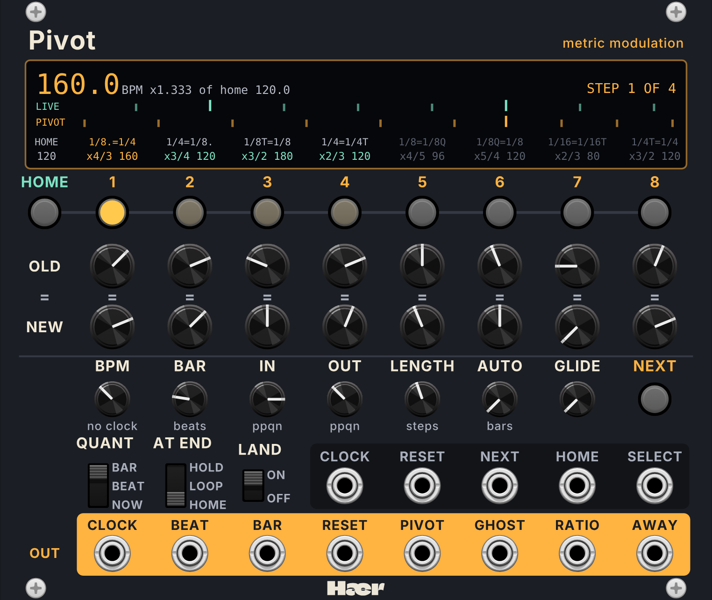

# Pivot

A metric modulation clock for VCV Rack. 30 HP, plugin 2.0.0, MIT.

Pivot follows Live's clock and plays a chain of up to 8 tempo changes, each written as
**OLD note = NEW note** (the old note value, at the old tempo, lasts as long as the new note
value at the new tempo). "Dotted 8th = quarter" takes 120 BPM to 160 without breaking the groove.

- **HOME + steps 1-8**: press to go there on the next bar, beat or straight away (QUANT).
- **OLD / NEW** per step: 1/16T, 1/16Q, 1/16, 1/8T, 1/16., 1/8Q, 1/8, 1/4T, 1/8., 1/4, 1/2T, 1/4., 1/2. Steps multiply along the chain.
- **GLIDE**: snap, or slide into the new tempo over 1 beat to 16 bars, with the phase kept intact.
- **LAND**: going home bends the tempo over at least 2 bars so Pivot's downbeat lands exactly on Live's.
- **AUTO**: walk the chain every 1-32 bars. **AT END**: home, loop or hold. **LENGTH**: 1-8 steps.
- **BAR** (beats per bar), **IN / OUT** clock resolution (1-48 PPQN), **BPM** when no clock is patched.
- In: CLOCK, RESET, NEXT, HOME, SELECT (1 V per step, 0 V = home).
- Out: CLOCK, BEAT, BAR, RESET, PIVOT (trigger on each change), GHOST (the tempo you just left,
  still running), RATIO (1 V per doubling of tempo), AWAY (high while not home).

The screen shows the tempo, Live's grid against Pivot's grid over the last two bars, and each
step's OLD=NEW, ratio and resulting tempo above its knobs.

Guide: `docs/guide.html` (PDF in the project files). Offline engine checks and a demo WAV:
`make test`. Panel: `python3 res/make_panel.py` (needs `pip install fonttools`), preview:
`python3 tools/preview.py panel-preview.png`.

