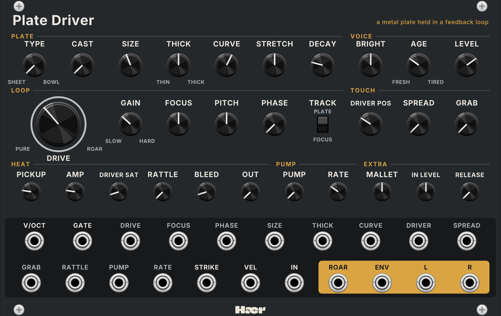

# Plate Driver Fable

A VCV Rack 2 plugin with one module, **Plate Driver** (40 HP): a metal plate held in a feedback loop by a pickup, an amplifier and a driver, like an EBow on a gong. It sings one tone, splits into multiphonics and roars, with saturation at every stage of the loop, a rattling driver head, a pumping amplifier and an AGE knob.



- Manual: [docs/MANUAL.md](docs/MANUAL.md) and `docs/PlateDriver-Manual.pdf`
- Build spec: [docs/BUILD-INSTRUCTIONS.md](docs/BUILD-INSTRUCTIONS.md)
- Reference engine the sound was approved on: `tools/proto/plate_driver_ref.c`

## Build

```
make RACK_DIR=/path/to/Rack-SDK dist     # the plugin
make test                                # offline engine checks, no Rack needed (about 15 minutes)
```

`make test` compiles the reference engine, renders its scenes into `test/ref/`, and compares. It also renders a 10 s WAV of every preset into `test/out/`. The CI in this repository builds the plugin for Apple silicon Macs on every push.

Regenerate the panel with `python3 res/make_panel.py` (needs fonttools and the Inter font), the presets with `python3 tools/make_presets.py`, the preview with `python3 tools/preview.py panel-preview.png <Rack>/res/ComponentLibrary`.

## Test results

All 18 checks pass (`make test`). Speed: about 28% of one core on the cloud test machine in full roar at 48 kHz; the spec's target was 12% on Apple silicon, which has not been measured (see deviations).

## Deviations from the spec

The engine:

1. **Double precision, not float.** In float the lowest modes detune audibly against the reference (the two-pole resonators at 96 kHz need more precision than float has for low frequencies). This is the main reason the module costs more CPU than the spec's target.
2. **Modes above 0.25 of the engine rate are muted** instead of being clamped to 0.3 of it. Clamping piled every high mode onto one frequency at high pitches, which then blew up when stretched. At 2x oversampling this only removes modes above about 22 kHz.
3. **Stability of the stretching.** The fuzz test found settings (high pitch, thin plate, high drive) where the stretch stiffness grew past what a step at the sample rate can follow, and the plate exploded. The engine now estimates that stiffness every sample (from the stretch gradient, including the amplitude-dependent terms) and scales the stretch forces back when it would exceed the headroom (twice a conservative bound). None of the reference scenes reach this limit, so the approved sound is unchanged.
4. **Energy guard.** The spec's guard (halve every state above an energy of 1e9) fired at legitimate energies at high drive and high pitch. It is now a soft ceiling that scales with drive squared and tuning squared and falls slowly (1.5 s) after the drive is cut. Above it the plate loses amplitude smoothly; a hard reset is kept only for non-finite numbers or 100x the ceiling. No test triggers the hard reset.
5. **PUMP breaker.** With PUMP up from the start (rather than faded in, as in the sketch) the breaker could trip at the noise floor and stay tripped, or settle into a second tone while tripped and never recover. The breaker now only arms once the loop is actually singing, and resets after a hold of 1.2x the RATE follower time.
6. **Drive scaling with pitch.** The spec's law did not pass test 6. Fitted instead: linear in frequency below C4, `x^2 (1 + C4 x / 700) / (1 + C4 / 700)` above, capped at C6. Result: the split point stays within 0.15 of C4's from C2 to C6.
7. **Pitch range.** PITCH + V/OCT is clamped to four octaves either side of C4.
8. **RATTLE.** The contact damper of the reference (12) took 89% of the energy and the loop died. It is 2.0, and the knob maps to 0.78 of the reference range, capped at 0.85. Test 9 passes: 49% energy kept, +28 dB at 3 to 10 kHz.

The tests:

9. **Test 1** cannot be matched band for band in the chaotic passages: the reference against itself, compiled with different rounding, already differs by 2.7 dB. The test checks the mean third-octave difference over 6 s windows (at most 3 dB) and the first 1.5 s of `swell` exactly (0.1 dB; it matches to 0.000 dB).
10. **Tests 2 and 3** use the statistics of the approved `swell` sketch (the spec's numbers came from an earlier 128-mode version).
11. **Test 4** includes the stretch potential in the energy and checks 10 ms averages.
12. **Test 5** measures the sung tone within three semitones of the target, and allows 25 cents at STRETCH 1 (the plate's pitch rises with amplitude by design); 10 cents at STRETCH 0 as specified.
13. **Test 14 (new)** renders every preset for 10 s through the full module chain and checks it sounds and never trips the guard.

The module:

14. The DRIVE ring light is a ring drawn around the knob (dim blue, white, red for ROAR, brightness from ENV).
15. Row 3 holds RELEASE in the EXTRA section; rows 3 and 5 use 11 columns with narrower spacing.
16. SPREAD CV is 0.05 per volt (a tenth of its 0 to 0.5 range). GATE is high above 1 V.
17. A bug in the spec's control-rate timing of AGE (the drift and warm-up ran twice as fast with oversampling) is fixed in the module and the tests.

## Untested in Rack

The module has been built by CI but not yet opened in Rack. The engine is shared with the offline tests (`src/dsp/`), so the sound and stability are checked; the panel, jacks and menus are not.

Haer, GPL-3.0-or-later.
