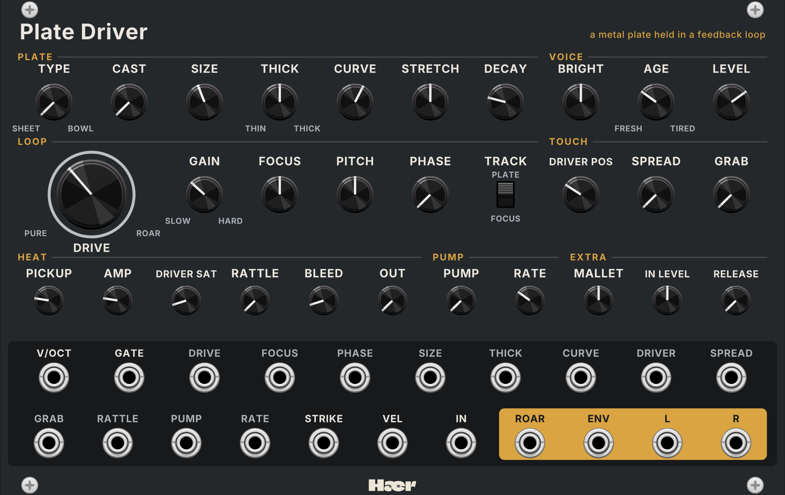

# Plate Driver

Plate Driver is a thin metal plate held in a feedback loop. A pickup listens to the plate, an amplifier boosts what it hears, and a driver pushes that signal back into the plate. Think of an EBow resting on a gong, or a guitar feeding back through its amplifier, except the string is a sheet of metal with hundreds of tones of its own.

Turn DRIVE up slowly and you hear the three things a driven plate does:

1. **It sings.** At low drive one of the plate's tones wins and the loop holds it as a clean, steady note. FOCUS and PITCH choose which one.
2. **It splits.** As the plate moves further, it stretches, and stretching couples its tones together. The single note breaks into a chord of related and unrelated tones, a multiphonic, which flickers and drifts.
3. **It roars.** Higher still, energy pours from tone to tone faster than the loop can hold any of them, and the plate becomes a dense metallic roar.

There is **hysteresis**: once the plate has split, it stays split as you turn DRIVE back down, further than where it first split. Approaching a setting from above or from below gives two different sounds, so play DRIVE like an instrument, not like a dial.

The HEAT section adds saturation at every stage of the loop, and the PUMP section makes the amplifier trip and recover like an overloaded breaker. Harsh is allowed. The model is meant to be pushed to where it breaks up.

## Quick start

1. Patch **L** and **R** to your mixer. With nothing else patched the plate sings a pure C4 at the default settings.
2. Turn **DRIVE** slowly clockwise. Watch the ring around it: dim blue is one pure tone, white is a multiphonic, red is roar.
3. Patch a sequencer or keyboard to **V/OCT** to play it, and a gate to **GATE** so it only sings while the note is held.

## What is modelled and what is not

The **plate** is a physical model: 192 modes of a real plate, each a resonator with its own frequency and loss, coupled through the plate's stretching exactly as a curved shell couples its modes (the stretching stores energy and gives it back; nothing is invented there). The **rattle** of a loose driver head is a physical model too: a small mass that touches the plate through a stiff contact and lets go.

Other parts are **behavioural**: the driver and pickup positions lie along one line rather than on a 2D plate, and the saturation curves of the pickup, amplifier, driver and output are chosen to sound right, not measured from particular hardware.

## The panel

### Plate

| Control | What you hear |
|---|---|
| TYPE | Which plate. **Sheet** (the default) has an even spread of modes and is the sound the module was designed around. **Tam-tam** has the dense, rising cluster of a large gong. **Bossed** has near-harmonic pairs from a raised centre, then plate modes, so it sings like a bell-organ. **Bowl** has slowly beating pairs, like a singing bowl, with sheet modes far above. |
| CAST | Sixteen plates of the same type, each with its own fine detail. If one note will not sing the way you want, try another cast. |
| SIZE | The plate's lowest mode at C4, 20 to 200 Hz. In TRACK PLATE mode a small value means a big plate singing one of its high modes with close neighbours, so it splits sooner and more richly. A large value means a small plate singing near its bottom: purer and harder to split. |
| THICK | Thin plates (left) stretch easily: they split early and bloom. Thick plates (right) stay pure much longer. |
| CURVE | How curved the plate is. A curved plate couples its tones strongly, which is where the splits come from. At zero the plate is flat: it hardly splits, but its pitch still rises with amplitude. |
| STRETCH | How much the sung pitch rises as the plate moves harder: about +10 cents at 0, about +120 at 1, about +200 at 2. High values give clean pitch dives as the loop starts and stops. |
| DECAY | Ring time of the plate on its own, from short and damped to very long. Long decays make the loop start gently and hold through gaps. |

### Voice

| Control | What you hear |
|---|---|
| BRIGHT | Tilts the plate's output from dark to bright. |
| AGE | Analog looseness, from factory-fresh to tired. See below. |
| LEVEL | Output level. At 70% a pure tone is about 5 V peak. A slow level rider before LEVEL keeps the pure tone and the roar at similar loudness. |

### Loop

| Control | What you hear |
|---|---|
| DRIVE (large) | How hard the driver pushes. This is the main performance control. The ring light shows ROAR and the plate's energy. |
| GAIN | Loop gain. Low gain lets the tone build up slowly and organically from the noise floor; high gain makes it start at once and hit hard. |
| FOCUS | A band-pass filter in the loop, tuned to the played pitch. High focus holds one tone and resists splitting. Low focus lets the plate choose. |
| PITCH | The played pitch, three octaves either side of C4. V/OCT adds to it. |
| PHASE | A short delay in the loop, 0 to 4 ms. It changes which of the plate's tones the loop can keep alive, so sweeping it hops between tones and chords. |
| TRACK | **PLATE** (up): the whole plate is retuned to follow the pitch, so V/OCT plays melodies. **FOCUS** (down): the plate stays fixed and only the loop filter follows the pitch, so the loop hops between the plate's own tones, like overblowing a horn. |

### Touch

| Control | What you hear |
|---|---|
| DRIVER POS | Where the driver touches the plate. Every position favours different tones. |
| SPREAD | How far the pickup sits from the driver. At zero they are together and the loop always sings. Away from zero some tones are fed and others are fought, so the set of possible notes and chords changes, and some settings refuse to sing at all. |
| GRAB | A hand resting on the plate: damps everything, more on the high tones. Patch a gate here for chokes. |

### Heat

Saturation at each stage of the loop. They interact: saturation inside the loop changes what the plate does, not just how it sounds.

| Control | What you hear |
|---|---|
| PICKUP | The pickup overloads as the plate swings close to it. Asymmetric, adds even harmonics and grit. |
| AMP | The loop amplifier overdrives, from warm to a hard fuzz. |
| DRIVER SAT | The driver squares off: the plate is hit with something close to a square wave. More buzz, and the loop locks harder. |
| RATTLE | The driver head comes loose and rattles against the plate. Adds a dirty buzz on top of the tone. Above about 90% the head barely touches and the loop starves. |
| BLEED | Some of the driver signal leaks straight into the output, like hearing the transducer itself. |
| OUT | The output stage saturates. |

### Pump

| Control | What you hear |
|---|---|
| PUMP | The amplifier trips like an overloaded breaker when the plate gets loud, briefly turning the loop against the plate, then recovers. The result is a pulsing, surging loop: a motorboat at fast rates, slow swells at slow ones. It bites hardest with DRIVE above the middle. |
| RATE | How fast the breaker reacts and resets: from slow surges (left) to a fast flutter (right). |

### Extra

| Control | What you hear |
|---|---|
| MALLET | Brightness of the STRIKE input, from a soft beater to a hard metal hammer. |
| IN LEVEL | How strongly the IN jack is fed into the loop. |
| RELEASE | Extra damping while the gate is low, so notes stop quickly instead of ringing out. |

### Jacks

Every CV input adds to its knob at a tenth of the knob's range per volt (SPREAD: a twentieth of its range, the full knob is half of the plate). GRAB is full at 10 V.

| Jack | |
|---|---|
| V/OCT | Pitch, added to PITCH. |
| GATE | While high (above 1 V) the driver is on. Unpatched, the driver is always on. A 4 ms slew avoids clicks. |
| STRIKE, VEL | A trigger at STRIKE hits the plate with a mallet, velocity from VEL (0 to 10 V, 8 V when unpatched). Striking works with DRIVE at zero too, so the module is also a struck plate. |
| IN | Audio into the loop. The plate rings with it and the loop takes over from there. |
| ROAR | 0 V when one pure tone sings, 10 V in full roar. Measured from how many tones share the energy. |
| ENV | The plate's energy as an envelope, 0 to 10 V. |
| L, R | Two pickups at different places on the plate. |

The module is monophonic. A polyphonic cable uses its first channel.

## AGE

One knob for everything an old, used rig does to the sound. At zero all of it is off. Each module has its own random "unit" (right-click to roll a new one), saved with the patch.

- The loop gain wanders slowly, so the balance between tones drifts.
- More hiss in the loop, so different tones win on different notes.
- Mains hum: 50 Hz and its harmonics, faint, at about -38 dB under a pure tone at full AGE.
- Dents: each mode is detuned by a fixed random amount, up to 1.5%.
- A loose driver head: a little RATTLE all the time.
- Warm-up: a plate that has been roaring for a while heats up, its pitch sags slightly and it rings shorter. It recovers over about 20 seconds.
- A tired amplifier: its saturation becomes lopsided.

## Presets

| # | Name | What it does |
|---|---|---|
| 1 | Init | A pure tone at C4 that splits when you raise DRIVE. |
| 2 | Pure Singer | High FOCUS, no HEAT: the cleanest sung tone. |
| 3 | First Split | Just past the edge of multiphonics. Nudge DRIVE either way. |
| 4 | Full Roar | DRIVE nearly full, low FOCUS. |
| 5 | Infinite Gong | Long decay and gentle gain. Patch one trigger to both STRIKE and GATE: each hit starts a tone that the loop sustains for as long as the gate is high. |
| 6 | Overblown Horn | TRACK FOCUS. Play V/OCT and the loop jumps between the plate's own tones. |
| 7 | Breathing Drone | A big plate, an octave down. Patch a slow LFO to DRIVE so it breathes across the split. |
| 8 | Sub Plate | The biggest plate, two octaves down. |
| 9 | Glass Lead | Thick plate, high FOCUS, bright: a glassy lead that resists splitting. |
| 10 | Scream Lead | Pickup, amplifier and output saturation. |
| 11 | Square Pusher | Driver fully squared, lots of bleed. |
| 12 | Loose Head | The driver rattles against the plate. |
| 13 | Motorboat | PUMP at full, fast RATE. |
| 14 | Slow Surge | PUMP with a slow RATE: long swells. |
| 15 | Metal Stabs | High gain, RELEASE damping. Gate it with short notes. |
| 16 | Meltdown | Every HEAT control at full, thin plate, full DRIVE. The model at its limit. |
| 17 | Flat Sheet | No curvature, full STRETCH: clean pitch dives, few splits. |
| 18 | Bowl Halo | Bowl plate, low drive: beating, halo-like tones. |
| 19 | Bossed Organ | Bossed plate, focused: an organ-like sung tone. |
| 20 | Resonator | Low DRIVE, high IN LEVEL. Needs audio at IN: drums or a voice make the plate ring and sing back. |

## Patch recipes

1. **Notes that split on accents.** Patch an envelope (attack about 50 ms, decay a few hundred ms) into the DRIVE jack and set the DRIVE knob just below the split. Accented notes from a sequencer (with the envelope's amount following velocity) push the plate over the edge and the note blooms into a chord.
2. **Melodies in TRACK PLATE.** Sequencer pitch to V/OCT, gate to GATE, RELEASE about 50%. Each note is the whole plate retuned. Small SIZE values make every note split sooner.
3. **Overblowing in TRACK FOCUS.** Same patch with TRACK on FOCUS. The sequence no longer sets exact pitches; it pushes the loop towards a pitch and the plate answers with its nearest tone. Play a slow chromatic line to hear it lock onto the plate's own scale.
4. **ROAR as a modulation source.** Patch ROAR into the cutoff of a filter on another voice, or into a reverb's mix. The filter opens exactly when the plate splits.
5. **A kick drum into IN.** Patch a kick to IN, IN LEVEL about 70%, DRIVE about 30%, GAIN low. Each kick makes the plate ring and the loop sustains a metallic tail that the next kick resets.
6. **The infinite gong.** Load preset 5. Patch one gate to both STRIKE and GATE. The strike starts the tone; the loop keeps it going for as long as the gate is high; RELEASE stops it.
7. **Breathing across the threshold.** Patch a very slow triangle LFO (30 s or slower) to DRIVE, with the knob at the split point. Because of hysteresis the way up and the way down sound different.
8. **Stereo pair.** Two Plate Drivers with the same settings but different CAST, one panned left and one right. Feed one gate and one pitch to both. They sing the same note with different splits.
9. **Pump against a tempo.** Set PUMP to about 70% and adjust RATE by ear until the surges sit with your tempo. Then patch a slow clocked LFO to RATE to drift in and out of time.
10. **Chokes.** Patch a gate (or the inverted gate of another voice) to GRAB. The plate is damped instantly, like a hand on a cymbal.
11. **Feedback through a delay.** Patch L into a delay (about 300 ms, feedback low), and the delay's output into IN with IN LEVEL low. The plate hears itself late, so the loop starts to choose tones that agree with the delay time.
12. **Sweeping PHASE.** Patch a slow LFO to PHASE. The loop hops from tone to tone and through short splits at the boundaries, like a feedbacker walking around the room.

## Specifications

- 40 HP, monophonic.
- Internal rate 2x the host rate below 88.2 kHz, then a half-band decimator.
- CPU: one module is about 28% of one core on a cloud test machine in full roar; expect noticeably less on Apple silicon.
