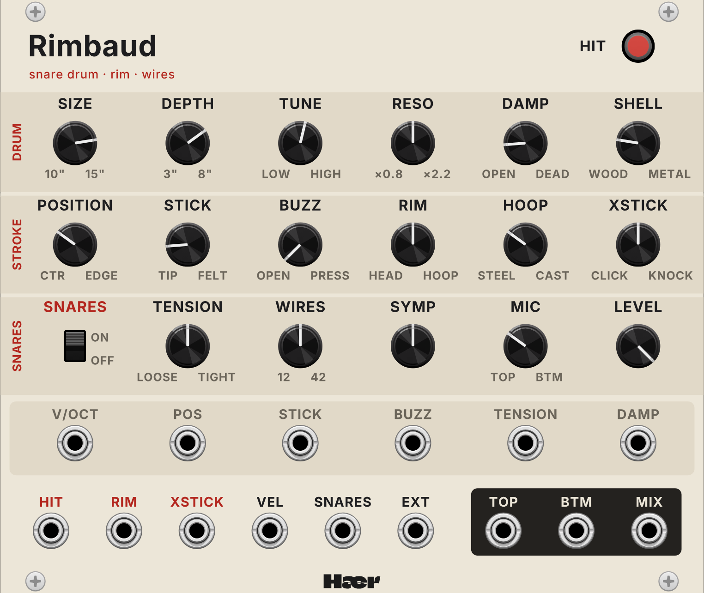

# Rimbaud

A physical model of a snare drum with its rim, for VCV Rack (30 HP, plugin 2.1.0, MIT).

Two coupled heads (Bessel-spaced modes, joined by the air inside), a pitch drop after
hard hits (tension modulation), a stick that really bounces off the head (BUZZ keeps the
fingers pressing for buzz strokes), 8 strips of snare wire that collide with the bottom
head, a metal hoop for rimshots and cross-sticks, a ringing shell, and three outputs:
top mic, bottom mic and a mix with the room. EXT lets outside sound make the snares buzz
in sympathy.

- Guide: [docs/Rimbaud-Guide.pdf](docs/Rimbaud-Guide.pdf) (source `docs/guide.html`)
- Engine (no Rack code): `src/RimbaudEngine.hpp`, with notes on how it works
- 20 presets in the right-click menu (`src/RimbaudPresets.hpp`)
- Offline checks, a demo WAV and a preset tour: `make test` (writes `test/out/rimbaud-demo.wav`, `test/out/rimbaud-presets.wav`)
- Panel: `python3 res/make_panel.py` (needs `pip install fonttools`), preview: `tools/preview.py`

Status: passes the offline checks; Haer has played it in Rack (2026-11-23: "sounds great").
