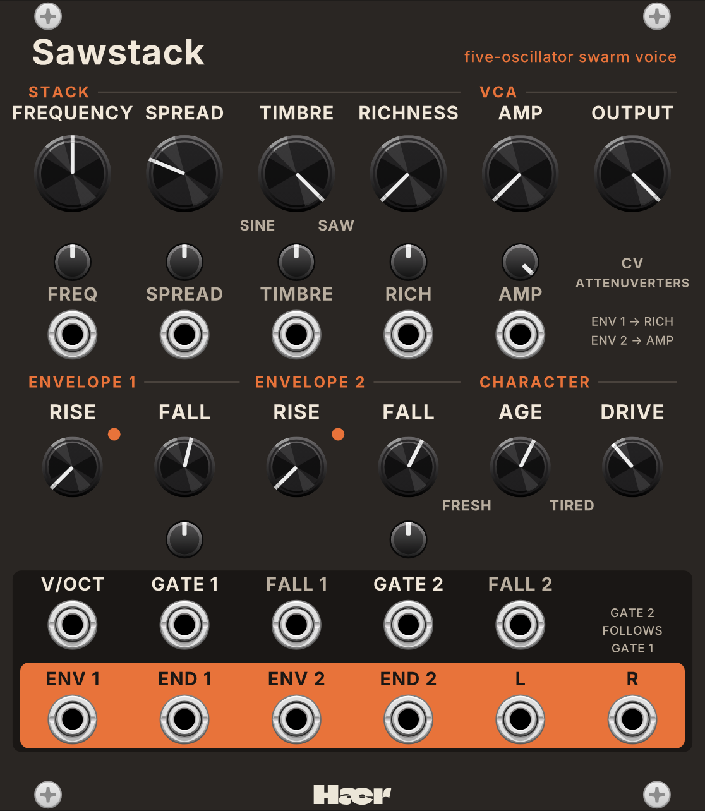

# Sawstack

Sawstack is a complete synth voice built from five oscillators that share one pitch. One knob, SPREAD, fans them apart: two tune down, two tune up and one stays in the middle. At the bottom of the knob they sit in unison and beat against each other like a supersaw. At the top they are spread over five octaves like an organ registration. TIMBRE fades every oscillator from sine to saw, RICHNESS multiplies the saw so it sounds like a hard-synced oscillator being swept, and the five are placed across the stereo field and pass through a stereo VCA. Two rise/fall envelopes are built in and already wired to RICHNESS and the VCA, so a gate and a pitch are all it needs to play.

It is inspired by the Verbos Electronics Sawtooth Stack and is not affiliated with Verbos Electronics. Some details of the hardware are not published, so parts of this module are a careful guess. They are listed at the end.

Sawstack adds three things the hardware does not have: polyphony, a choice of what the top of SPREAD reaches, and two knobs for analog character, AGE and DRIVE.

## Quick start

1. Patch a MIDI to CV module: **V/OCT** to V/OCT and **GATE** to GATE 1.
2. Patch **L** and **R** to your audio interface. Patch only one of them for a mono mix.
3. Play. Envelope 2 opens the VCA and envelope 1 sweeps RICHNESS, so each note has a short bite.
4. Turn SPREAD up slowly and listen to the swarm open into octaves.

For a polyphonic voice, set the MIDI to CV module to several channels. Every note gets its own five oscillators and its own envelopes.

## The panel

### Stack

| Control | What it does |
|---|---|
| FREQUENCY | Pitch of the centre oscillator, four octaves either side of C4. V/OCT adds to it. Right-click to make it snap to semitones. |
| SPREAD | Fans the five apart. The bottom third is a fine detune, from perfect unison up to about a third of a semitone for the inner pair. The top reaches the STACK voicing chosen in the right-click menu. The outer pair always moves twice as far as the inner pair. |
| TIMBRE | Fades each oscillator from sine to saw. In the middle the two are 90 degrees apart, as on a real triangle-core oscillator, so the fundamental dips a little there. |
| RICHNESS | Multiplies the saw, up to eight teeth per cycle. This is what a hard-synced oscillator does when its pitch is swept, and sounds like one. On high notes it backs off by itself so it never aliases. |

### VCA

| Control | What it does |
|---|---|
| AMP | Opens the VCA by itself. Leave it at zero to let envelope 2 play the VCA. Turn it up for a drone. |
| OUTPUT | Final level. At full the output is 10 V peak to peak per voice. With many voices the sum can go higher, so turn it down for big chords. |

### CV inputs and attenuverters

Each of FREQ, SPREAD, TIMBRE, RICH and AMP has a jack and a small attenuverter above it. At full, FREQ is 1 V per octave and the other four sweep the whole knob for 10 V.

Two of them are already patched inside: **envelope 1 goes to RICH** and **envelope 2 goes to AMP**. A cable in either jack replaces the envelope. The AMP attenuverter starts at full and RICH at zero, so a new module plays a plain note; turn RICH's attenuverter up to hear envelope 1 sweep the saw.

There is no velocity jack. On the hardware MIDI velocity goes to TIMBRE, so patch your MIDI to CV module's velocity into TIMBRE to get the same.

### Envelopes

Two rise/fall envelopes, 2 ms to 10 s per stage.

- A gate starts the rise. The rise always finishes, then the level holds while the gate is high, then falls. A short trigger gives a plain rise and fall.
- A new gate during the fall rises again from wherever the level is.
- **ENV 1** and **ENV 2** are 0 to 10 V. **END 1** and **END 2** give a short 10 V pulse when the fall reaches zero. Patch END back to the same envelope's GATE and it loops; patch END 1 to GATE 2 to chain them.
- **FALL 1** and **FALL 2** inputs change the fall time. At full attenuverter each volt doubles or halves it.
- **GATE 2** follows GATE 1 until you patch it.
- The small lights show each envelope's level.

### Character

**AGE** runs from factory-fresh to tired. At zero the five oscillators are mathematically perfect. Turning it up brings in, all at once and in proportion:

- small fixed tuning and tracking errors, different for each oscillator, so the detune changes from note to note and the octave stack is never quite in tune;
- high notes that sag a little flat, each oscillator by a different amount;
- slow drift at three speeds (about 0.3, 2.5 and 25 seconds) plus a shared wander, so a unison breathes instead of repeating;
- a faint fast pitch jitter that roughens the beating;
- imperfect waveshapes: a slightly bent sine, a rounded saw edge and a small glitch where the triangle core turns around;
- oscillators pulling into lock when they are nearly in tune, at unison, octaves and fifths, then letting go as they drift;
- envelopes with curved segments and a few percent of timing scatter per note;
- above 60%, a little hiss and a trace of the oscillators leaking through the closed VCA.

The default, 60%, is a healthy, well-used unit. It is silent when the VCA is closed.

**DRIVE** saturates each oscillator and then the output stage. Because the output stage sees all five oscillators at once, when they line up in unison the mix compresses, so the beating changes tone as well as level. AGE and DRIVE interact: at high AGE the saturation soaks up some of the extra movement.

### Right-click menu

- **STACK voicing**: what the top of SPREAD reaches.
  - *Octaves* (default): -2, -1, 0, +1, +2 octaves.
  - *Fifths*: an octave down, a fourth down, the root, a fifth up, an octave up.
  - *Harmonics*: harmonics 1 to 5 of a note a twelfth below FREQUENCY. The centre oscillator is the third harmonic. With TIMBRE at sine this is a small additive organ.
- **FREQUENCY knob snaps to semitones.**
- **New unit**: every Sawstack has its own set of component errors, saved with the patch so it sounds the same next time. This rolls a new set, like swapping for another module off the shelf. In poly each voice is a different unit, as in an analog polysynth. The menu shows the current unit's number.

## Factory presets

| Preset | What it is |
|---|---|
| Init Swarm | The defaults. |
| Tight Unison | SPREAD at zero: five oscillators phasing in unison. |
| Supersaw Pad | Light swarm with slow envelopes. Turn up RICH's attenuverter for movement. |
| Octave Organ | Sines spread over five octaves. |
| Sync Sweep Bass | Two octaves down, envelope 1 sweeping RICHNESS. |
| Fifths Stack | Fifths voicing at full SPREAD. |
| Harmonic Bells | Harmonics voicing, sines, short fall. |
| Tired Unit | AGE and DRIVE high. |
| Factory Fresh | AGE and DRIVE at zero: the perfect digital stack, for comparison. |
| Driven Drone | VCA open, heavy drive. Plays with nothing patched. |
| Sine Swarm | Five detuned sines. |
| Looper | VCA open. Patch END 1 to GATE 1 and ENV 1 to SPREAD: the stack opens and closes by itself. |

## Patch recipes

**1. Velocity into timbre.** MIDI to CV: V/OCT, GATE to GATE 1, VELOCITY to TIMBRE. Set TIMBRE to about a third and its attenuverter to two thirds. Soft notes are round, hard notes are bright, as on the hardware.

**2. The sync-sweep bass.** Load Sync Sweep Bass. Play low notes with short gates. Turn RICH's attenuverter between a third and full to set how far each note sweeps. FALL 1 sets how long the sweep lasts.

**3. A breathing octave drone.** Load Looper. Patch END 1 to GATE 1 and ENV 1 to SPREAD. Set RISE 1 and FALL 1 long. Each loop opens the unison out to the octave stack and folds it back.

**4. Polyphonic pad.** MIDI to CV with 6 or 8 channels. Load Supersaw Pad. Each note is its own five-oscillator stack with its own drift, so chords shimmer without any chorus effect.

**5. Self-playing drone.** Load Driven Drone. Patch two slow LFOs, one into SPREAD and one into TIMBRE, with the attenuverters at about half. Add a third, slower one into RICH.

**6. Additive organ.** Choose Harmonics voicing, TIMBRE at sine, SPREAD full. Play it as an organ. Bring SPREAD back to about 80% and the harmonics go slightly sour, like an old drawbar organ.

**7. Two units layered.** Put two Sawstacks side by side with the same patch, choose New unit on one, and pan one left and one right. Their errors differ, so the pair is wider than either.

**8. Fresh against tired.** Play a held unison note and sweep AGE from zero to full. At zero it beats like a clean digital chorus; by 60% it wanders and locks; at full it sags and hisses.

**9. Chained envelopes.** Patch END 1 to GATE 2 and set AMP's attenuverter to full. Envelope 1 sweeps RICHNESS first, then the note sounds when envelope 2 starts: a delayed, swelling attack.

## What is a guess

Verbos does not publish a manual with numbers, so these parts are informed guesses, chosen to sound right:

- How far SPREAD goes. "Several octaves" is all the hardware description says. Here the inner pair reaches an octave and the outer pair two.
- The shape of the SPREAD knob (fine detune in the bottom third).
- Exactly how RICHNESS multiplies the saw. Here it amplifies the saw and wraps it, which is the same as hard sync.
- Where each oscillator sits in the stereo field. Here the low and high pairs alternate sides so the bass is not all on one side.
- How the envelopes behave with a held gate.

If you play the hardware and something sounds different, the model is easy to change.
