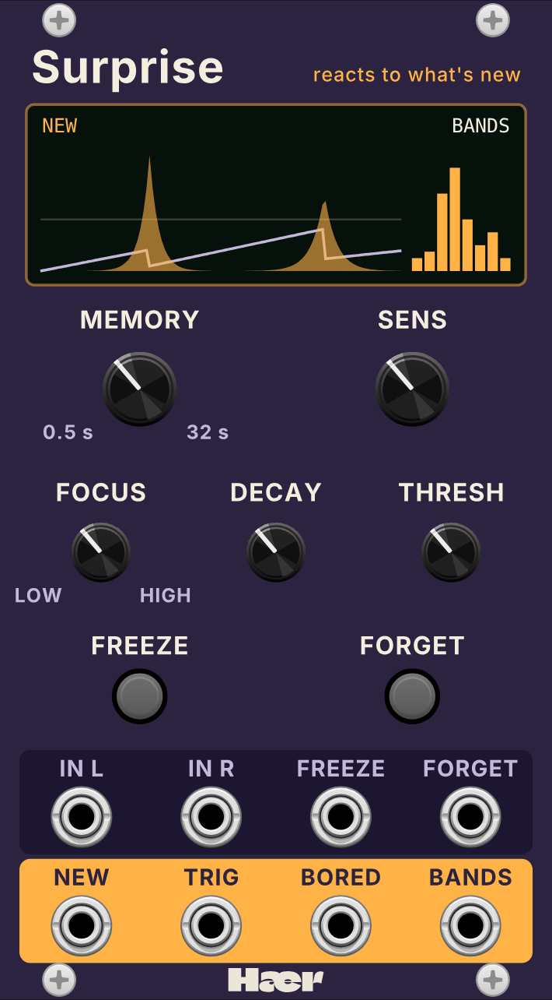
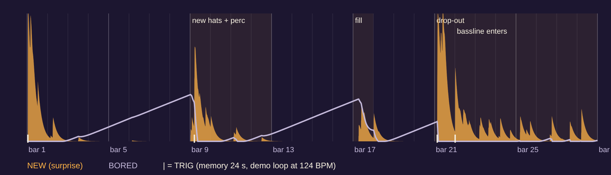

# Surprise

A follower that reacts to **novelty**, not loudness. Feed it audio (a loop, a
drum bus, a whole mix). NEW jumps when the sound does something it hasn't heard
in the last MEMORY seconds, and stays quiet on repeats. A loop goes quiet on
NEW once it has played through, while a new part, a fill, a drop-out or a
change of pattern stands out.

The picture shows the demo loop. The first pass is all new, the loop then settles, and the new hats
light it up. Going back to the old loop at bar 13 does **not** trigger, because
it's still in memory. The fill, the drop-out and the bassline all stand out. BORED climbs
while nothing changes.

## Controls
| | |
|---|---|
| MEMORY | How far back it compares: 0.5 s to 32 s. Longer means it remembers parts that come back |
| SENS | Sensitivity |
| FOCUS | Listen more to the lows or the highs |
| DECAY | How fast NEW falls back (20 ms to 4 s) |
| THRESH | Where TRIG fires |
| FREEZE | Stop learning: memory stays as it is, so anything not in it stays "new" (button or gate) |
| FORGET | Clear the memory (button or trigger) |

## Outputs
- **NEW**: 0-10 V surprise.
- **TRIG**: fires when NEW passes THRESH.
- **BORED**: 0-10 V that climbs while nothing new happens (15 s to 4 min to full, right-click) and drains when something does. It's a loop-fatigue meter: use it to bring in a change.
- **BANDS**: 8-channel poly, how new each band is (low to high).

## How it works
Eight band-pass filters, one frame of band levels every 20 ms. The last three
frames are compared with every frame in memory, and the closest match decides
how new it is. `make test` renders `test/surprise-demo.wav`, where a pad's filter
opens with NEW and a bell rings on TRIG, and checks the behaviour above.

MIT licence.
