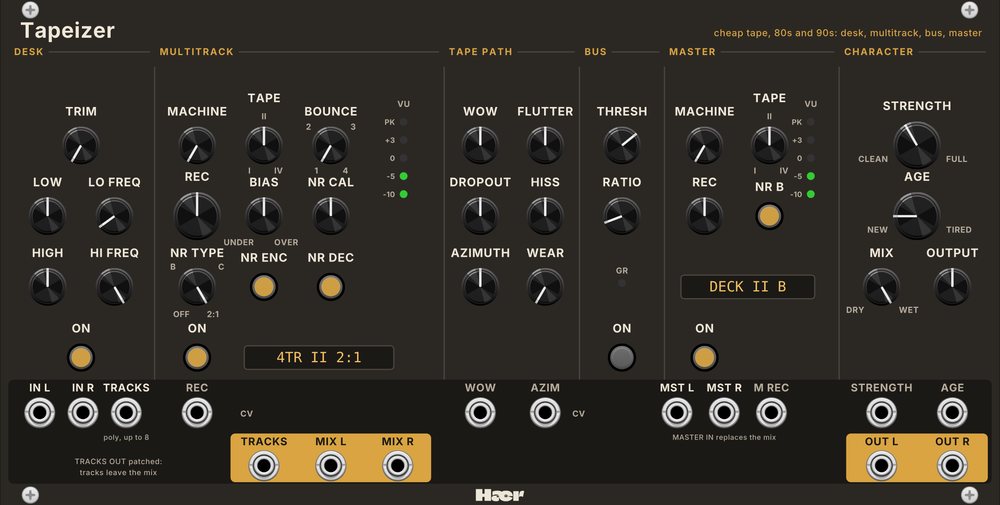

# Tapeizer



Tapeizer is the recording half of an 80s or 90s record: the sound of music that went through a small mixing desk, onto a cheap multitrack tape machine, through a budget compressor and down to a cassette or a quarter-inch reel before anyone cut a lacquer. It is not a model of a big studio tape machine. It is the four-track in the bedroom, the eight-track in the back room, and the hi-fi cassette deck it was all mixed onto.

It pairs with **Vinylizer**. Put Tapeizer first and Vinylizer after it, and you have the whole path from the recording to the record.

Everything is on one 50 HP panel, left to right, in the order the signal travels: DESK, noise reduction, the MULTITRACK deck, the TAPE PATH controls the decks share, the BUS compressor, the MASTER deck, and the CHARACTER knobs.

Some settings are modelled on particular machines: the four-tracks on the Tascam Portastudio family and the Fostex 260, the eight-tracks on the Tascam 488 cassette eight-track, the Tascam 388 and the Fostex A-8 and R8 reel eight-tracks, and the noise reduction on Dolby B, Dolby C and dbx. Tapeizer is not affiliated with Tascam, Fostex, Dolby or dbx, and none of their names appear on the panel.

## Quick start

1. Patch a stereo source (a drum machine, a mixer's output) into **IN L** and **IN R**. Patch only IN L for mono.
2. Patch **OUT L** and **OUT R** to your audio interface.
3. Play. The defaults are a cassette four-track with 2:1 noise reduction, mixed down to a cassette deck, at a gentle STRENGTH of 40%.
4. Turn **REC** on the multitrack deck up until the red peak light flickers on loud hits. That is where tape starts to thicken and squash.
5. Turn **STRENGTH** to taste. Turn it right up to hear the machines as they really were. Turn it down for a hint.

## Signal path

```
IN L/R ─────────┐
                ├─► DESK ─► MULTITRACK deck (x BOUNCE) ─► mix ─► MIX OUT L/R
TRACKS (poly) ──┘                │                          │
                                 └─► TRACKS OUT (poly)      │
MASTER IN L/R (normalled to the mix) ◄──────────────────────┘
        └─► BUS compressor ─► MASTER deck ─► MIX (dry/wet) ─► OUTPUT ─► OUT L/R
```

Each of DESK, MULTITRACK, BUS and MASTER has a lit button. When the light is on, the section is in the path. Pressed off, the section passes its input straight through. Switching never clicks: the output ramps down for 5 ms, waits for the change, and ramps back up.

## STRENGTH and AGE

These two big knobs on the right are the ones to reach for first.

### STRENGTH

STRENGTH is how much of the tape sound you hear. It scales every way the machines fall short of perfect, in both decks at once:

- the soft top end and the way loud treble squashes;
- saturation and the thickening of loud passages;
- wow, flutter and the swimmy treble from azimuth;
- hiss, hum, crosstalk between tracks and the grain that rides on the signal;
- drop-outs;
- the head bump in the low end and the bass roll-off.

At **0** both decks are transparent apart from a few milliseconds of delay. At **100%** they are the real machines, as faithfully as the model knows them, and that is a lot. The first sketches were made at 100% and were too much for most music, so the default is **40%**: clearly tape, never in the way. Between 25% and 60% is where most of the presets sit.

STRENGTH does not touch the parts you set on purpose: the DESK, the BUS compressor, the noise reduction switches, the CAL knob or the DAT machine.

### AGE

AGE is the state of the gear. At **0** both machines have just been serviced. Turning it up brings in, all together: a dirtier, more worn head; azimuth errors; worn pinch rollers and belts (more wow); level drift between record and playback, which makes the noise reduction mistrack; channel imbalance; more crosstalk, hiss and hum; a magnetised head that adds a trace of even harmonics; and more frequent drop-outs. The default is 20%.

AGE decides *what* is wrong with the machine. STRENGTH decides *how much of it* you hear. So high AGE at low STRENGTH is an old machine heard faintly, and low AGE at high STRENGTH is a new cheap machine heard in full.

Every Tapeizer is a slightly different unit. Its small fixed errors (per-track level and calibration, which way the head is tilted) are drawn from a seed saved with the patch. **New unit** in the right-click menu draws a new one.

Both knobs have a CV input. ±5 V sweeps the whole knob.

## DESK

The channel strip of a cassette multitracker, applied to every track.

| Control | What it does |
|---|---|
| TRIM | Drive into the desk's op-amp stage, 0 to 24 dB. It stays clean, then clips hard and slightly unevenly. The output level is compensated, so you hear the clipping, not a jump in volume. This is the Portastudio overdrive. |
| LOW, LOW FREQ | A low shelf, ±15 dB, at 80 to 1200 Hz (default 100 Hz). |
| HIGH, HIGH FREQ | A high shelf, ±15 dB, at 700 Hz to 10 kHz (default 10 kHz). |

Boosting HIGH before the tape is what engineers did to fight the soft top of cassette. On tape that boost then squashes on loud passages, so it sounds bright on quiet parts and dense on loud ones.

## Noise reduction

For the multitrack deck. Every model here is a simplified model with the right amount of boost and cut at the right levels, not the licensed circuit.

| Control | What it does |
|---|---|
| TYPE | OFF, **B**, **C** or **2:1** (default). B is modelled on Dolby B: up to 10 dB of treble lift on quiet signals, one sliding band. C is modelled on Dolby C: two stages, up to about 20 dB, with an anti-saturation shelf. 2:1 is modelled on dbx: the whole signal is compressed 2:1 on the way to tape and expanded 1:2 on the way back. |
| ENC | Encode on the way to tape. |
| DEC | Decode on the way off tape. |
| CAL | The level error between the tape and the decoder, ±6 dB. At 0 the decoder sees the level it expects. |

Used properly (ENC and DEC both on), noise reduction removes most of the hiss, but anything the tape does in between is exaggerated. With 2:1, a 2 dB treble loss on tape comes back as 4 dB, a drop-out becomes a hole, and the hiss swells behind every bass note and fades away again. That breathing is part of the sound.

ENC and DEC have separate switches because the misuses were part of the craft:

- **ENC on, DEC off with B or C**: a bright, compressed top end. The quiet treble stays lifted. See *The bright trick* below.
- **ENC off, DEC on**: dull and dynamic. Quiet treble is pushed down.
- **2:1 with ENC on, DEC off**: a crushed, airless, very even sound.
- **CAL away from 0**: the decoder mistracks. With 2:1, the level and dynamics shift. With B and C, the top end goes dull or bright depending on the direction.

## MULTITRACK deck

| Control | What it does |
|---|---|
| MACHINE | Which recorder. See the table below. |
| REC | Record level, ±12 dB, with CV. The output is compensated, so this changes the tape sound, not the volume. Low is clean and hissy. High is thick, squashed and soft on top. This is the main performance control. |
| TAPE | **I** (normal), **II** (chrome) or **IV** (metal) on cassette machines. On the reel machines the three settings are older, standard and high-output tape. Changes headroom, treble headroom and hiss. |
| BIAS | -1 to +1. Under-biased (left) is brighter and gritty on quiet sounds and loses level on low notes. Over-biased (right) is smooth and dull. |
| BOUNCE | 1 to 4. How many generations the tracks go through: the whole deck, noise reduction included, is run that many times in a row. |
| VU | The loudest track's level on tape, after noise reduction: -10, -5, 0, +3 VU and a red peak light when a sound goes past the tape's maximum level. |

The machines:

| Setting | What it is | Modelled on |
|---|---|---|
| 4TR | Four tracks on a cassette at normal speed (4.76 cm/s) | The Tascam Porta One, 244 and 424 at normal speed |
| 4TR HI | Four tracks on a cassette at double speed (9.5 cm/s) | The 424 and similar at high speed |
| 4TR C | Double-speed four-track with a little more headroom and a finer head | The Fostex 260 |
| 8TR CASS | Eight tracks on a cassette at double speed: narrow tracks, more hiss and crosstalk | The Tascam 488 and similar |
| 8TR 7.5 | Eight tracks on quarter-inch reel at 19 cm/s (7.5 inches per second) | The Tascam 388 |
| 8TR 15 | Eight tracks on reel at 38 cm/s (15 inches per second): the medium-fi end | The Fostex A-8 and R8, and the Tascam 38 |

## TAPE PATH

These act on both decks.

| Control | What it does |
|---|---|
| WOW | Slow speed drift from the capstan and pinch roller. 50% is the machine's own amount, 0 is none, 100% is four times as much. CV input. |
| FLUTTER | Faster speed wobble from the motor and belts, plus the fine roughness of tape scraping over the heads. Same scale as WOW. |
| DROPOUT | How often a speck of dirt lifts the tape off the head. The treble goes first. Same scale. |
| HISS | The tape's own noise and the mains hum. 0 turns both off. Same scale. |
| AZIMUTH | The tilt of the head, ±20 arc minutes. It costs treble, and in stereo it delays one channel against the other, so in mono the top end phases in and out. CV input. |
| WEAR | The condition of the tape itself: shed oxide, less headroom, more drop-outs. |

## BUS

A budget VCA compressor across the mix on its way to the master deck: the "minimal mastering" of a cheap studio. It is **off by default**; press its button to bring it in.

| Control | What it does |
|---|---|
| THRESH | -24 to 0 dB relative to 0 VU. |
| RATIO | 1.5:1 to 20:1. |
| GR light | Lights with gain reduction. |

It is fast (3 ms attack, 120 ms release) with a hard knee, and the two sides are linked so the stereo image stays put.

## MASTER deck

A second, complete tape machine for the mixdown.

| Control | What it does |
|---|---|
| MACHINE | **DECK**: a hi-fi cassette deck. **BOOMBOX**: a portable cassette recorder, dull, wobbly and hissy. **1/4 INCH**: a quarter-inch two-track reel, the clean option of the 80s. **DAT**: 16-bit digital with a steep filter at 20 kHz, the clean option of the 90s. |
| REC | Record level, ±12 dB, with CV. |
| TAPE | I, II or IV, as on the multitrack deck. Ignored by DAT. |
| NR B | B-type noise reduction, encode and decode. On by default. Ignored by DAT. |
| VU | As on the multitrack deck. |

## Inputs and outputs

| Jack | What it does |
|---|---|
| IN L, IN R | Stereo input. IN R follows IN L until it is patched. Each is one track on the multitrack tape. |
| TRACKS | Polyphonic input. Each channel, up to 8, becomes one more track on the same tape. They share one transport, so they wow together, and each leaks a little into its neighbours. The outer tracks are a little worse, as on a real machine. Unless TRACKS OUT is patched, the tracks are mixed equally into both sides. |
| TRACKS OUT | Polyphonic output: each TRACKS channel after the multitrack deck. When this is patched, the tracks are left out of the internal mix, so you can mix them yourself and come back in through MASTER IN. |
| MIX OUT L, R | The mix after the multitrack deck, before the bus and master deck. |
| MASTER IN L, R | The input to the BUS and MASTER deck. Normalled to the internal mix. |
| OUT L, OUT R | The final output, after MIX and OUTPUT. |
| CV | STRENGTH, AGE, REC, MASTER REC, WOW and AZIMUTH. ±5 V sweeps the whole knob. |

MIX blends the dry input (IN L and IN R) with the processed output. The dry signal is delayed to match the module's latency, so the blend does not comb.

Levels: 5 V peak is +3 dB over 0 VU, so a typical ±5 V Rack signal at REC 0 sits just above meter zero.

## Right-click menu

- **Hum**: 50 Hz (default) or 60 Hz mains.
- **New unit**: draw a new set of fixed machine errors. The current unit's number is shown just above it.

## Presets

| # | Name | What it is |
|---|---|---|
| 1 | Four-Track To Cassette | The defaults: a cassette four-track with 2:1 noise reduction, mixed to a cassette deck. |
| 2 | Two Decks 1985 | No multitrack at all: one cassette deck recorded onto another, normal tape, no noise reduction, both a little hot. The method behind some of the first house records. |
| 3 | Clean Four-Track | A careful high-speed four-track, mixed to DAT. The 90s demo. |
| 4 | In The Red | Desk and both decks pushed hard. |
| 5 | 260 Session | The Fostex 260-style four-track with C-type noise reduction and a little desk EQ, mixed to DAT. |
| 6 | Eight On A Cassette | The cassette eight-track with 2:1. |
| 7 | Studio Eight | Quarter-inch eight-track, hot, mixed to quarter-inch. |
| 8 | Budget Reel | The half-inch eight-track with C-type, mixed to quarter-inch. The medium-fi end. |
| 9 | Third Bounce | A high-speed four-track, three generations deep. |
| 10 | Boombox Dub | Multitrack bypassed, straight to a boombox, hot. |
| 11 | Bright Trick | B-type encoded and never decoded. |
| 12 | Neglected | STRENGTH 70%, AGE full, worn tape. A cassette that lived in a car. |

## Patch recipes

### 1. A drum machine through the defaults

Drum machine stereo out to IN L and IN R, OUT L and OUT R to the interface. Raise REC until the peak light flickers on the kick and snare. The hats will soften and sit back on loud hits and come forward between them. That ducking is most of what people mean by tape glue. Try TAPE I for less headroom and more of it.

### 2. Stems on TRACKS, mixed in Rack

Merge kick, snare, hats, bass and chords into one poly cable with a Merge module and patch it to **TRACKS**. Patch **TRACKS OUT** to a Split module and on into a Rack mixer, so each part has its own fader and pan after the tape. Patch the mixer's stereo out back into **MASTER IN L** and **R**. Now every part was recorded on its own track of the same tape, with real crosstalk between neighbours, and you mix them like an engineer did, onto the master deck. Order the parts in the Merge so the things that should bleed into each other sit next to each other.

### 3. The two-deck method

Load preset 2, or set MULTITRACK and MASTER to cassette machines with NR OFF. Put your drums and bass on **TRACKS** and the parts played on top on **MASTER IN**, through a mixer that also takes **MIX OUT**. The rhythm goes through cassette twice and the overdubs once, exactly as when a pass on one deck was played back into the other while the next part was played live.

### 4. Bouncing

Set BOUNCE to 2, 3 or 4 and listen to the top end recede and the noise reduction breathe more with each generation. For a realistic bounce, keep BOUNCE at 1 for the parts recorded last and run the earlier ones through a second Tapeizer at BOUNCE 2 or 3 before they reach TRACKS.

### 5. The bright trick

Load preset 11, or set TYPE to **B** or **C**, ENC on, DEC off. Quiet treble is lifted by up to 10 dB (B) or 20 dB (C) and loud treble is left alone, so the top end becomes bright and compressed: hats and room sound jump forward. Turn the master deck's NR B off so it does not undo the effect.

### 6. Phasing from azimuth

Patch a slow LFO (0.05 to 0.2 Hz, ±2 V) to **AZIMUTH** and listen in mono. The top end sweeps in and out of phase, like a cassette master on a deck whose head was never quite aligned. Raise AGE for a deeper wander of its own.

### 7. Level-dependent treble

Patch an envelope follower, or the envelope that plays a part, to **REC** CV. Loud notes push the tape harder, so they come out thicker and duller while the quiet tails stay bright. A sidechain from the kick on a pad gives a tape pump without any compressor.

### 8. To the record

Patch **OUT L** and **OUT R** into Vinylizer and Vinylizer to the interface. Set Tapeizer for the recording (preset 1, 5 or 8) and Vinylizer for the pressing. That is the whole path a record took: desk, multitrack, mixdown, lacquer, vinyl.

### 9. A worn tape that breathes

Set TYPE to 2:1, HISS up to 75%, WEAR to 50%, and play just drums and bass. Then switch TYPE to OFF and back. Without noise reduction the hiss is steady. With it, the hiss swells up behind every bass note and fades away.

### 10. Wow as an effect

Patch a sample-and-hold or a slow random source to **WOW** CV and turn the WOW knob right up. Short bursts of pitch drift, like a pinch roller catching. Keep STRENGTH below 50% so it stays an accent.

## Latency

Each deck adds about 2.4 ms (116.5 samples at 48 kHz) per pass and the desk adds well under a millisecond, so with the defaults the module is about 5.5 ms late. Each BOUNCE adds another pass. Bypassed sections add nothing. The dry side of MIX is delayed by the same amount.

## What is simplified

- **Noise reduction.** B and C are sliding-band models with the right boost at the right levels, not the licensed circuits. C is the roughest. 2:1 is close to the real thing in principle; its detector and time constants are a careful guess.
- **The tape curve** is a smooth saturation with a small memory for under-bias, not a full magnetic hysteresis model.
- **Machine figures.** The cassette four-track figures come from published specifications. The reel machines' figures are from memory, as are the head bump frequencies, crosstalk levels, the treble headroom of each tape type and every AGE scaling. They are judgement, tuned by ear against recordings.
- **Gaussian noise** uses a cheap approximation, which is inaudible.

## Credits

Design by Fable, build by Opus, for Haer. GPL-3.0-or-later.
