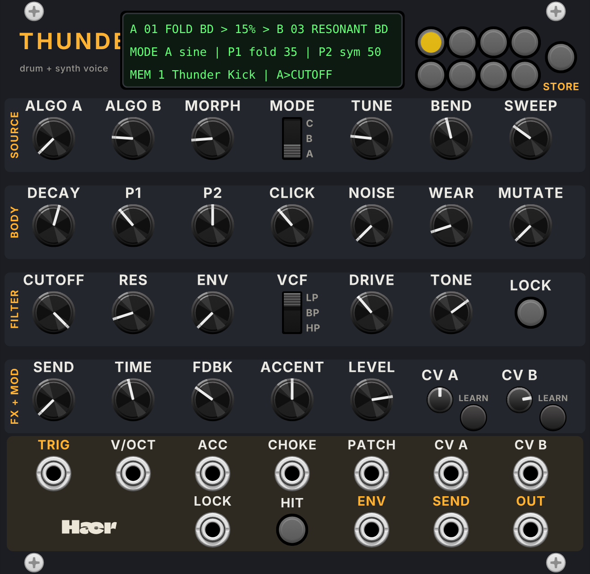
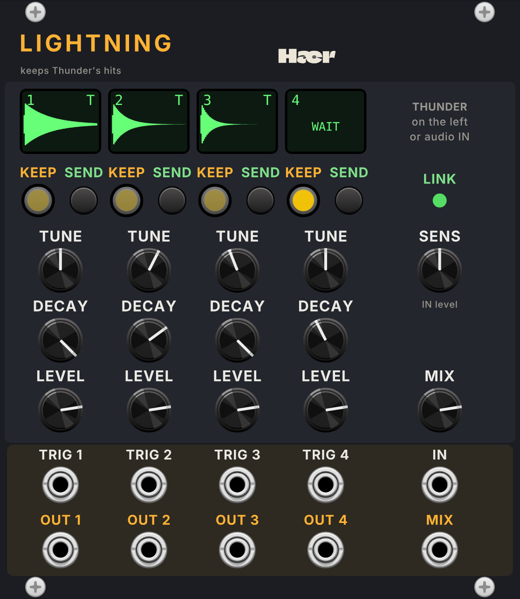

# Thunder

A drum voice for VCV Rack, 26 HP, with a companion sampler, Lightning (below). Thunder follows
the idea of Erica Synths' Perkons voices (Pērkons is the Latvian thunder god): a digital sound
engine, then a multimode filter, then an overdrive, with DECAY fully up turning any sound into a
drone. Every sound model here is our own; nothing comes from Erica's firmware or samples.



## Signal path

```
ALGO A ──┐
         ├─ MORPH ─ + CLICK + NOISE ─ filter (HP/BP/LP) ─┐  up to 4 overlapping hits
ALGO B ──┘                                                ┘
   ─ overdrive (DRIVE = dry/wet) ─ TONE ─┬─────────────────── LEVEL ─ OUT
                                          └ SEND ─ delay ─┘   (or SEND output when patched)
```

## The 15 algorithms (MODE switch = 3 variants of each; P1 and P2 change meaning, shown on the screen)

| # | Algorithm | P1 | P2 | MODE A / B / C |
|---|---|---|---|---|
| 1 | Fold BD | fold | symmetry | sine / triangle / fold follows envelope |
| 2 | Wavetable BD | position | surf (envelope sweeps the table) | classic / vocal / digital |
| 3 | Resonant BD | knock | fm (pitch follows level) | pure / punch / overdriven |
| 4 | Complex | ratio | index | FM / ring / feedback FM |
| 5 | Res Snare | noise tone | snap | tight / open / brush |
| 6 | Slap | tone | spread | 3, 4 or 5 random-gap retriggers |
| 7 | Tom | overtone | skin | tom / conga / talking drum |
| 8 | Noise Hat | tone | metal | white / crushed / dust |
| 9 | Pulse Hat | spread | tone | 808 ratios / bell ratios / random per hit |
| 10 | Karplus | bright | damp | string / drum / metal |
| 11 | Sample | start | attack | slot 1 / 2 / 3 (right-click to load WAVs) |
| 12 | Metal | inharmonic | strike | cowbell / bell / plate |
| 13 | Particles | beads | size | maracas / tambourine / scrape (guiro) |
| 14 | Circuit 909 | shape | attack | kick / snare / rim (our own analogue-style model) |
| 15 | Chaos | chaos | speed | logistic map / feedback FM / Lorenz attractor |

## Controls

- **Source:** ALGO A, ALGO B, MORPH (equal-power crossfade A to B), MODE, TUNE (20 Hz to 2.5 kHz; its jack is V/OCT), BEND (pitch envelope up to 4 octaves), SWEEP (pitch envelope time), CLICK.
- **Body + filter:** DECAY (12 ms to 4.8 s, fully up = drone), P1, P2, NOISE, CUTOFF (LP opens clockwise, HP opens anticlockwise), RES, ENV (filter envelope, +-6 octaves), VCF type.
- **Drive + FX:** DRIVE, TONE, SEND, TIME, FDBK (bucket-brigade style delay: dark repeats, slight wow), ACCENT (how much the ACC input adds level, brightness and drive), LEVEL (left out of randomize).
- **Move:** WEAR (every hit slightly different in pitch, decay, brightness, level and timing), MUTATE (P1, P2, MORPH and MODE wander from hit to hit; left out of randomize so Ctrl+R never switches it on), LOCK (freeze where MUTATE got to; also a gate input).
- **Memories:** 8 slots with factory sounds. Press a slot to recall it. Press STORE, then a slot, to save. PATCH CV (0-10 V) picks the slot, so a sequencer can change the sound per step.
- **CV A / CV B:** two assignable CV inputs, each with an amount trim (attenuverter). Press LEARN, then move the knob it should control (or pick a target from the right-click menu). +-5 V = full range of that knob. Defaults: CV A = CUTOFF, CV B = MORPH. The screen shows the current target.
- **Jacks:** TRIG, V/OCT, ACC (5 V = full accent), CHOKE, PATCH, CV A, CV B, LOCK gate; outputs ENV (0-10 V), SEND (patching it bypasses the built-in delay), OUT.

## Building

`make` with the Rack SDK, or push and let GitHub Actions build it. `make test` renders demo WAVs to
`test/out/` without Rack. `python3 res/make_panel.py` redraws the panel.

MIT licence.

# Lightning

A 4-slot hit catcher for Thunder, 22 HP. Put it directly to the right of Thunder (the green LINK
light comes on). Randomise or play Thunder until a hit sounds right, press **KEEP 1**, find the next
one, press **KEEP 2**, and so on. Nothing to trim: Thunder tells Lightning exactly when each hit
starts, and Lightning cuts the end where the sound (including delay echoes) has died away.



- **KEEP n:** keeps the last whole hit. If a hit is still ringing, KEEP waits for it to finish (the
  slot shows WAIT) and takes that one. Press again to cancel.
- **SEND n:** puts the knob settings that made slot n's hit back on Thunder (including where MUTATE
  had wandered to; MUTATE's wander is cleared and LOCK turned on so the sound stays put). Lit when the
  slot came from Thunder and Thunder is linked.
- **Waveforms:** click one to hear that slot. **T** marks a sound kept from Thunder.
- **TUNE** (+-24 semitones, right-click for semitone steps), **DECAY** (fully up = the whole hit,
  lower fades it sooner), **LEVEL**, per slot.
- **TRIG 1-4**, **OUT 1-4** and **MIX**. A patched OUT leaves the mix (right-click to keep it in).
- **IN** + **SENS:** with IN patched, Lightning listens to any audio instead of Thunder and finds hits
  by level (it also catches a hit that lands on the tail of the one before).
- The four sounds are saved inside the patch. Right-click a slot to save it as a WAV, load a WAV, or
  clear it.
