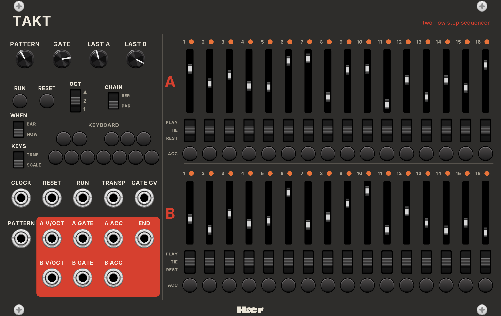
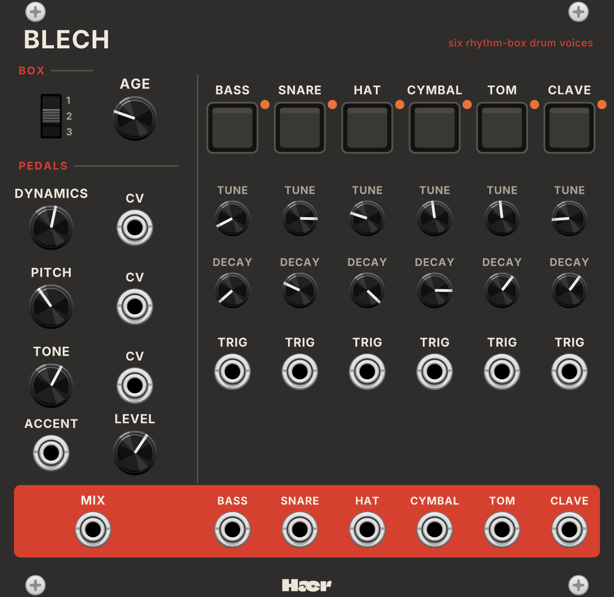
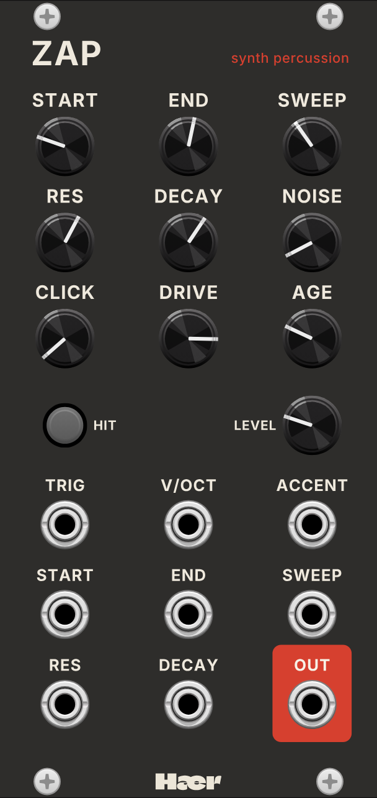
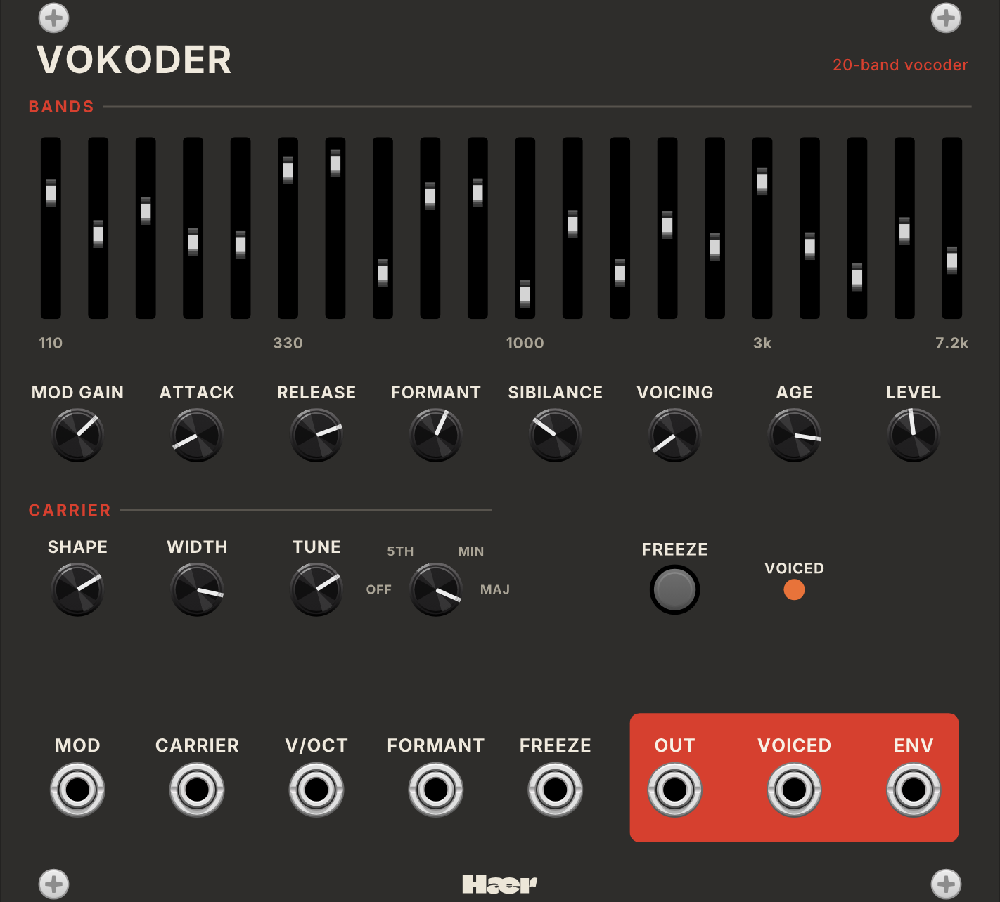
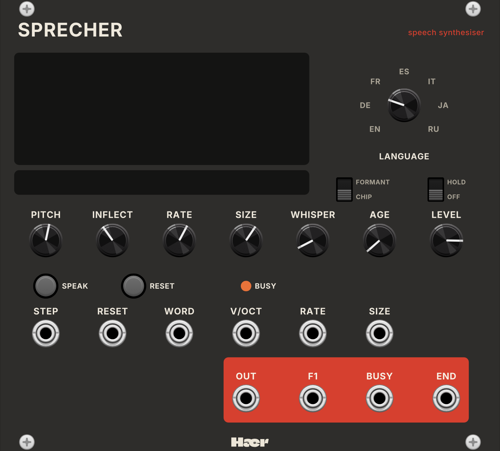
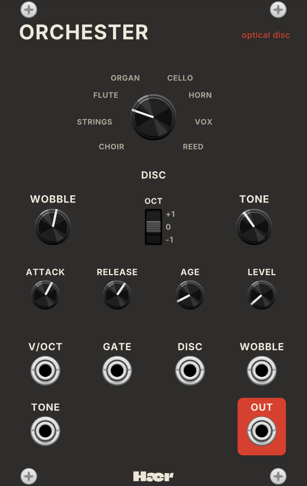
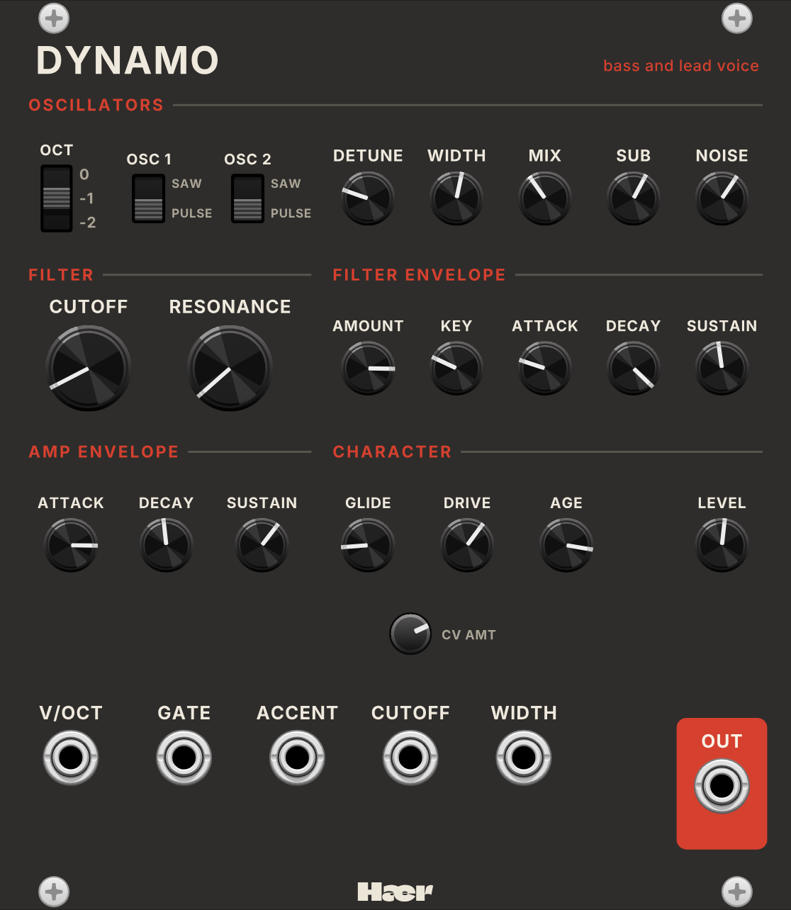

# Werkbank

Werkbank is a set of seven VCV Rack modules for building electronic pop the way it was built in a German studio workbench at the end of the 1970s: a step sequencer that keeps a pattern in a scale while you transpose it live, a rhythm box with pedals, a synth drum, a vocoder, a talking machine, an optical-disc choir keyboard and a two-oscillator bass voice.

The set is inspired by the instruments heard on the records of Kraftwerk between 1975 and 1981. It is not affiliated with the band or with any maker of those instruments. Nothing here is a copy of a particular product. Each module is a model of how that kind of instrument works, with an AGE knob for the looseness of old analog circuits.

| Module | What it is | HP |
|---|---|---|
| TAKT | Two-row 16/32-step pitch sequencer with an interval quantiser, live transpose and eight patterns | 40 |
| BLECH | Six analog rhythm-box drum voices with pads and DYNAMICS, PITCH and TONE pedals | 26 |
| ZAP | Synth percussion: a pinged resonant filter with a swept pitch (poly) | 12 |
| VOKODER | 20-band vocoder with voiced/unvoiced switching, formant shift, freeze and a built-in carrier | 28 |
| SPRECHER | Speech synthesiser: type words, clock them, sing them by V/OCT. Formant and speech-chip engines | 28 |
| ORCHESTER | Optical-disc keyboard: looped choir, strings, flute and five more, with disc wobble (poly) | 16 |
| DYNAMO | Two-oscillator ladder-filter bass and lead voice (poly) | 22 |

**Conventions.** Audio is ±5 V. Triggers and gates switch at 1 V (and reset below 0.1 V). V/OCT 0 V is C4. Every knob is smoothed over 5 ms, so turning one never clicks; CV inputs are not smoothed.

**AGE.** Six of the modules have an AGE knob, from factory-fresh (0) to tired (1). The default is 30%. Every unit has its own "personality" (which oscillator runs sharp, which band is a little louder), set when the module is created and saved with the patch. AGE scales how far that personality shows. Hiss, hum and bleed only come in above 60%, so at the default every module is silent when nothing plays. Right-click and choose **New unit** for a different personality: like buying a second one of the same instrument.

## TAKT: the sequencer

TAKT has two rows of sixteen steps. Each step has a slider for pitch, a three-way switch (PLAY, TIE, REST) and an ACCENT button. The two rows run side by side (PARALLEL) or one after the other as a single 32-step row (SERIES).

The sliders do not output raw voltage. Each slider position is rounded to a semitone and then moved to the nearest note allowed by the SCALE (ties go down). Then the transposition is added. The pattern keeps its exact shape when you transpose it, which is how one bass line can follow a chord sequence.

| Control | What it does |
|---|---|
| PATTERN | Eight patterns. A new pattern starts when row A next plays step 1, so changes land on the bar. When stopped it changes at once. The panel always shows the current pattern. |
| GATE | Gate length, 5% to 100% of the step. At 100% the gate drops for 1 ms between two PLAY steps so envelopes re-trigger. |
| LAST A, LAST B | The last step of each row, 1 to 16. Rows of different length drift against each other. In SERIES, LAST B sets where the 32-step loop ends (when LAST A is 16; if LAST A is lower, the loop is row A only). |
| RUN | Starts and stops. A gate in the RUN jack replaces the button. |
| RESET | The next clock plays step 1. A reset up to 1 ms after a clock counts as before it, so a clock and reset from the same source line up. |
| OCT | Slider travel: 1, 2 or 4 octaves. |
| CHAIN | PAR: two 16-step rows. SER: one 32-step row (A then B); the row B jacks then carry the same signals as row A. |
| WHEN | NOW: a new transposition takes effect at once. BAR: only when row A plays step 1. |
| KEYS | SCALE: the keyboard toggles which notes are allowed (at least one stays on). TRNS: the keyboard chooses a transposition of 0 to 11 semitones. The lights show whichever the switch selects. |
| Steps | Slider (its tooltip shows the note it plays), PLAY / TIE / REST, ACCENT. PLAY sets the pitch and opens the gate for GATE × the clock period. TIE sets the pitch and holds the gate from the step before with no gap, for glides. REST plays nothing and keeps the last pitch. |

**Jacks.** In: CLOCK, RESET, RUN, TRANSP (V/OCT, rounded to semitones, added to the keys), GATE CV (±5 V sweeps the knob range), PATTERN (1 V per pattern, added to the knob). Out: V/OCT, GATE and ACC (10 V while an accented step's gate is high) for each row, and END (a 1 ms trigger when row A wraps to step 1).

**Right-click:** Copy pattern, Paste pattern, Clear pattern, Randomise pitches in scale. All eight patterns, the scale and the key transposition are saved in the patch.

A new TAKT already holds a pattern in slot 1, an octave-jumping bass line, so patching a clock and a voice plays something at once.

## BLECH: the rhythm box

Six drum voices of a 1970s analog rhythm box: BASS, SNARE, HAT, CYMBAL, TOM and CLAVE. Each is a small circuit, a ringing filter or a filtered noise burst, modelled with its own component values. All six share one noise source, as in the hardware, and a little of every trigger pulse leaks into the mix, which is part of the click of these machines.

| Control | What it does |
|---|---|
| BOX | Three boxes with different component values: 1 is the punchy one, 2 is softer, 3 is brighter and tighter. A change takes effect on each voice's next hit. |
| AGE | Mismatch between voices in tuning and decay, drift, and hit-to-hit level jitter. Above 60% hiss and mains hum. |
| DYNAMICS pedal | How hard every hit lands (default 70%). A CV (0 to 10 V) replaces the knob, like a real pedal. |
| PITCH pedal | Retunes all six voices together, ±1 octave. CV adds 0.2 octave per volt. |
| TONE pedal | A low-pass on the whole box. CV adds, 10 V for the full range. |
| ACCENT | When this input is high at a trigger, the hit is 1.6 times harder. |
| LEVEL | Output level for the mix and the single outputs. |
| Pads | Play a voice by hand. The light flashes on every hit, from the pad or the jack. |
| TUNE, DECAY | Per voice: TUNE ±1 octave, DECAY ×0.25 to ×4. |
| TRIG, outputs | Per voice. A voice whose own output is patched is taken out of MIX. |

**Right-click:** "Trigger voltage sets level": a 10 V trigger is a full accent, lower triggers are softer (minimum 20%). Useful with sequencers that send velocity as trigger height.

## ZAP: synth percussion

ZAP pings a resonant filter with a short kick and sweeps its pitch from START to END. Low and slow, it is a deep kick drum. High and fast, it is a laser. With NOISE it is a snare, and with the decay at HOLD and the resonance at full it is a sine oscillator you play by V/OCT.

| Control | What it does |
|---|---|
| START | Pitch at the hit, 20 Hz to 16 kHz. |
| END | Pitch it settles to. May be above START for a rising zap. |
| SWEEP | Time constant of the pitch fall, 1 ms to 1 s. |
| RES | Ring length. Above 90% the filter rings on its own. |
| DECAY | VCA time to silence, 5 ms to 8 s. Fully clockwise is HOLD: the VCA stays open. |
| NOISE | A noise burst into the filter. |
| CLICK | How hard the kick pings the filter. |
| DRIVE | Output saturation. |
| AGE | Tuning error, hit-to-hit jitter in pitch and level, drift. Above 60% a little hiss. |
| HIT | Plays all active voices. |
| LEVEL | Output level. |

**Jacks.** TRIG, V/OCT (moves START and END together), ACCENT (1.6 times harder when high at the trigger), START and END CV (1 V/oct), SWEEP and DECAY CV (time doubles per volt), RES CV (0.1 per volt), OUT.

**Polyphony.** The number of voices is the larger of the TRIG and V/OCT channel counts, up to 16. A mono trigger with a poly V/OCT fires every voice at once. The output is summed to mono unless you untick "Sum voices to mono" in the right-click menu.

## VOKODER: the vocoder

A 20-band vocoder. The voice goes into MOD and is split into twenty bands from 100 Hz to 8 kHz. The level of each band shapes the same band of the carrier. A detector decides whether the voice is voiced (a vowel) or unvoiced (S, T, F): on consonants the carrier is replaced by noise, which is what makes a vocoded voice intelligible.

| Control | What it does |
|---|---|
| Band sliders | Gain of each band. The middle is unity. The light in each slider follows the band. |
| MOD GAIN | Input gain for the voice, up to ×4. |
| ATTACK, RELEASE | How fast the band levels follow the voice: 1 to 30 ms and 10 to 600 ms. Fast is clear and robotic, slow is smooth and choral. |
| FORMANT | Shifts the voice across the bank by up to five bands. Up for a small voice, down for a giant. |
| SIBILANCE | Level of the noise on consonants. |
| VOICING | Where the detector draws the line. Lower treats more of the voice as consonant. |
| AGE | Mismatch between the analysis and synthesis bands in centre, Q and gain, and slower envelopes. Above 60% the carrier bleeds through and hiss comes in. |
| LEVEL | Output level. |
| SHAPE, WIDTH | The built-in carrier: saw to pulse, and the pulse width. |
| TUNE | Carrier pitch, ±2 octaves (default one octave below C4). |
| CHORD | The built-in carrier plays one note, a fifth, a minor or a major chord. |
| FREEZE | Holds the band levels: the last vowel stays and the carrier keeps singing it. The FREEZE jack does the same from a gate. |

**Jacks.** In: MOD, CARRIER (an external carrier replaces the built-in one), V/OCT (poly: one carrier note per channel, each with the CHORD; the sum is scaled so a chord is not louder), FORMANT CV (1 band per volt), FREEZE. Out: OUT, VOICED (10 V while the voice is voiced), ENV (the voice's envelope, 0 to 10 V).

## SPRECHER: the talking machine

SPRECHER speaks words you type into its display. Each STEP trigger speaks the next word. With V/OCT patched it sings them, and with HOLD on a held gate sustains the stressed vowel, so a sequencer can make it sing long notes.

There are two engines:

- **FORMANT**: an analog-style formant synthesiser. A buzz and a noise source go through resonators that move from sound to sound. Smooth and clear.
- **CHIP**: a speech chip of the period. It runs at 8 kHz with 25 ms frames, coarse tables for the formants and an 8-bit converter. Gritty and toy-like, and its 8 kHz clock does not change with RATE.

| Control | What it does |
|---|---|
| Text | Type words, numbers or phonemes (see below). Up to 256 words. Changes apply at once. |
| Word display | The word being spoken and its phonemes, or the number of words. |
| LANGUAGE | EN, DE, FR, ES, IT, JA, RU. Chooses the number words, which dictionary is tried first, and the spelling rules for unknown words. |
| ENGINE | FORMANT or CHIP. |
| HOLD | On: while the STEP gate (or SPEAK) is held, the stressed vowel is sustained; the rest of the word follows when the gate falls. A short trigger just plays the word. |
| PITCH | Base pitch, 55 to 440 Hz. |
| INFLECT | Speech-like pitch movement (a rise on the stressed vowel and a fall to the end of the word) when V/OCT is not patched. |
| RATE | Speaking speed, half to double. |
| SIZE | Vocal tract length: small (0.7) to giant (1.4). |
| WHISPER | Replaces the voice's buzz with breath. |
| AGE | Clock error and drift, formant offsets. Above 60% a little hiss. |
| SPEAK, RESET | SPEAK is the same as a STEP trigger (hold it for HOLD). RESET makes the next STEP speak the first word. |

**Jacks.** In: STEP, RESET, WORD (0 to 10 V picks a word from the list; when patched, STEP speaks the picked word instead of the next one), V/OCT (sing: the pitch is PITCH × 2^volts), RATE CV (5 V doubles the speed), SIZE CV (0.07 per volt). Out: OUT, F1 (the first formant as a voltage: 0 V at 200 Hz, 80 Hz per volt, for making other modules "talk"), BUSY (10 V while a word sounds), END (a trigger when a word finishes).

### How to type

- **Words.** Each word is looked up in the dictionary of the chosen language, then in English, then in German. A word in none of them is spelled out by rules for the chosen language. English and German have the largest dictionaries (179 and 107 entries, listed at the end). Spanish, Italian and Japanese (in rōmaji) have simple spelling rules of their own; French and Russian have no rules of their own and borrow the Spanish ones, so for those two type numbers or phonemes.
- **Numbers.** 0 to 20 are spoken as words in the chosen language. Longer numbers are spoken digit by digit: "1981" is "one nine eight one".
- **Phonemes.** Anything in square brackets is read as phonemes, for example `[R OW B AA T]`. Put `'` before the stressed vowel: that is the vowel HOLD sustains, as in `[M 'AA]`. One bracket is one word.
- **Punctuation** separates words and is otherwise ignored. German umlauts and ß work.

The speech rules are approximate. They were tuned by measuring spectrograms, not by listening, so some words will come out wrong. When one does, type it in phonemes.

| Phoneme | As in | Phoneme | As in | Phoneme | As in |
|---|---|---|---|---|---|
| IY | b**ee**t | AY | b**i**te | M | **m**an |
| IH | b**i**t | AW | b**ou**t | N | **n**o |
| EH | b**e**t | OY | b**oy** | NG | si**ng** |
| AE | b**a**t | EY | b**ai**t | F | **f**an |
| AA | f**a**ther | OW | b**oa**t | TH | **th**in |
| A | German M**a**nn | W | **w**et | DH | **th**is |
| AH | b**u**t | Y | **y**es | S | **s**ee |
| AX | sof**a** | R | **r**ed | Z | **z**oo |
| AO | b**ou**ght | L | **l**eg | SH | **sh**e |
| UH | b**oo**k | RR | Spanish pe**r**o (tap) | ZH | mea**s**ure |
| UW | b**oo**t | RX | German **R**adio | CX | German i**ch** |
| ER | b**ir**d | P, T, K | **p**ay, **t**ea, **k**ey | KX | German a**ch** |
| EE | German S**ee** | B, D, G | **b**ay, **d**ay, **g**o | HH | **h**at |
| OO | German S**o**hn | CH | **ch**in | V | **v**an |
| UE | German **ü**ber | JH | **j**am | _ | a short pause |
| UY | German M**ü**ller | TS | German **Z**eit | | |
| OE | German sch**ö**n | PF | German **Pf**erd | | |
| OX | German k**ö**nnen | | | | |

## ORCHESTER: the optical-disc keyboard

Before samplers, some keyboards played recordings of real choirs and strings from loops printed on glass discs, read by a lamp and photocells. Every key had its own short loop, so every note sounds a little different, and the whole disc turned on one motor, so when the disc wobbled every note wobbled together. ORCHESTER models that: eight discs of synthetic choir and instrument sounds, one shared spinning disc, and a personality for each key.

| Control | What it does |
|---|---|
| DISC | CHOIR, STRINGS, FLUTE, ORGAN, CELLO, HORN, VOX, REED. A new disc takes effect on each key's next press, as if the disc had been swapped. DISC CV adds 1.25 V per disc. |
| WOBBLE | How much the disc's eccentricity bends pitch and level once per revolution (about 1.8 s). All keys move together. |
| OCT | -1, 0 or +1 octave. |
| TONE | Brightness of the photocell circuit. |
| ATTACK, RELEASE | Key envelope: 5 ms to 2 s, and 30 ms to 4 s. |
| AGE | A worn disc: dust clicks, darker photocells and a louder thump where the loop is spliced. Above 60% lamp hum. Photocell hiss is always there faintly while a key is down, as on the real thing. |
| LEVEL | Output level. |

**Jacks.** V/OCT and GATE (poly, up to 16 keys), DISC, WOBBLE and TONE CV (10 V = full range), OUT.

## DYNAMO: bass and lead

A two-oscillator synth voice with a sub oscillator, noise, a four-pole ladder filter and two envelopes: the classic monophonic bass and lead of the period, here polyphonic if you want it.

| Control | What it does |
|---|---|
| OCT | 0, -1 or -2 octaves. |
| OSC 1, OSC 2 | Saw or pulse for each oscillator. |
| DETUNE | Oscillator 2 against oscillator 1, ±12 semitones. |
| WIDTH | Pulse width. |
| MIX | Oscillator 1 to oscillator 2. |
| SUB | A square one octave below oscillator 1. |
| NOISE | White noise into the filter. |
| CUTOFF, RESONANCE | The ladder filter. At high resonance it whistles; the drive stage keeps it from getting thin. |
| AMOUNT, KEY | Filter envelope amount (up to 7 octaves) and keyboard tracking. |
| ATTACK, DECAY, SUSTAIN | Filter envelope (top row) and amp envelope (lower row). Attack 1 ms to 5 s, decay 5 ms to 10 s. |
| GLIDE | Portamento, up to 2 s. |
| DRIVE | Saturation before the filter. |
| AGE | Oscillator tuning and tracking error, drift, pulse-width and cutoff offsets, bent saw shapes, loose envelope timing. Above 60% hiss and VCA bleed. |
| LEVEL | Output level. |

**Jacks.** V/OCT and GATE (poly), ACCENT (read when the gate rises, 5 V for a full accent: more filter envelope and a louder note), CUTOFF CV with its CV AMT trimpot (1 octave per volt at full), WIDTH CV (0.09 per volt), OUT. Each voice of a poly patch has its own personality. Right-click for "Sum voices to mono".

## Factory presets

Right-click a module and open **Preset**.

- **TAKT (8):** Init, Octave Motor, Fifths Climb, Minor Arpeggio 5 against 16, Bass and Answer, Thirty-Two, Rest Machine, Tied Line.
- **BLECH (8):** Init Box 1, Soft Box 2, Electro Box 3, Low and Long, Tight and High, Dull Pedal, Hot Pedal, Tired Box.
- **ZAP (12):** Init Zap, Deep Kick, Electro Kick, Pew Snare, Tick, Rim, Low Tom, High Tom, Laser, Riser, Sine Drone, Tired Zap.
- **VOKODER (8):** Init, Clear Robot, Choir of Machines, Small Robot, Giant Robot, Telephone, Whisper Only, Tired Unit.
- **SPRECHER (12):** Count to Eight, Zählen, Seven Tongues (Japanese; turn LANGUAGE to hear the others), Chip Counter, Music Machine, Data Words, Sung Vowels (patch a gate and V/OCT), Small Voice, Giant, Whisperer, Spelling, Tired Clock.
- **ORCHESTER (10):** one per disc, plus Slow Choir and Warped Disc.
- **DYNAMO (12):** Init, Motor Bass, Clipped Pluck, Sliding Lead, Hollow Pulse Melody, Sub Bass, Octave Bass, Resonant Blip, Soft Pad Lead, Noise Sweep, Factory Fresh, Tired Unit.

## Patch recipes

All recipes use a clock at 16th notes (for example VCV CLOCK at 120 BPM, ×4 output) unless they say otherwise.

**1. One pattern, many chords.** Clock into TAKT CLOCK. Row A V/OCT and GATE into DYNAMO (preset Motor Bass). Set KEYS to TRNS and WHEN to BAR. Play the TAKT keys (or patch a MIDI keyboard's V/OCT into TRANSP): the bass line moves to the new key on the next bar, keeping its shape.

**2. Five against sixteen.** Load TAKT's "Minor Arpeggio 5 against 16". Row A plays sixteen steps, row B five. Send row A to DYNAMO and row B to a second DYNAMO (Sub Bass). The two lines meet again every 80 steps.

**3. The pad kit.** A clock divider (VCV CLKD) feeds BLECH's six TRIG inputs at different divisions. A slow LFO into the PITCH pedal CV makes the whole kit sag and rise like a tape slowing down.

**4. Pedal dynamics.** Patch a slow random voltage (VCV RANDOM, smooth, 0 to 10 V) into BLECH's DYNAMICS jack. The kit breathes: soft in some bars, hard in others, the way a player rocks the pedal.

**5. Tuned zaps.** TAKT row B V/OCT into ZAP's V/OCT and row B GATE into TRIG. Use ZAP's "Low Tom" or "Sine Drone": the drum plays the melody.

**6. A whole kit from one ZAP.** Merge four triggers into one poly cable (VCV MERGE) into TRIG, and four constant voltages (MERGE again) into V/OCT. Each channel is its own tuned drum from the same settings; untick "Sum voices to mono" and split the output to mix them separately.

**7. The counting robot.** A quarter-note clock into SPRECHER STEP, preset Count to Eight. Every bar or two, turn LANGUAGE by hand (it has no CV input) and hear the count change language. Try ENGINE on CHIP.

**8. The singing robot.** TAKT row A GATE into SPRECHER STEP and row A V/OCT into SPRECHER V/OCT. Turn HOLD on and set TAKT's GATE knob to 90%. Each step sings the next word, sustaining its vowel for the length of the gate. TIE steps make long held notes.

**9. Robot choir.** SPRECHER OUT into VOKODER MOD. A poly MIDI keyboard (or ORCHESTER's poly V/OCT source) into VOKODER V/OCT, CHORD on MAJ. Raise RELEASE a little. The words come out sung as chords.

**10. Vocoding a drum loop.** BLECH MIX into VOKODER MOD, CHORD on MIN, TUNE at -1. Turn SIBILANCE down so the hats do not hiss: the beat plays a chord.

**11. Freezing a vowel.** SPRECHER into VOKODER as in recipe 9, with a slow gate into VOKODER FREEZE. While FREEZE is high the last vowel stays and the carrier keeps singing it; play the V/OCT to move the frozen vowel around.

**12. The optical choir through a phaser.** ORCHESTER (Choir) into Heathrow, the stereo phaser in this repository, or into any phaser you have. Slow sweep, low feedback, mix around 50%. Hold a chord with a long RELEASE.

**13. A talking bass.** SPRECHER F1 into DYNAMO's CUTOFF jack, CV AMT at about 40%. Clock SPRECHER from the same clock as the bass. The filter opens and closes with the vowels of the words, so the bass "talks". Turn SPRECHER's LEVEL down if you only want its shape.

**14. A full track from the seven modules.**
1. Clock (VCV CLOCK, 120 BPM): ×4 into TAKT CLOCK, the base clock into a divider.
2. TAKT (Octave Motor) row A into DYNAMO (Motor Bass).
3. BLECH (Electro Box 3): BASS on every quarter, SNARE on 2 and 4, HAT on every 16th.
4. ZAP (Pew Snare) on 2 and 4 beside the BLECH snare, ZAP DECAY a bit longer.
5. ORCHESTER (Strings) playing a held chord from a poly keyboard, ATTACK 0.4 s, RELEASE 1.5 s.
6. SPRECHER (Data Words) on a half-note clock, into VOKODER (Clear Robot) with the chord's V/OCT into VOKODER V/OCT.
7. TAKT KEYS on TRNS, WHEN on BAR. Every four bars press a different key: the bass, and anything else you drive from TAKT, moves with it.
8. Mix (VCV MIX) with a little delay on the voice.

The demo recording in the project files is this patch, played by the same engines.

## What is a guess

- **The rhythm-box component values.** The three BOX tables are plausible values for this kind of circuit, chosen by ear from measurements, not taken from a specific machine.
- **The disc.** The revolution time (about 1.8 s), the loop lengths and the eight disc sounds are guesses at how an optical-disc keyboard behaves. The disc sounds are synthesised, not recordings.
- **The speech rules.** The phoneme timings, the dictionaries and the spelling rules were written and tuned by measuring spectrograms, without listening. Some words will be wrong; type those in phonemes. Your verdict on intelligibility is the real test.
- **AGE.** How much each imperfection grows with AGE is a judgement, not a measurement.
